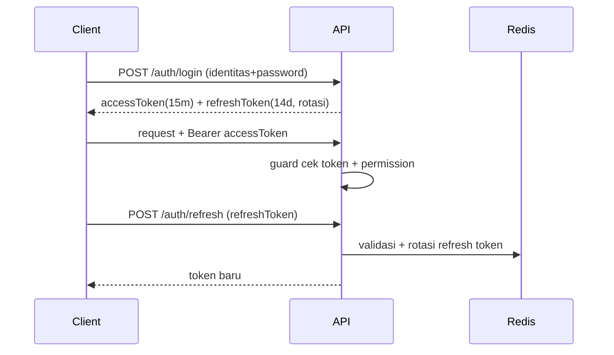
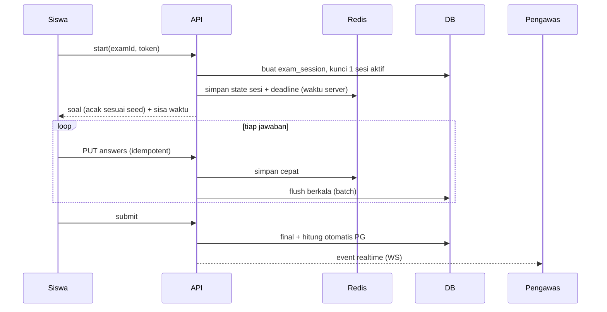
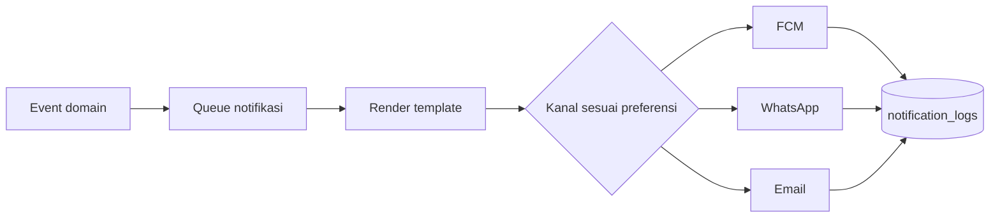
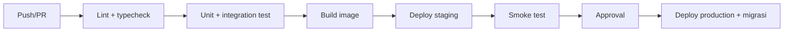

# 03. Arsitektur Sistem

## 1. Gambaran Umum
```mermaid
flowchart LR
  subgraph Client
    WP["Web Portal Terpadu (Next.js)<br/>Publik, PPDB, Admin, Guru, Siswa, Ortu"]
    MA["Mobile App Android Native (Kotlin)<br/>Siswa, Guru, Ortu"]
  end
  subgraph Edge
    P[Nginx/Caddy + HTTPS + WAF/rate limit]
  end
  subgraph Backend
    API[Laravel 11 REST API (apps/api)]
    WS[WebSocket Gateway]
    WK[Queue Worker (Laravel / Redis)]
  end
  subgraph Data
    DB[(PostgreSQL)]
    RD[(Redis)]
    S3[(Object Storage)]
  end
  subgraph External
    FCM[FCM]
    WA[WhatsApp Gateway]
    ML[Email]
  end
  WP --> P
  MA --> P
  P --> API
  P --> WS
  API --> DB
  API --> RD
  API --> S3
  WS --> RD
  API --> WK
  WK --> DB
  WK --> S3
  WK --> FCM
  WK --> WA
  WK --> ML
```

## 2. Prinsip Arsitektur
1. **API-first:** semua klien hanya lewat API; tidak ada akses DB langsung dari klien.
2. **Modular monolith:** satu deployable backend modular (Laravel 11 `apps/api` dengan isolasi modul di `routes/api/*.php` dan controller sub-domain terfokus); siap diskalakan horizontal atau dipecah menjadi microservices di masa mendatang.
3. **Stateless API:** sesi di token dan Redis, siap horizontal scaling.
4. **Async untuk pekerjaan berat:** PDF, import, notifikasi massal, analisis soal → queue.
5. **Kontrak tunggal:** OpenAPI dihasilkan dari kode, klien TS/Dart digenerate.
6. **Least privilege:** permission granular, data sensitif terisolasi.
7. **Auditability:** aksi penting dicatat (siapa, kapan, apa, nilai lama/baru).

## 3. Komponen & Tanggung Jawab
| Komponen | Tanggung jawab |
|---|---|
| API (REST) | Bisnis, validasi, otorisasi, CRUD, orkestrasi |
| WebSocket Gateway | Monitor CBT real-time, notifikasi in-app (opsional) |
| Worker | PDF rapor, import Excel, kirim notifikasi, hitung analisis butir, job terjadwal |
| Scheduler | Pengingat, tutup gelombang PPDB, lock ujian, rekap harian, backup trigger |
| Storage | Berkas bertanda tangan URL (signed URL), kebijakan privat/publik |
| Redis | Cache, rate limit, sesi CBT, antrean, pub/sub |

## 4. Alur Autentikasi

- Refresh token dirotasi; pemakaian ulang token lama = cabut semua sesi perangkat itu.
- Web/Admin: refresh token di cookie `HttpOnly; Secure; SameSite=Lax`. Mobile: secure storage.

## 5. Alur CBT (arsitektur)

Prinsip: waktu dihitung di server, jawaban idempotent, flush batch ke DB, recover dari Redis bila klien reconnect.

## 6. Alur File & Berkas
1. Klien meminta `POST /files/presign` (tipe, ukuran, konteks).
2. Server validasi (ekstensi, ukuran, izin) → memberi URL upload bertanda tangan.
3. Klien upload langsung ke storage → memanggil `POST /files/confirm`.
4. Berkas sensitif (PPDB, BK, surat sakit) bucket privat, diakses via signed URL berumur pendek.
5. Pindai virus (ClamAV) untuk unggahan publik (P1).

## 7. Notifikasi

Setiap pengiriman dicatat, ada retry dengan backoff, dan provider disembunyikan di balik interface `NotificationChannel`.

## 8. Deployment
| Opsi | Cocok untuk | Catatan |
|---|---|---|
| VPS tunggal + docker-compose | Sekolah kecil, anggaran terbatas | Backup eksternal wajib |
| Cloud (VM/Container) managed DB | Direkomendasikan produksi | HA, backup otomatis |
| Server lokal sekolah (CBT) | Internet lemah | Sinkronisasi hasil ke server pusat (P2) |

Pipeline CI/CD:

Aturan: migrasi DB dijalankan sebelum rilis aplikasi, kompatibel mundur satu versi; ada rencana rollback.

## 9. Strategi Skalabilitas
- Index DB pada kolom filter utama; pagination wajib.
- Cache baca untuk konten publik (ISR di Next.js + cache API).
- Pisahkan worker dari API; skala worker terpisah.
- CBT: pre-warm saat jam ujian, batasi payload, kompres respons.
- Load test sebelum STS/SAS (k6) dengan skenario 500 siswa.

## 10. Multi-Sekolah (Persiapan)
Tabel utama memiliki `school_id`. Pada v1 nilainya tunggal; query selalu memfilter lewat konteks tenant sehingga bisa dikembangkan ke multi-sekolah tanpa refactor besar.

## Changelog
- 1.1 (2026-10-27): Sinkronisasi arsitektur backend ke Laravel 11 (`apps/api`) modular monolith sesuai implementasi aktual repositori (Fase 5 GOV-01).
- 1.0: Draf awal.
