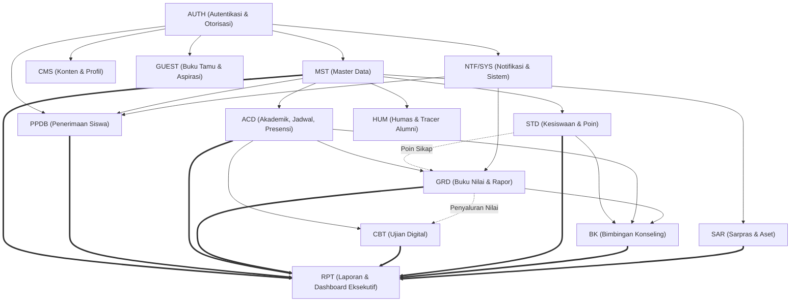

# 13. Master Daftar Modul (Master of Modules)

Dokumen ini adalah **sumber kebenaran tunggal (single source of truth)** untuk seluruh modul, fitur, dependensi arsitektur, dan pemetaan ID pada proyek **Portal Sekolah Satu Pintu (SISTLABUM)**.

---

## 1. Ringkasan 14 Modul Final

Sistem dibagi menjadi **14 modul fungsional terpadu**. Tabel di bawah menyajikan tujuan tunggal, tingkat prioritas, dependensi langsung, serta **jumlah fitur riil** terverifikasi pada masing-masing platform (`BE` = API Backend, `WEB` = Website Publik/PPDB, `ADM` = Web Sistem Admin, `MOB` = Aplikasi Mobile):

| No | Kode Modul | Nama Modul | Tujuan Utama (1 Kalimat) | Prioritas | Dependensi Modul | BE | WEB | ADM | MOB | Total Fitur |
|:--:|:---|:---|:---|:---:|:---|:---:|:---:|:---:|:---:|:---:|
| 1 | **AUTH** | Autentikasi & Hak Akses | Mengelola identitas pengguna, token JWT, peran ganda (RBAC), sesi perangkat, dan audit keamanan. | **P0** | - | 5 | 1 | 1 | 4 | **11** |
| 2 | **MST** | Master Data | Menyediakan data fondasi terpusat untuk tahun ajaran, profil siswa, guru, staf, rombel, dan mata pelajaran. | **P0** | AUTH | 8 | 0 | 8 | 1 | **17** |
| 3 | **CMS** | Konten & Profil Sekolah | Mempublikasikan informasi profil sekolah, berita, agenda kalender, unduhan, dan mading digital secara terkurasi. | **P0** | AUTH | 7 | 11 | 3 | 1 | **22** |
| 4 | **PPDB** | Penerimaan Murid Baru | Menyelenggarakan alur pendaftaran siswa baru secara online dari seleksi berkas, perangkingan kuota, hingga daftar ulang. | **P0** | AUTH, MST, NTF/SYS | 9 | 10 | 6 | 0 | **25** |
| 5 | **GUEST** | Buku Tamu & Aspirasi | Mencatat kehadiran tamu kedinasan/umum dan menampung aspirasi masyarakat/whistleblowing secara akuntabel. | **P0** | AUTH | 3 | 2 | 3 | 0 | **8** |
| 6 | **ACD** | Akademik (KBM & LMS) | Mengelola jadwal KBM, jurnal mengajar guru, presensi harian siswa/staf, perizinan, dan modul bahan ajar. | **P0** | AUTH, MST | 7 | 0 | 7 | 10 | **24** |
| 7 | **GRD** | Penilaian & Rapor | Menghitung akumulasi nilai kompetensi, catatan karakter, serta menerbitkan e-progress report dan e-rapor ber-QR. | **P0** | AUTH, MST, ACD, STD, NTF/SYS | 4 | 1 | 4 | 5 | **14** |
| 8 | **CBT** | Ujian Digital | Menyelenggarakan ujian berbasis komputer/mobile dengan pengacakan soal, token ruang, monitor live, dan analisis butir. | **P0** | AUTH, MST, ACD, GRD | 12 | 0 | 8 | 8 | **28** |
| 9 | **STD** | Kesiswaan | Mencatat riwayat kedisiplinan poin pelanggaran/prestasi, kegiatan ekstrakurikuler, lomba, dan agenda study trip. | **P1** | AUTH, MST | 4 | 0 | 4 | 5 | **13** |
| 10 | **BK** | Bimbingan Konseling | Memberikan ruang bimbingan konseling privat terenkripsi, rujukan kasus, dan peringatan dini siswa berisiko. | **P1** | AUTH, MST, STD, ACD, GRD | 3 | 0 | 2 | 2 | **7** |
| 11 | **SAR** | Sarpras & Perpustakaan | Mengatur peminjaman fasilitas ruang/alat, inventaris aset label QR, helpdesk perbaikan, dan sirkulasi buku perpustakaan. | **P1** *(P0: Booking & Helpdesk)* | AUTH, MST | 4 | 0 | 4 | 1 | **9** |
| 12 | **HUM** | Humas & Kemitraan | Mengelola naskah kerja sama MoU lembaga, delegasi pertukaran pelajar, serta penelusuran tracer study alumni. | **P2** | AUTH, MST | 2 | 0 | 2 | 0 | **4** |
| 13 | **RPT** | Laporan & Dashboard | Menyajikan konsolidasi laporan agregat seluruh modul serta dashboard eksekutif real-time bagi pemangku kepentingan. | **P0** | Seluruh Modul Terkait | 2 | 0 | 3 | 3 | **8** |
| 14 | **NTF/SYS** | Notifikasi & Sistem | Menyediakan infrastruktur push notification, WhatsApp gateway, antrean job, storage berkas bertanda tangan, dan scheduler. | **P0** | AUTH | 5 | 0 | 4 | 4 | **13** |
| **TOTAL** | | | | | | **75** | **25** | **59** | **44** | **203** |

*Catatan 1: Pengelompokan fitur Admin SET (Pengaturan) dimasukkan ke dalam SYS (dan AUTH untuk hak akses user); ADM-DASH dikelompokkan ke RPT.*  
*Catatan 2: Modul Keuangan (FIN) telah terbangun fondasi kodenya (5 tabel, 6 controller REST API, antarmuka Admin & Portal Siswa, serta feature test), namun operasional produksinya berstatus **Menunggu Keputusan Sekolah (Pending Decision)** sesuai ketetapan tata kelola `AGENTS.md §8` dan dirangkum dalam `docs/DECISION_PENDING_FINANCE.md`.*

---

## 2. Graf Dependensi Modul Bebas Siklus

Arsitektur dependensi antar-modul dirancang berlapis (*layered DAG*) dan terverifikasi **100% bebas dari dependensi siklik (cyclic dependency)**:

---

## 3. Daftar Lengkap ID Fitur per Modul Sesuai Prioritas

### 1. Modul AUTH
- **P0**: `BE-AUTH-01`, `BE-AUTH-02`, `BE-AUTH-03`, `BE-AUTH-05`, `WEB-AUTH-01`, `ADM-SET-01`, `MOB-UMM-01`, `MOB-UMM-02`, `MOB-UMM-03`, `MOB-UMM-07`
- **P1**: `BE-AUTH-04`

### 2. Modul MST
- **P0**: `BE-MST-01`, `BE-MST-02`, `BE-MST-03`, `BE-MST-04`, `BE-MST-05`, `BE-MST-06`, `ADM-MST-01`, `ADM-MST-02`, `ADM-MST-03`, `ADM-MST-04`, `ADM-MST-05`, `ADM-MST-06`, `MOB-SIS-04`
- **P1**: `BE-MST-07`, `BE-MST-08`, `ADM-MST-07`, `ADM-MST-08`

### 3. Modul CMS
- **P0**: `BE-CMS-01`, `BE-CMS-02`, `BE-CMS-04`, `BE-CMS-05`, `WEB-HOME-01`, `WEB-PRF-01`, `WEB-PRF-02`, `WEB-NEWS-01`, `WEB-CAL-01`, `WEB-CT-01`, `WEB-SEO-01`, `WEB-A11Y-01`, `ADM-CMS-01`, `ADM-CMS-02`, `MOB-UMM-04`
- **P1**: `BE-CMS-03`, `BE-CMS-06`, `WEB-GAL-01`, `WEB-DL-01`, `ADM-CMS-03`
- **P2**: `BE-CMS-07`, `WEB-I18N-01`

### 4. Modul PPDB
- **P0**: `BE-PPDB-01`, `BE-PPDB-02`, `BE-PPDB-03`, `BE-PPDB-04`, `BE-PPDB-05`, `BE-PPDB-06`, `BE-PPDB-07`, `BE-PPDB-08`, `WEB-PPDB-01`, `WEB-PPDB-02`, `WEB-PPDB-03`, `WEB-PPDB-04`, `WEB-PPDB-05`, `WEB-PPDB-06`, `WEB-PPDB-07`, `WEB-PPDB-08`, `ADM-PPDB-01`, `ADM-PPDB-02`, `ADM-PPDB-03`, `ADM-PPDB-04`, `ADM-PPDB-05`
- **P1**: `BE-PPDB-09`, `WEB-PPDB-09`, `WEB-PPDB-10`, `ADM-PPDB-06`

### 5. Modul GUEST
- **P0**: `BE-GUEST-01`, `BE-GUEST-02`, `WEB-GUEST-01`, `WEB-ASP-01`, `ADM-GUEST-01`, `ADM-GUEST-02`
- **P2**: `BE-GUEST-03`, `ADM-GUEST-03`

### 6. Modul ACD
- **P0**: `BE-ACD-01`, `BE-ACD-02`, `BE-ACD-03`, `BE-ACD-04`, `ADM-ACD-01`, `ADM-ACD-02`, `ADM-ACD-03`, `ADM-ACD-04`, `MOB-UMM-05`, `MOB-ORT-02`, `MOB-ORT-06`, `MOB-GRU-02`, `MOB-GRU-03`, `MOB-GRU-06`, `MOB-SIS-02`
- **P1**: `BE-ACD-05`, `BE-ACD-06`, `BE-ACD-07`, `ADM-ACD-05`, `ADM-ACD-06`, `ADM-ACD-07`
- **P2**: `MOB-GRU-12`, `MOB-GRU-13`, `MOB-SIS-06`

### 7. Modul GRD
- **P0**: `BE-GRD-01`, `BE-GRD-02`, `BE-GRD-03`, `BE-GRD-04`, `WEB-VER-01`, `ADM-GRD-01`, `ADM-GRD-02`, `ADM-GRD-03`, `ADM-GRD-04`, `MOB-ORT-03`, `MOB-ORT-04`, `MOB-GRU-04`, `MOB-GRU-05`, `MOB-SIS-03`

### 8. Modul CBT
- **P0**: `BE-CBT-01`, `BE-CBT-02`, `BE-CBT-03`, `BE-CBT-04`, `BE-CBT-05`, `BE-CBT-06`, `BE-CBT-07`, `ADM-CBT-01`, `ADM-CBT-02`, `ADM-CBT-03`, `ADM-CBT-04`, `ADM-CBT-05`, `MOB-CBT-01`, `MOB-CBT-02`, `MOB-CBT-03`, `MOB-CBT-04`, `MOB-CBT-05`
- **P1**: `BE-CBT-08`, `BE-CBT-09`, `BE-CBT-10`, `BE-CBT-12`, `ADM-CBT-06`, `ADM-CBT-07`, `ADM-CBT-08`, `MOB-GRU-08`, `MOB-GRU-09`, `MOB-CBT-06`
- **P2**: `BE-CBT-11`

### 9. Modul STD
- **P0**: `BE-STD-01`, `ADM-STD-01`
- **P1**: `BE-STD-02`, `BE-STD-03`, `ADM-STD-02`, `ADM-STD-03`, `MOB-ORT-05`, `MOB-GRU-07`, `MOB-SIS-05`
- **P2**: `BE-STD-04`, `ADM-STD-04`, `MOB-ORT-08`, `MOB-ORT-09`

### 10. Modul BK
- **P0**: `BE-BK-01`, `ADM-BK-01`, `MOB-ORT-07`
- **P1**: `BE-BK-02`, `BE-BK-03`, `ADM-BK-02`
- **P2**: `MOB-SIS-07`

### 11. Modul SAR
- **P0**: `BE-SAR-01`, `BE-SAR-03`, `ADM-SAR-01`, `ADM-SAR-03`
- **P1**: `BE-SAR-02`, `BE-SAR-04`, `ADM-SAR-02`, `ADM-SAR-04`, `MOB-GRU-11`

### 12. Modul HUM
- **P1**: `BE-HUM-01`, `BE-HUM-02`, `ADM-HUM-01`, `ADM-HUM-02`

### 13. Modul RPT
- **P0**: `BE-RPT-01`, `BE-RPT-02`, `ADM-DASH-01`, `ADM-DASH-02`, `ADM-RPT-01`, `MOB-ORT-01`, `MOB-GRU-01`, `MOB-SIS-01`

### 14. Modul NTF/SYS
- **P0**: `BE-NTF-01`, `BE-NTF-03`, `BE-FILE-01`, `ADM-SET-02`, `ADM-SET-03`, `MOB-UMM-06`, `MOB-UMM-08`
- **P1**: `BE-NTF-02`, `ADM-SET-04`, `ADM-SET-05`, `MOB-UMM-09`, `MOB-GRU-10`
- **P2**: `BE-NTF-04`

---

## 4. Tabel Pemetaan ID Lama → ID Baru

Seluruh ID fitur yang direstrukturisasi dicatat secara transparan untuk mencegah referensi hilang:

| ID Lama | ID Baru | Modul Baru | Keterangan Perubahan | Dokumen Terdampak |
|:---|:---|:---:|:---|:---|
| `BE-ACD-06` | `BE-GRD-01` | **GRD** | Dipindahkan ke modul Penilaian & Rapor | `04_PRD_BACKEND.md` |
| `BE-ACD-07` | `BE-GRD-02` | **GRD** | Dipindahkan ke modul Penilaian & Rapor | `04_PRD_BACKEND.md` |
| `BE-ACD-08` | `BE-GRD-03` | **GRD** | Dipindahkan ke modul Penilaian & Rapor | `04_PRD_BACKEND.md`, `10_TESTING_QA.md` |
| `BE-ACD-09` | `BE-GRD-04` | **GRD** | Dipindahkan ke modul Penilaian & Rapor | `04_PRD_BACKEND.md`, `05_PRD_WEB_PPDB.md` |
| `BE-ACD-10` | `BE-ACD-06` | **ACD** | Penomoran ulang repositori modul ajar | `04_PRD_BACKEND.md` |
| `BE-ACD-11` | `BE-ACD-07` | **ACD** | Penomoran ulang tugas LMS ringan | `04_PRD_BACKEND.md` |
| `ADM-ACD-06` | `ADM-GRD-01` | **GRD** | Dipindahkan ke modul Penilaian & Rapor | `06_PRD_SYSTEM_ADMIN.md` |
| `ADM-ACD-07` | `ADM-GRD-02` | **GRD** | Dipindahkan ke modul Penilaian & Rapor | `06_PRD_SYSTEM_ADMIN.md` |
| `ADM-ACD-08` | `ADM-GRD-03` | **GRD** | Dipindahkan ke modul Penilaian & Rapor | `06_PRD_SYSTEM_ADMIN.md`, `10_TESTING_QA.md` |
| `ADM-ACD-09` | `ADM-GRD-04` | **GRD** | Dipindahkan ke modul Penilaian & Rapor | `06_PRD_SYSTEM_ADMIN.md` |
| `ADM-ACD-10` | `ADM-ACD-06` | **ACD** | Penomoran ulang bank modul ajar admin | `06_PRD_SYSTEM_ADMIN.md` |
| `ADM-ACD-11` | `ADM-ACD-07` | **ACD** | Penomoran ulang tugas/materi admin | `06_PRD_SYSTEM_ADMIN.md` |
| `ADM-HUM-01` | `ADM-GUEST-01` | **GUEST** | Pemisahan buku tamu admin dari Humas | `06_PRD_SYSTEM_ADMIN.md` |
| `ADM-HUM-02` | `ADM-GUEST-02` | **GUEST** | Pemisahan aspirasi/pengaduan admin dari Humas | `06_PRD_SYSTEM_ADMIN.md` |
| `ADM-HUM-03` | `ADM-HUM-01` | **HUM** | Penomoran ulang MoU & pertukaran | `06_PRD_SYSTEM_ADMIN.md` |
| `ADM-HUM-04` | `ADM-HUM-02` | **HUM** | Penomoran ulang alumni & tracer | `06_PRD_SYSTEM_ADMIN.md` |
| *(Baru)* | `BE-CBT-12` | **CBT** | Deteksi anomali IP/perangkat sesi ujian [P1] | `04_PRD_BACKEND.md` |
| *(Baru)* | `BE-GUEST-03` | **GUEST** | Tanda tangan digital formulir buku tamu [P2] | `04_PRD_BACKEND.md` |
| *(Baru)* | `ADM-GUEST-03` | **GUEST** | Audit visual tanda tangan buku tamu [P2] | `06_PRD_SYSTEM_ADMIN.md` |
| *(Istilah)* | `KKM` → `KKTP` | **Semua** | Kriteria Ketercapaian Tujuan Pembelajaran | Seluruh dokumen |

---

## 5. Daftar "Menunggu Keputusan" (Pending Policy)

Beberapa area kebijakan operasional sekolah berikut berstatus **[Menunggu Keputusan]** dan **tidak boleh diimplementasikan secara mendalam** pada rilis v1:

| No | Topik Keputusan | Status Kebijakan | Dampak Ketergantungan Modul | Batasan Implementasi v1 |
|:--:|:---|:---:|:---|:---|
| 1 | **Modul Keuangan & SPP (FIN)** | Menunggu Keputusan Sekolah | Memblokir aktivasi gateway pembayaran & tagihan live di produksi | Fondasi kode telah terbangun (5 tabel, API, admin UI, portal siswa); aktivasi live menunggu keputusan pimpinan sekolah sesuai `docs/DECISION_PENDING_FINANCE.md`. |
| 2 | **Sinkronisasi Dapodik / e-Rapor Kemdikbud** | Menunggu Keputusan Sekolah | Memblokir integrasi web-service / sinkronisasi otomatis kementerian | v1 hanya menyediakan fungsionalitas impor/ekspor spreadsheet Excel terstruktur. |
| 3 | **Pembiayaan Outing / Study Trip** | Menunggu Keputusan Sekolah | Memblokir buku kas kegiatan dan pencatatan iuran siswa | v1 hanya menyediakan kolom teks non-finansial pada lembar persetujuan orang tua. |
| 4 | **Chat Real-time Interaktif Ortu-Guru** | Menunggu Keputusan Sekolah | Memblokir fitur socket messaging dua arah | v1 mengalihkan komunikasi langsung melalui deep-link WhatsApp resmi atau tiket permohonan konseling. |
| 5 | **Skema Pembobotan Seleksi PPDB** | Menunggu Keputusan Sekolah | Formula perangkingan otomatis final | Menggunakan JSON formula dinamis tanpa mengunci algoritma tetap di kode program. |
| 6 | **Ambang Poin Pelanggaran & Sanksi** | Menunggu Keputusan Sekolah | Tabel penindakan disiplin bertingkat | Disimpan dalam tabel konfigurasi `point_thresholds` yang dapat diubah admin kapan saja. |

---

## 6. Saran Urutan Implementasi (Fase Rekomendasi)

*Urutan ini adalah rekomendasi teknis berbasis dependensi modul (bukan keputusan fase final yang mengikat):*

1. **Fase 0: Fondasi Infrastruktur & Keamanan (Sprint 1–2)**
   - `AUTH` (Login, RBAC, sesi, audit)
   - `NTF/SYS` (Storage S3 bertanda tangan, scheduler, job worker)
   - `MST` (Struktur tahun ajaran, rombel, guru, siswa, mapel)
2. **Fase 1: Kehadiran Publik & Pintu Masuk (Sprint 3–4)**
   - `CMS` (Profil sekolah, berita, kalender kegiatan publik)
   - `GUEST` (Buku tamu digital kiosk, aspirasi whistleblowing)
   - `PPDB` (Pendaftaran calon siswa, upload dokumen, verifikasi panitia, seleksi)
3. **Fase 2: Inti KBM & Evaluasi (Sprint 5–7)**
   - `ACD` (Jadwal pelajaran, jurnal mengajar, presensi siswa/staf, perizinan)
   - `GRD` (Komponen nilai, catatan karakter, kalkulasi nilai)
   - `CBT` (Bank soal, plotting ruang, engine ujian, anti-cheat, koreksi)
4. **Fase 3: Pelayanan Siswa & Output Akademik (Sprint 8–9)**
   - `GRD Final` (Generate antrean massal E-Progress Report & E-Rapor PDF ber-QR)
   - `STD` (Poin kedisiplinan & prestasi, ekskul)
   - `BK` (Konseling privat terenkripsi, deteksi dini peringatan)
5. **Fase 4: Manajemen Sarpras & Hubungan Eksternal (Sprint 10–11)**
   - `SAR` (Booking sarpras, helpdesk perbaikan, inventaris QR, perpustakaan)
   - `HUM` (MoU kemitraan, tracer study alumni)
6. **Fase 5: Konsolidasi & Monitoring Eksekutif (Sprint 12)**
   - `RPT` (Pusat laporan rekapitulasi data, dashboard manajerial kepala sekolah, CBT monitor realtime)

---

## Changelog
- **1.1 (2026-10-27)**: Penyelarasan status Modul Keuangan (FIN) yang kodenya telah terbangun namun operasional produksinya menunggu keputusan resmi sekolah sesuai `AGENTS.md §8` (Fase 5 GOV-01 / `docs/DECISION_PENDING_FINANCE.md`).
- **1.0 (2026-10-08)**: Dokumen Master Daftar Modul resmi diterbitkan. Penyelarasan 14 modul, 203 fitur terhitung riil, graf dependensi bebas siklus, dan dokumentasi pemetaan ID lama ke ID baru.
