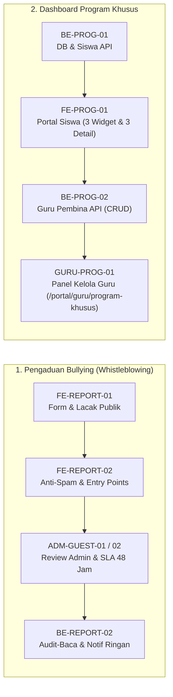

# LAPORAN KOMPREHENSIF PEKERJAAN SESI
**Portal Sekolah Satu Pintu (SISTLABUM)**
*Tanggal: 3 November 2026 · Standar Kerja: AGENTS.md · Status: Seluruh Tugas Terverifikasi & Lulus Uji*

---

## 1. Ringkasan Eksekutif

Dalam sesi pengembangan ini, telah diselesaikan implementasi dua modul prioritas tinggi berdasarkan dokumen PRD resmi (`docs/prd/`):
1. **Modul Pengaduan Perundungan / Bullying (`REPORT` & `GUEST`)** — Fase P0 dan P1 penuh.
2. **Modul Dashboard Program Khusus Tahfidz, ICP & Inklusi (`PROG`)** — Fase P0 dan P1 penuh.

Seluruh fitur dikerjakan secara bertahap dengan mematuhi aturan ketat **[AGENTS.md](file:///Users/macbookprom12020/SISTLABUM/AGENTS.md)**: satu tugas per ID fitur, rencana sebelum pengkodean, *anti-IDOR & deny-by-default*, perlindungan privasi data sensitif anak, serta *Definition of Done (DoD)* lengkap dengan unit dan integration testing.

---

## 2. Rincian Implementasi per Fitur

### Bagian A: Pengaduan Perundungan / Bullying (PRD: `docs/prd/PRD_PENGADUAN_BULLYING.md`)

#### 1. `FE-REPORT-01` & `ADM-GUEST-01` — Form Publik, Lacak Tiket & Admin Review [P0]
- **Form Lapor Publik (`/lapor`)**:
  - Formulir ramah anak dan whistleblower di [`public-complaint-form.tsx`](file:///Users/macbookprom12020/SISTLABUM/apps/web/src/features/public-relations/components/complaint-form.tsx).
  - Opsi pelaporan anonim murni: saat dicentang, frontend dilarang menyertakan token otentikasi atau data identitas pelapor.
  - Validasi minimal 10 karakter pada uraian peristiwa; menghasilkan kode tiket acak `ASP-YYYYMMDD-XXXX`.
- **Pelacakan Tiket Publik (`/lapor/lacak`)**:
  - Halaman pelacakan status di [`complaint-tracker.tsx`](file:///Users/macbookprom12020/SISTLABUM/apps/web/src/features/public-relations/components/complaint-tracker.tsx) dengan visualisasi kronologi/timeline penanganan.
  - Perlindungan privasi: jika tiket anonim, informasi pengguna tidak ditampilkan sama sekali.
- **Review Humas & BK (`/admin/public-relations?tab=complaints`)**:
  - Statistik aduan (Total, Baru, Ditinjau, Ditindaklanjuti, Selesai, dan counter khusus Bullying).
  - Filter kategori dan status, tabel aduan, serta modal intervensi kasus.

#### 2. `FE-REPORT-02` — Perlindungan Anti-Spam & Titik Masuk Portal [P1]
- **Proteksi Anti-Abuse di Form Publik**:
  - **Honeypot Trap**: Penambahan input tersembunyi `_hp_verification` yang otomatis menggagalkan bot scraper jika terisi tanpa memanggil backend.
  - **Timing Protection**: Pengecekan durasi pengisian form (`_started_at < 1.5 - 3 detik`) untuk mencegah pengiriman instan skrip otomatis.
  - **Repetitive Spam Filter**: Sanitasi regex terhadap karakter berulang tidak wajar (misal: "aaaaaaa...").
- **Portal Entry Points**:
  - Tautan "Lapor Perundungan" menonjol pada footer publik [`PublicFooter.tsx`](file:///Users/macbookprom12020/SISTLABUM/apps/web/src/components/shell/public/PublicFooter.tsx).
  - Komponen kartu edukasi dan saluran bantuan [`SafetyCounselingCard.tsx`](file:///Users/macbookprom12020/SISTLABUM/apps/web/src/features/portal/safety-counseling-card.tsx) pada Dashboard Siswa dan Dashboard Orang Tua/Wali Murid.

#### 3. `BE-REPORT-02` & `ADM-GUEST-02` — Audit-Baca & Notifikasi Ringan [P1]
- **Backend Audit-Baca (`09_SECURITY_PRIVACY.md`)**:
  - Pada [`ComplaintService.php`](file:///Users/macbookprom12020/SISTLABUM/apps/api/app/Services/ComplaintService.php) metode `getComplaintDetail`, setiap kali staf berwenang membuka detail via `GET /api/v1/complaints/{id}`, sistem otomatis mencatat entri `complaint.read_detail` pada tabel `audit_logs`.
- **Notifikasi Ringan ke BK & Kepsek (`09_SECURITY_PRIVACY.md §6.7`)**:
  - Saat laporan baru kategori `bullying` masuk, sistem mengirim notifikasi in-app kepada pengguna dengan peran `counselor` (Guru BK) dan `principal` (Kepala Sekolah) di sekolah terkait.
  - **Prinsip Nol Kebocoran**: Notifikasi hanya memuat kode tiket dan instruksi tinjauan. Isi aduan dan identitas pelapor sama sekali **tidak** dimasukkan ke dalam notifikasi.
- **UI Admin Prioritas & SLA**:
  - Penanda badge merah `SLA: ≤ 48 Jam` dan `Prioritas Tinggi` pada tabel admin.
  - Banner peringatan darurat Permendikbudristek No. 46/2023 dan indikator status transparansi audit baca aktif pada modal tindak lanjut.

---

### Bagian B: Dashboard Program Khusus (PRD: `docs/prd/PRD_DASHBOARD_PROGRAM_KHUSUS.md`)

#### 1. `BE-PROG-01` — Skema Database & API Siswa [P0]
- **Migrasi Skema PostgreSQL**:
  - File migrasi: [`2026_11_03_000043_create_program_khusus_tables.php`](file:///Users/macbookprom12020/SISTLABUM/apps/api/database/migrations/2026_11_03_000043_create_program_khusus_tables.php).
  - 4 Tabel baru: `program_materials`, `program_targets`, `program_tasks`, dan `program_task_submissions` dengan UUID PK, multi-tenant `school_id`, soft deletes, dan check constraint enum program (`tahfidz`, `icp`, `inklusi`, `reguler`).
- **Eloquent Models**:
  - [`ProgramMaterial.php`](file:///Users/macbookprom12020/SISTLABUM/apps/api/app/Models/ProgramMaterial.php), [`ProgramTarget.php`](file:///Users/macbookprom12020/SISTLABUM/apps/api/app/Models/ProgramTarget.php), [`ProgramTask.php`](file:///Users/macbookprom12020/SISTLABUM/apps/api/app/Models/ProgramTask.php), [`ProgramTaskSubmission.php`](file:///Users/macbookprom12020/SISTLABUM/apps/api/app/Models/ProgramTaskSubmission.php).
- **Service & Anti-IDOR Controller**:
  - [`ProgramKhususService.php`](file:///Users/macbookprom12020/SISTLABUM/apps/api/app/Services/ProgramKhususService.php) & [`MeStudentProgramController.php`](file:///Users/macbookprom12020/SISTLABUM/apps/api/app/Http/Controllers/Api/V1/MeStudentProgramController.php).
  - Endpoint siswa: `GET /api/v1/me/program/materials`, `GET /me/program/targets`, `GET /me/program/tasks`, dan `POST /me/program/tasks/{id}/submit` dengan dukungan header `Idempotency-Key`.

#### 2. `FE-PROG-01` — Tampilan Siswa Program Khusus [P0]
- **Komponen Modular**:
  - [`program-materials-card.tsx`](file:///Users/macbookprom12020/SISTLABUM/apps/web/src/features/portal/student-programs/program-materials-card.tsx): Daftar modul, materi audio/murottal, past papers, dan adaptif modul.
  - [`program-targets-card.tsx`](file:///Users/macbookprom12020/SISTLABUM/apps/web/src/features/portal/student-programs/program-targets-card.tsx): Target capaian juz, skor Cambridge Checkpoint, dan milestone PPI.
  - [`program-tasks-card.tsx`](file:///Users/macbookprom12020/SISTLABUM/apps/web/src/features/portal/student-programs/program-tasks-card.tsx): Tugas terstruktur dengan dialog submission (tautan/catatan) dan invalidasi reaktif TanStack Query.
- **Pembaruan 3 Widget Dashboard Siswa**:
  - [`tahfidz-widget.tsx`](file:///Users/macbookprom12020/SISTLABUM/apps/web/src/features/portal/student-programs/tahfidz-widget.tsx): Tab Ringkasan, Materi Murottal, Setoran/Tugas, Target Juz.
  - [`icp-widget.tsx`](file:///Users/macbookprom12020/SISTLABUM/apps/web/src/features/portal/student-programs/icp-widget.tsx): Tab Skor, Cambridge Materials, Tasks & Past Papers, Target Checkpoint.
  - [`inklusi-widget.tsx`](file:///Users/macbookprom12020/SISTLABUM/apps/web/src/features/portal/student-programs/inklusi-widget.tsx): Tab Milestone & Mood, Modul Adaptif, Aktivitas, Target PPI.
- **3 Halaman Detail Penuh**:
  - [`/portal/siswa/hafalan`](file:///Users/macbookprom12020/SISTLABUM/apps/web/src/app/(portal)/portal/siswa/hafalan/page.tsx)
  - [`/portal/siswa/cambridge`](file:///Users/macbookprom12020/SISTLABUM/apps/web/src/app/(portal)/portal/siswa/cambridge/page.tsx)
  - [`/portal/siswa/ppi`](file:///Users/macbookprom12020/SISTLABUM/apps/web/src/app/(portal)/portal/siswa/ppi/page.tsx)
  - Seluruh halaman dilengkapi state *loading (skeleton), kosong (empty illustration), dan error state* dengan tombol coba lagi.

#### 3. `BE-PROG-02` — API Guru Pembina & Admin [P1]
- **FormRequests Validasi DTO Ketat**:
  - `StoreProgramMaterialRequest`, `UpdateProgramMaterialRequest`, `StoreProgramTargetRequest`, `UpdateProgramTargetRequest`, `StoreProgramTaskRequest`, `UpdateProgramTaskRequest`, `GradeProgramSubmissionRequest`.
- **Controller & Otorisasi Anti-IDOR**:
  - [`TeacherProgramController.php`](file:///Users/macbookprom12020/SISTLABUM/apps/api/app/Http/Controllers/Api/V1/TeacherProgramController.php) dengan 14 endpoint CRUD di `/api/v1/program/*`.
  - Pengecekan cakupan penugasan binaan guru: guru hanya dapat mengelola siswa/kelas binaannya (`homeroom_teacher_id` atau `TeachingAssignment`), pelanggaran memicu status 403 Forbidden.
  - Setiap mutasi create, update, delete, dan grading otomatis dicatat ke tabel `audit_logs`.

#### 4. `GURU-PROG-01` — Panel Kelola Guru Pembina [P1]
- **Query & Mutation Hooks**:
  - [`use-teacher-program-data.ts`](file:///Users/macbookprom12020/SISTLABUM/apps/web/src/lib/use-teacher-program-data.ts) mengelola sinkronisasi data TanStack Query dan mutasi form.
- **Halaman Manajemen Guru**:
  - [`/portal/guru/program-khusus/page.tsx`](file:///Users/macbookprom12020/SISTLABUM/apps/web/src/app/(portal)/portal/guru/program-khusus/page.tsx).
  - Navigasi tab: Materi Pembelajaran, Tugas & Evaluasi, Target Capaian.
  - Filter cepat per program (`Tahfidz`, `ICP`, `Inklusi`) dan pencarian.
  - Modal form RHF + Zod untuk input materi, tugas, dan target.
  - Drawer evaluasi submission siswa: preview tugas siswa, form input nilai (0–100), status dinilai, dan catatan feedback.
  - Perlindungan hak akses dengan [`PermissionGate`](file:///Users/macbookprom12020/SISTLABUM/apps/web/src/components/auth/PermissionGate.tsx) (`permission="program.manage"`).
- **Integrasi Menu Sidebar Guru**:
  - Pendaftaran menu "Program Khusus" pada layout portal guru [`layout.tsx`](file:///Users/macbookprom12020/SISTLABUM/apps/web/src/app/(portal)/portal/guru/layout.tsx).

---

## 3. Matriks Hasil Pengujian (Test Suite)

Seluruh pengujian otomatis dijalankan dan lulus 100% tanpa kendala:

| Modul & ID Uji | Layer | Berkas Pengujian | Hasil |
|---|---|---|---|
| **`FE-REPORT-01` & `ADM-GUEST-01`** | Web | `apps/web/src/test/fe-report-01-complaint.test.tsx` | **7/7 Passed** ✅ |
| **`FE-REPORT-02` (Anti-Spam)** | Web | `apps/web/src/test/fe-report-02-antispam.test.tsx` | **5/5 Passed** ✅ |
| **`ADM-GUEST-02` (SLA & Audit)** | Web | `apps/web/src/test/adm-guest-02-bullying-review.test.tsx` | **3/3 Passed** ✅ |
| **`BE-REPORT-02` (Security & Audit)** | Backend | `apps/api/tests/Feature/Guest/BullyingP1SecurityTest.php` | **4/4 Passed (23 assertions)** ✅ |
| **`BE-GUEST-02` (Complaint Core)** | Backend | `apps/api/tests/Feature/Guest/ComplaintTest.php` | **13/13 Passed (71 assertions)** ✅ |
| **`BE-PROG-01` (Siswa Program)** | Backend | `apps/api/tests/Feature/Portal/ProgramKhususStudentTest.php` | **9/9 Passed (36 assertions)** ✅ |
| **`FE-PROG-01` (Portal Siswa)** | Web | `apps/web/src/test/fe-prog-01-student-programs.test.tsx` | **7/7 Passed** ✅ |
| **`BE-PROG-02` (Guru Program)** | Backend | `apps/api/tests/Feature/Portal/TeacherProgramKhususTest.php` | **11/11 Passed (32 assertions)** ✅ |
| **`GURU-PROG-01` (Panel Guru)** | Web | `apps/web/src/test/guru-prog-01-teacher-program.test.tsx` | **7/7 Passed** ✅ |

**Total Keseluruhan:**
- **Backend**: **37 uji coba lulus** (162 assertions).
- **Frontend**: **29 uji coba lulus** (komponen Vitest).
- **TypeScript Typecheck**: `tsc --noEmit` lulus bersih (**0 errors**).
- **ESLint & Pint**: Lulus bersih (**0 errors, 0 warnings**).

---

## 4. Kepatuhan Standar AGENTS.md

| Kriteria DoD AGENTS.md | Status | Bukti Verifikasi |
|---|:---:|---|
| Satu tugas = satu ID fitur | ✅ | `FE-REPORT-01`, `FE-REPORT-02`, `BE-REPORT-02`, `ADM-GUEST-02`, `BE-PROG-01`, `FE-PROG-01`, `BE-PROG-02`, `GURU-PROG-01` |
| Rencana singkat sebelum coding | ✅ | Selalu diajukan dan disetujui pengguna sebelum implementasi |
| Tanpa data rahasia / data pribadi nyata | ✅ | Menggunakan data fiktif dan anonymized placeholder |
| Anti-IDOR & Deny-by-default | ✅ | Verifikasi kepemilikan kelas/binaan di layer service |
| Kepatuhan privasi doc 09 | ✅ | Isi aduan tidak bocor di notifikasi/audit/URL, audit-baca aktif |
| Kompatibilitas mundur migrasi | ✅ | Migrasi baru saja tanpa mengubah migrasi lama |
| State UI Lengkap | ✅ | Loading, kosong, dan error tertangani di semua halaman/widget |
| Conventional Commits & Clean Code | ✅ | Lulus linter, typecheck, dan format rapi |
