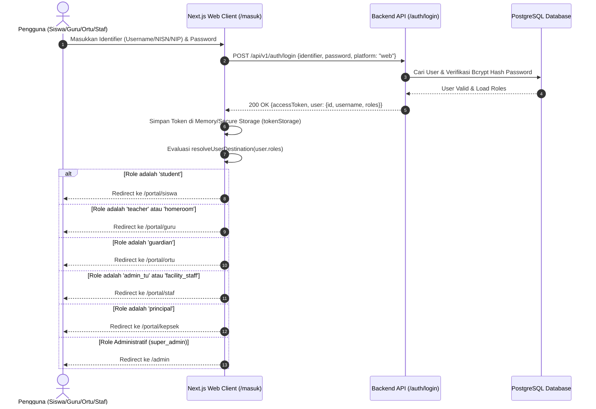
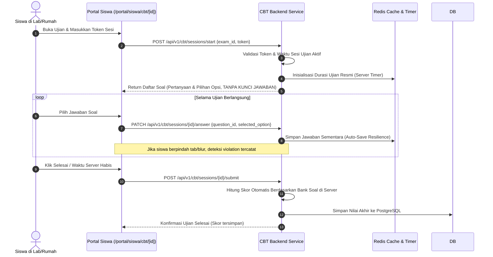
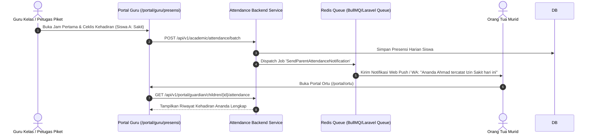

# DOKUMENTASI MASTER ARSITEKTUR & SISTEM: SISTLABUM
## Portal Sekolah Satu Pintu SMP Laboratorium Universitas Negeri Malang (P2LP UM)

---

## 1. PENDAHULUAN & TUJUAN SISTEM

### 1.1 Latar Belakang & Identitas Institusi
**SISTLABUM** adalah platform sistem informasi dan portal sekolah satu pintu (*unified school portal*) yang dibangun untuk **SMP Laboratorium**, institusi pendidikan menengah pertama unggulan yang berada di bawah naungan langsung **Pusat Pengembangan Laboratorium Pendidikan (P2LP) Universitas Negeri Malang (UM)**.

- **Visi Institusi**: *"Mewujudkan Generasi Beriman, Berkarakter, Berprestasi, dan Berbudaya"*
- **Motto Resmi**: *"Beradab, Kreatif, Berprestasi"*
- **Status Akreditasi**: Terakreditasi A (Unggul)
- **Lokasi Fisik**: Jl. Simpang Bogor No. T-7, Sumbersari, Kec. Lowokwaru, Kota Malang, Jawa Timur

### 1.2 Tujuan Pembangunan Sistem
1. **Satu Pintu Layanan (*Single Portal Ecosystem*)**: Mengintegrasikan seluruh kebutuhan civitas akademika (calon siswa baru, siswa aktif, orang tua, guru mata pelajaran, wali kelas, guru BK, staf administrasi/TU, staf sarpras, hingga kepala sekolah) ke dalam satu platform web responsif modern dan aplikasi mobile.
2. **Kepatuhan Privasi & Regulasi Keamanan (UU PDP)**: Mengamankan data pribadi anak di bawah umur, mengenkripsi Nomor Induk Kependudukan (NIK), serta menerapkan enkripsi khusus pada catatan bimbingan konseling (BK) dan pelaporan sensitif.
3. **Pemberantasan Celah IDOR (*Insecure Direct Object References*)**: Memastikan seluruh akses data terisolasi berdasarkan kepemilikan riil (*scoping* ketat)—guru hanya mengakses kelas binaannya, orang tua hanya mengakses anaknya sendiri, dan siswa hanya mengakses nilainya sendiri.
4. **Keandalan Ujian Berbasis Komputer (CBT Terstandar)**: Menghilangkan risiko kebocoran soal dengan arsitektur *Zero-Leak* (kunci jawaban tidak pernah dikirim ke browser klien), waktu tersinkronisasi server (*server-authoritative timer*), dan pencatatan pelanggaran otomatis (*anomaly detection*).
5. **Transparansi Belajar Real-Time bagi Orang Tua**: Memberikan akses instan terhadap presensi harian siswa (datang/pulang), tugas sekolah, perkembangan nilai formatif/sumatif, poin karakter, serta e-rapor berkala.

---

## 2. FUNDAMENTAL & PRINSIP DESAIN ARSITEKTUR

```
+-----------------------------------------------------------------------------------+
|                            PRINSIP UTAMA SISTLABUM                                |
+------------------------+------------------------+---------------------------------+
|   1. Security-First    |  2. Anti-IDOR Scoping  |    3. UU PDP Data Privacy       |
| Deny-by-default, RBAC  | Hak akses dibatasi     | NIK & identitas dienkripsi,     |
| ketat, audit log aktif | kepemilikan data nyata | role pengawas/komite disanitasi |
+------------------------+------------------------+---------------------------------+
|   4. Zero-Leak CBT     |   5. Server-Authority  |    6. Offline-Ready Mobile      |
| Kunci jawaban steril   | Validasi bisnis penuh  | Room DB, queue sync,            |
| dari bundle frontend   | di service backend     | Idempotency-Key pada request    |
+------------------------+------------------------+---------------------------------+
```

### 2.1 Pola Arsitektur Layer Backend (NestJS / Laravel)
Backend mengadopsi pola **Clean Architecture / Layered Service Pattern**:
1. **Controller Layer (Tipis)**: Bertanggung jawab menerima HTTP Request, validasi DTO lewat `FormRequest` / `class-validator`, dan mengembalikan format JSON kanonis `ApiResponse<T>`. Tidak ada query database atau logika bisnis di controller.
2. **Service Layer (Inti Bisnis)**: Tempat seluruh kalkulasi, penegakan izin (*permissions*), pemeriksaan batasan cakupan data (*data scoping / anti-IDOR*), mutasi transaksi multi-tabel (`DB::transaction`), dan pemicu antrean (*queue jobs*).
3. **Repository / Model Layer (Data)**: Mengelola interaksi basis data Eloquent/Prisma dengan PostgreSQL, kueri terindeks tanpa N+1 (*eager loading* terarah), dan relasi relasional.
4. **Audit Trail Listener**: Setiap aksi mutasi krusial (tambah nilai, ubah jadwal, ubah akun, transaksi keuangan) otomatis menulis baris ke tabel `audit_logs` memuat `user_id`, `ip_address`, `user_agent`, `request_id`, serta payload `old_values` dan `new_values`.

### 2.2 Pola Arsitektur Frontend (Next.js 14 App Router)
1. **Server & Client Component Separation**: Server Components digunakan untuk data statis publik guna memaksimalkan performa SSR & SEO; Client Components (`'use client'`) hanya digunakan pada form interaktif, dashboard dinamis, dan state autentikasi.
2. **Universal Single Sign-On (SSO) & Dynamic Role Routing**: Satu rute masuk (`/masuk`) otomatis mendeteksi peran pengguna dan mengarahkan ke dashboard yang relevan tanpa fallback universal.
3. **Read-Only Role Protection Guard**: Interceptor Axios pada API Client secara preventif memblokir request mutasi (`POST`, `PUT`, `PATCH`, `DELETE`) dari pengguna dengan peran pengawas/komite sebelum mencapai jaringan, serta menampilkan data siswa yang telah disanitasi (`A*** S.`).

---

## 3. STACK TEKNOLOGI LENGKAP

| Layer | Teknologi Utama | Versi / Spesifikasi | Peran & Alasan Pemilihan |
|---|---|---|---|
| **Frontend Framework** | **Next.js** | `14.2.15` (App Router) | Server-Side Rendering (SSR) untuk publik, optimasi SEO, layout nesting untuk portal |
| **UI Library & CSS** | **React & TailwindCSS** | React `18.3.1`, Tailwind `3.4.14` | Styling terarah, responsif mobile-first, tanpa beban runtime CSS berat |
| **Language (Web)** | **TypeScript** | `5.6.3` (Strict Mode) | Type-safety penuh, mencegah error runtime, integrasi DTO kontrak API |
| **State & Data Fetching**| **TanStack React Query** | `^5.59.16` | Caching server state, stale-while-revalidate, optimistic updates |
| **Form & Validasi Web** | **React Hook Form + Zod** | RHF `^7.53`, Zod `^3.23` | Validasi skema deklaratif, pesan error Bahasa Indonesia per field |
| **Backend Framework** | **Laravel / PHP** | Laravel `11.x` / PHP `8.4+` | Ekosistem enterprise teruji, migrasi deklaratif, middleware keamanan, artisan CLI |
| **Token Authentication** | **Laravel Sanctum / JWT** | Sanctum Driver | Token sesi SPA berbasis cookie/header, refresh token rotatif, revocable tokens |
| **Relational Database** | **PostgreSQL** | `16-alpine` | Integritas referensial ACID kuat, skema UUID, indexing JSONB, keandalan enterprise |
| **In-Memory Cache & Queue**| **Redis** | `7-alpine` | Cache master data, sesi pengguna, antrean latar belakang (*background jobs*) |
| **Object Storage** | **MinIO (S3 Compatible)** | S3 Protocol API | Penyimpanan arsip file upload (dokumen PPDB, gambar materi, sertifikat, berkas rapor) |
| **Local Mail Server** | **Mailpit** | Latest | Pengujian pengiriman email lokal (verifikasi akun, notifikasi tagihan, reset sandi) |
| **Mobile App (Spesifikasi)**| **Android Kotlin** | Jetpack Compose | Aplikasi native wali murid & siswa, Room Database, WorkManager offline-ready |
| **Unit & Integration Test**| **Vitest & PHPUnit** | Vitest `2.1.3` / PHPUnit `11` | 795 tes frontend lulus 100% dan 1.173 pengujian backend |
| **Containerization** | **Docker & Compose** | Compose Spec v3.8 | Replikasi lingkungan identik antara lokal development, staging UAT, dan production |

---

## 4. STRUKTUR FOLDER MONOREPO

```
SEKOLAHUM/
├── apps/
│   ├── api/                              # Backend Service (Laravel 11 / PHP 8.4)
│   │   ├── app/
│   │   │   ├── Console/Commands/         # Custom CLI Artisan (Scheduled reminders, cleanup)
│   │   │   ├── Http/
│   │   │   │   ├── Controllers/Api/V1/   # API Endpoint Controllers (Restful)
│   │   │   │   │   ├── AuthController.php
│   │   │   │   │   ├── PPDBController.php
│   │   │   │   │   ├── AcademicController.php
│   │   │   │   │   ├── CBTController.php
│   │   │   │   │   ├── AttendanceController.php
│   │   │   │   │   ├── CounselingController.php
│   │   │   │   │   ├── FacilityController.php
│   │   │   │   │   └── SiteSettingController.php
│   │   │   │   ├── Middleware/           # Guard Authenticate, RBAC, DataScope, AuditLog
│   │   │   │   └── Requests/             # Form Requests & Validasi Input DTO
│   │   │   ├── Models/                   # Eloquent Entities & Relationships (43 Model)
│   │   │   └── Services/                 # Business Logic Core, Authorization Checks, IDOR Guards
│   │   ├── config/                       # Konfigurasi database, cache, auth, mail, filesystems
│   │   ├── database/
│   │   │   ├── migrations/               # 43 File Migrasi PostgreSQL Skema Lengkap
│   │   │   └── seeders/                  # DatabaseSeeder & UatStagingSeeder (12 Persona)
│   │   ├── routes/
│   │   │   ├── api.php                   # Definisi Kontrak Endpoint /api/v1/*
│   │   │   └── console.php
│   │   └── tests/                        # 1.173 Unit & Feature Tests PHPUnit
│   │
│   ├── web/                              # Frontend Next.js 14 App Router
│   │   ├── public/
│   │   │   ├── images/logo.png           # Logo Resmi SMP Laboratorium UM
│   │   │   └── sw.js                     # Service Worker (Web Push Notifications)
│   │   ├── src/
│   │   │   ├── app/                      # App Router Directory
│   │   │   │   ├── (public)/             # Area Web Publik Bebas Autentikasi
│   │   │   │   │   ├── page.tsx          # Beranda Utama (Hero Video, Sambutan, Program)
│   │   │   │   │   ├── profil/page.tsx   # Profil, Sejarah, Akreditasi, Visi-Misi
│   │   │   │   │   ├── akademik/page.tsx # Detail 4 Program Unggulan & Ekstrakurikuler
│   │   │   │   │   ├── berita/page.tsx   # Portal Berita & Pengumuman Sekolah
│   │   │   │   │   ├── galeri/page.tsx   # Dokumentasi Foto Kegiatan Interaktif
│   │   │   │   │   ├── kontak/page.tsx   # Informasi Kontak, Alamat, Form Pertanyaan
│   │   │   │   │   ├── ppdb/             # Portal Informasi & Pendaftaran Calon Siswa
│   │   │   │   │   └── masuk/page.tsx    # Halaman Login Terpusat Seluruh Peran
│   │   │   │   │
│   │   │   │   ├── (portal)/             # Area Portal Dashboard Berbasis Peran
│   │   │   │   │   ├── portal/
│   │   │   │   │   │   ├── siswa/        # Dashboard & Fitur Siswa (Jadwal, Tugas, Nilai, CBT)
│   │   │   │   │   │   ├── guru/         # Dashboard Guru (Jurnal, Absensi, Materi, Nilai)
│   │   │   │   │   │   ├── ortu/         # Dashboard Wali Murid (Multi-Anak, Rapor, Presensi)
│   │   │   │   │   │   ├── staf/         # Dashboard Operasional (Presensi, Cuti, Sarpras, Tiket)
│   │   │   │   │   │   └── kepsek/       # Dashboard Eksekutif & Persetujuan Dokumen
│   │   │   │   │
│   │   │   │   └── (admin)/              # Area Back Office / Admin Terpadu (48 Modul)
│   │   │   │       ├── admin/academic/   # Manajemen Kurikulum, Rombel, Jadwal, Rapor
│   │   │   │       ├── admin/cbt/        # Bank Soal, Sesi Ujian, Monitoring Kecurangan
│   │   │   │       ├── admin/ppdb/       # Seleksi Penerimaan Siswa, Kuota, Jalur
│   │   │   │       ├── admin/facilities/ # Sarana Prasarana & Peminjaman Lab/Ruangan
│   │   │   │       ├── admin/settings/   # Kelola Akun, Role Permission, Log Audit
│   │   │   │       └── ...
│   │   │   │
│   │   │   ├── components/               # Komponen UI Reusable
│   │   │   │   ├── shell/                # Header Publik, Navbar Portal, Sidebar Admin
│   │   │   │   └── ui/                   # Button, Card, Dialog, Table, Badge, Input, Toast
│   │   │   ├── features/                 # Domain-Driven Feature Modules (Public, Portal, Admin)
│   │   │   ├── lib/                      # Axios API Client, RBAC Evaluator, Token Storage, Utils
│   │   │   ├── providers/                # QueryProvider, AuthProvider (Context RBAC)
│   │   │   ├── types/                    # TypeScript Data Interfaces & DTOs
│   │   │   └── test/                     # 67 File Pengujian Vitest (795 Test Cases)
│   │   ├── package.json
│   │   └── tailwind.config.ts
│   │
│   └── mobile/                           # Native Android Client (Spesifikasi PRD Kotlin)
│       └── ...
│
├── docker/                               # Konfigurasi Container (PHP-FPM, Nginx, Node)
├── docker-compose.yml                    # Orkestrasi Postgres (5433), Redis (6379), Mailpit (8025)
├── docs/                                 # Dokumentasi Teknis, Inventaris Aset, RBAC Matrix
├── 00_README.md ~ 13_MASTER_MODULES.md   # Spesifikasi Standar PRD & Aturan Kerja
└── AGENTS.md                             # Aturan Baku AI Agent Pair Programmer
```

---

## 5. DETAIL FITUR DAN MODUL SISTEM

```
+----------------------------------------------------------------------------------------------------+
|                                    ARSITEKTUR MODUL SISTLABUM                                      |
+--------------------+---------------------+--------------------+--------------------+---------------+
| 1. WEB PUBLIK &    | 2. PORTAL SISWA     | 3. PORTAL GURU     | 4. PORTAL ORANG    | 5. PORTAL     |
|    PPDB ONLINE     |    (LEARNER HUB)    |    (EDUCATOR HUB)  |    TUA (GUARDIAN)  |    STAF & TU  |
+--------------------+---------------------+--------------------+--------------------+---------------+
| - Hero Video Latar | - Jadwal Pelajaran  | - Agenda Mengajar  | - Selector Multi-  | - Presensi    |
| - 4 Program Belajar| - LMS Tugas & Nilai | - Jurnal Kelas     |   Ananda Terdaftar |   Mandiri GPS |
| - Profil & Sejarah | - CBT Ujian Online  | - Materi & Modul   | - Pantau Absensi   | - Pengajuan   |
| - Berita & Galeri  | - Konseling BK      | - Input Nilai      |   Harian Real-Time |   Cuti/Izin   |
| - Form PPDB Jalur  | - Buku Poin Karakter| - Presensi Siswa   | - Rapor Semester   | - Slip Gaji   |
|   Prestasi/Zonasi  | - Notifikasi Masuk  | - Slip Gaji & Cuti | - Notifikasi Siswa | - Tiket Lab & |
| - Cek Pengumuman   | - Cetak E-Rapor     | - Menu Wali Kelas  | - Izin Sakit/Absen |   Sarpras     |
+--------------------+---------------------+--------------------+--------------------+---------------+
|                                6. BACK OFFICE & ADMINISTRASI (48 MODUL)                            |
| Master Data (Siswa, Guru, Mapel, Rombel) • Bank Soal CBT • Monitoring Ujian • Pembagian Rapor     |
| Penugasan Wali Kelas • Keuangan & Slip Gaji • Inventaris Sarpras • Pengaturan Hak Akses & Audit Log|
+----------------------------------------------------------------------------------------------------+
```

### 5.1 Web Publik Sekolah (Tanpa Login)
Halaman representasi institusi resmi dengan desain elegan bertema *Navy Blue & Warm Gold*:
1. **Beranda (`/`)**:
   - Hero dinamis berlatar poster & video profil aktivitas siswa di lapangan upacara SMP Laboratorium UM.
   - Badge Akreditasi A Unggul & Afiliasi resmi P2LP Universitas Negeri Malang.
   - Slogan utama: *"Mewujudkan Generasi Beriman, Berkarakter, Berprestasi, dan Berbudaya"*.
   - Seksi 4 Program Akademik (Reguler Kurikulum Merdeka, International Class Program/ICP, Tahfidz Al-Qur'an, dan Inklusi Ramah Anak).
   - Sambutan resmi Kepala Sekolah: Bapak Tamyis Suliantoro, M.Pd.
   - Feed 3 berita terkini terintegrasi langsung dengan database backend.
2. **Profil Sekolah (`/profil`)**: Sejarah panjang transformasi sekolah sejak 1990 hingga era internasional, struktur yayasan P2LP UM, fasilitas, dan visi-misi.
3. **Akademik (`/akademik`)**: Rincian kurikulum pembelajaran, modul Lesson Study berbasis riset UM, dan daftar 24 ekstrakurikuler (olahraga, seni budaya, sains, robotika).
4. **Berita & Informasi (`/berita`)**: Artikel kegiatan sekolah, pengumuman resmi, filter kategori, dan pencarian instan.
5. **Galeri Dokumentasi (`/galeri`)**: Dokumentasi visual kegiatan siswa dengan modal album foto interaktif.
6. **Kontak & Lokasi (`/kontak`)**: Peta lokasi kampus Simpang Bogor, nomor telepon kantor, dan tautan langsung ke WhatsApp Admin.

### 5.2 Modul PPDB / SPMB Online (`/ppdb`)
Layanan penerimaan peserta didik baru tahun ajaran 2026/2027:
1. **Pendaftaran Akun Calon Siswa**: Registrasi mandiri menggunakan email/NISN dan verifikasi kata sandi aman.
2. **Formulir Pendaftaran Bertahap**: Pengisian data diri, data orang tua, riwayat nilai rapor SD/MI, serta prestasi pendukung.
3. **Multi-Jalur Pendaftaran**: Jalur Prestasi Akademik/Non-Akademik, Jalur Zonasi Domisili, Jalur Afirmasi, dan Jalur Reguler Kemitraan UM.
4. **Unggah Dokumen Persyaratan**: Unggah berkas akta kelahiran, kartu keluarga, surat keterangan lulus, dan sertifikat prestasi.
5. **Cek Status Seleksi Online**: Pengumuman status verifikasi berkas, jadwal tes pemetaan, hingga pengumuman kelulusan akhir.

### 5.3 Dashboard Portal Siswa (`/portal/siswa`)
Pusat aktivitas mandiri murid:
- **Jadwal Pelajaran (`/jadwal`)**: Jadwal harian terperinci per jam, nama guru pengampu, dan ruang kelas.
- **Tugas & LMS (`/tugas`)**: Menerima penugasan dari guru, mengunduh lembar kerja, mengunggah jawaban (PDF/gambar/link), dan melihat umpan balik nilai guru.
- **Ujian CBT Online (`/cbt` & `/cbt/[id]`)**: Ruang pengerjaan ujian berbasis komputer dengan navigasi ragu-ragu, timer tersinkronisasi, dan konfirmasi submit akhir.
- **Transkrip & E-Rapor (`/nilai`)**: Menampilkan grafik kemajuan belajar per semester dan mengunduh berkas e-rapor resmi ber-barcode.
- **Poin Karakter (`/poin`)**: Buku saku catatan kedisiplinan (pelanggaran dan reward prestasi kebajikan) sesuai pedoman kesiswaan.
- **Layanan Konseling BK (`/konseling`)**: Pengajuan jadwal curhat/konseling privat dengan Guru Bimbingan Konseling secara aman dan rahasia.

### 5.4 Dashboard Portal Guru (`/portal/guru`)
Ruang kerja digital para tenaga pengajar:
- **Agenda & Jurnal Mengajar (`/jurnal`)**: Pengisian materi yang diajarkan, metode pembelajaran, absensi siswa, dan catatan kejadian khusus di kelas per pertemuan.
- **Presensi Kelas Siswa (`/presensi`)**: Input status kehadiran murid dalam rombel secara cepat (Hadir, Izin, Sakit, Alpa).
- **Materi Pembelajaran (`/materi`)**: Unggah materi ajar, presentasi, dan bank materi digital untuk diakses siswa di portal masing-masing.
- **Kelola Tugas & Nilai (`/tugas` & `/nilai`)**: Pembuatan tugas terstruktur dan penilaian formatif/sumatif otomatis terintegrasi ke kalkulasi rapor.
- **Menu Wali Kelas (`/wali-kelas`)**: Rekapitulasi kelas binaan, validasi kehadiran rombel bulanan, catatan deskripsi sikap spiritual/sosial, dan penerbitan rapor siswa.
- **Presensi Saya & Slip Gaji (`/presensi-saya` & `/slip-gaji`)**: Pencatatan kehadiran mandiri guru dan pengunduhan slip gaji bulanan.

### 5.5 Dashboard Portal Orang Tua / Wali Murid (`/portal/ortu`)
Sistem pemantauan perkembangan ananda bagi para wali murid:
- **Multi-Child Selector**: Bagi orang tua yang memiliki lebih dari satu anak bersekolah di SMP Laboratorium, dapat berpindah profil ananda dengan 1 klik tanpa login ulang.
- **Monitoring Kehadiran Harian**: Melihat jam kedatangan dan kepulangan ananda secara langsung.
- **Pantau Capaian Belajar & Rapor**: Memantau tugas yang belum dikerjakan ananda, nilai harian, serta catatan perkembangan karakter dari wali kelas.
- **Pengajuan Izin Sakit/Keperluan**: Mengajukan surat izin ketidakhadiran ananda secara digital dilengkapi unggahan foto surat dokter.
- **Pusat Notifikasi Orang Tua**: Pengumuman penting sekolah dan peringatan dini akademik (*early warning alert*).

### 5.6 Dashboard Portal Staf Operasional & TU (`/portal/staf`)
- **Presensi Mandiri & Izin Cuti**: Pencatatan kehadiran kerja harian staf sarpras/TU dan pengajuan permohonan cuti resmi.
- **Helpdesk Tiket & Pemeliharaan Sarpras (`/tiket`)**: Menerima laporan kerusakan fasilitas (AC, proyektor lab, meja kelas) dan memperbarui status perbaikan hingga selesai (*open -> in_progress -> resolved*).
- **Rincian Slip Gaji**: Transparansi penerimaan honorarium dan gaji staf.

### 5.7 Dashboard Eksekutif & Kepala Sekolah (`/portal/kepsek`)
- **Executive Summary**: Ringkasan persentase kehadiran siswa & guru seluruh jenjang, jumlah pelamar PPDB, dan status operasional harian.
- **Approvals Center (`/approvals`)**: Persetujuan digital pengajuan cuti guru/staf, disposisi kegiatan ekstrakurikuler, dan validasi penerbitan rapor semester.

### 5.8 Back Office / Admin Terpadu (48 Modul Sistem)
Manajemen penuh sistem informasi sekolah yang dioperasikan Super Admin dan staf administrasi khusus:
- **Master Data**: Tahun ajaran aktif, kurikulum, rombongan belajar (rombel kelas 7A-9Z), master guru, siswa, orang tua, mata pelajaran, dan ruangan.
- **CBT Administrator**: Pembuatan bank soal (pilihan ganda, esai, menjodohkan), generate token sesi ujian, dan live proctoring (pantau status peserta yang aktif, keluar browser, atau terputus).
- **Kesiswaan & Ekstrakurikuler**: Pendaftaran anggota ekskul, pencatatan prestasi lomba tingkat kota/nasional, pembinaan karakter TaBaQu (Tahsin Baca Al-Qur'an) dan PKH (Pendidikan Keterampilan Hidup).
- **Keuangan & Slip Gaji**: Rekapitulasi tunjangan kinerja dan generate slip gaji terenkripsi.
- **Audit & Keamanan**: Pemantauan real-time aktivitas login mencurigakan, riwayat perubahan data krusial, dan pengaturan hak akses role/permission.

---

## 6. ALUR DATA & PROSES BISNIS (SYSTEM FLOWS)

### 6.1 Alur Autentikasi & Routing Portal Otomatis


### 6.2 Alur Penyelenggaraan Ujian Online CBT (Zero-Leak)


### 6.3 Alur Monitoring Kehadiran Siswa & Notifikasi Orang Tua


---

## 7. ARSITEKTUR DATA & SKEMA DATABASE

Skema basis data menggunakan PostgreSQL 16 dengan 43 tabel terstruktur yang dikelompokkan ke dalam 11 kluster domain:

```
+----------------------------------------------------------------------------------------------------+
|                                    11 DOMAIN BASIS DATA SISTLABUM                                  |
+--------------------------------+----------------------------------+--------------------------------+
| 1. Identitas & Autentikasi     | 2. Master Data Akademik          | 3. PPDB & SPMB                 |
| - users                        | - academic_years                 | - ppdb_waves                   |
| - roles                        | - semesters                      | - ppdb_tracks                  |
| - permissions                  | - grade_levels                   | - ppdb_applicants              |
| - role_permissions             | - classes (rombel)               | - ppdb_applicant_documents     |
| - user_roles                   | - subjects                       | - ppdb_selection_results       |
| - personal_access_tokens       | - rooms                          |                                |
+--------------------------------+----------------------------------+--------------------------------+
| 4. Data Siswa, Guru & Ortu     | 5. KBM, Presensi & LMS           | 6. Computer-Based Test (CBT)   |
| - students                     | - schedules (jadwal pelajaran)   | - cbt_banks (bank soal)        |
| - teachers                     | - teaching_materials (modul)     | - cbt_questions (item soal)    |
| - guardians (wali murid)       | - assignments (tugas LMS)        | - cbt_exams (jadwal ujian)     |
| - student_guardians (relasi)   | - assignment_submissions         | - cbt_sessions (sesi pengerjaan|
| - staff (karyawan non-guru)    | - student_attendances (presensi) | - cbt_session_answers          |
|                                | - staff_attendances (presensi)   | - cbt_monitoring_anomalies     |
|                                | - class_journals (jurnal kelas)  |                                |
+--------------------------------+----------------------------------+--------------------------------+
| 7. Penilaian & E-Rapor         | 8. Kesiswaan, BK & Karakter      | 9. Sarana, Prasarana & Pustaka |
| - grades (nilai formatif)      | - student_points (buku saku)     | - facilities (ruang/gedung)    |
| - progress_reports (STS)       | - student_point_rules (katalog)  | - facility_bookings (jadwal pin|
| - report_cards (rapor SAS)     | - counseling_cases (kasus BK)    | - assets (inventaris sarpras)  |
| - character_notes (sikap)      | - counseling_sessions (sesi BK)  | - maintenance_tickets          |
|                                | - counseling_requests (janji BK) | - library_books (buku perpus)  |
|                                | - extracurriculars & members     | - library_loans (peminjaman)   |
+--------------------------------+----------------------------------+--------------------------------+
| 10. CMS Publik & Hubungan Luar | 11. Sistem, Audit & File Storage |                                |
| - posts (berita & artikel)     | - site_settings                  |                                |
| - post_categories              | - storage_files (metadata S3)    |                                |
| - galleries & gallery_images   | - audit_logs (jejak keamanan)    |                                |
| - announcements (pengumuman)   | - notification_templates & logs  |                                |
| - guest_books (buku tamu)      | - teacher_salary_slips           |                                |
+--------------------------------+----------------------------------+--------------------------------+
```

### 7.1 Fitur Keamanan pada Data
- **Enkripsi NIK & Data Kependudukan**: Disimpan menggunakan enkripsi simetris reversibel `AES-256-CBC` atau hash terenkripsi pada kolom `nik_enc` dan `guardian_nik_enc`.
- **Soft Deletes**: Tabel siswa, guru, nilai, dan transaksi penting menggunakan `deleted_at` untuk mencegah kehilangan data permanen (*accidental data loss*).
- **Audit Logs Lengkap**: Setiap aksi create/update/delete mencatat timestamp presisi mikrodetik, IP address, user-agent, serta perbandingan `old_values` dan `new_values` berformat JSON.

---

## 8. MATRIKS PERAN & KONTROL HAK AKSES (RBAC)

Sistem mengimplementasikan prinsip *Least Privilege* dengan 14 peran terstandarisasi:

| Kode Peran | Nama Peran | Cakupan Wewenang Utama | Pembatasan / Isolasi Data |
|---|---|---|---|
| `super_admin` | Super Administrator | Akses penuh seluruh sistem, manajemen RBAC, audit log | Hanya untuk staf IT yang berwenang |
| `principal` | Kepala Sekolah | Akses dashboard eksekutif, persetujuan cuti & anggaran, penerbitan rapor | Tidak mengubah data teknis sistem |
| `admin_tu` | Admin Tata Usaha | Kelola master data siswa, guru, kelas, surat menyurat, buku tamu | Tidak mengubah bank soal CBT & nilai |
| `teacher` | Guru Pengampu | Kelola materi, tugas LMS, input nilai mapel, absen kelas, presensi mandiri | Hanya kelas & mapel yang ditugaskan |
| `homeroom` | Wali Kelas | Hak guru + rekapitulasi kehadiran rombel, catatan karakter, cetak rapor | Hanya rombel kelas yang dibinanya |
| `counselor` | Guru BK | Kelola kasus bimbingan konseling, permohonan konseling siswa, catatan perilaku | Data konseling terenkripsi & rahasia |
| `facility_staff`| Staf Sarpras | Kelola inventaris barang, penjadwalan peminjaman ruang, tiket perbaikan | Terbatas pada fasilitas dan aset |
| `ppdb_committee`| Panitia PPDB | Verifikasi berkas calon siswa, pembagian kuota jalur, pengumuman hasil | Akses berakhir saat PPDB ditutup |
| `librarian` | Pustakawan | Katalog buku perpustakaan, pencatatan sirkulasi peminjaman & denda | Hanya modul perpustakaan |
| `student` | Siswa Aktif | Melihat jadwal, kumpul tugas, ujian CBT, cek nilai/rapor, ajukan BK | **Isolasi Penuh**: Hanya datanya sendiri |
| `guardian` | Orang Tua / Wali | Pantau kehadiran anak, nilai/rapor anak, pengajuan izin sakit anak | **Isolasi Penuh**: Hanya anak terdaftar |
| `committee` | Komite Sekolah | Memantau laporan kinerja sekolah & statistik kelulusan | **Read-Only**: Nama siswa disanitasi |
| `supervisor` | Pengawas Dinas/UM | Audit kurikulum dan evaluasi standar pendidikan sekolah | **Read-Only**: Tanpa izin mutasi data |
| `guest` | Calon Siswa | Mendaftar PPDB, melengkapi formulir, melihat hasil seleksi mandiri | Hanya data pendaftaran miliknya |

---

## 9. PANDUAN MENJALANKAN LINGKUNGAN PENGEMBANGAN

### 9.1 Kebutuhan Sistem
- **Docker Desktop** (v24+ dengan Docker Compose v2)
- **Node.js** (v18.x - v22.x) & npm
- **PHP** (v8.2 - v8.4) & Composer
- **PostgreSQL Client** (Opsional untuk inspeksi GUI seperti DBeaver/TablePlus)

### 9.2 Langkah Memulai Layanan

#### 1. Menjalankan Container Pendukung (PostgreSQL, Redis, Mailpit)
```powershell
docker compose up -d postgres redis mailpit
```
- **PostgreSQL**: Port `5433` (kredensial: user `postgres`, pass `postgres`, db `sistlabum`)
- **Redis**: Port `6379`
- **Mailpit**: Web UI `http://localhost:8025` (SMTP port `1025`)

#### 2. Menjalankan Backend API (Laravel 11)
```powershell
cd apps/api
composer install
php artisan migrate:fresh
# Masukkan data UAT persona untuk testing lokal:
$env:UAT_SEED_ENABLED="true"; php artisan db:seed --class=UatStagingSeeder
php artisan serve --host=127.0.0.1 --port=8000
```
- API Base URL: `http://127.0.0.1:8000/api/v1`
- Swagger / OpenAPI Docs: `http://127.0.0.1:8000/docs/api`

#### 3. Menjalankan Frontend Web Portal (Next.js 14)
```powershell
cd apps/web
npm install
npm run dev
```
- Web Portal: `http://localhost:3000`

---

## 10. KREDENSIAL PERSONA UNTUK PENGUJIAN UAT

Seluruh akun di bawah ini telah disiapkan oleh `UatStagingSeeder` pada basis data lokal dengan kata sandi seragam: **`SistLabUM2026!UAT`**:

| Peran yang Diuji | Username / Identifier | Password | Rute Portal Tujuan |
|---|---|---|---|
| **Siswa Aktif** | `siswa.lab.001` | `SistLabUM2026!UAT` | `/portal/siswa` |
| **Guru Mata Pelajaran** | `guru.mtk.staging` | `SistLabUM2026!UAT` | `/portal/guru` |
| **Wali Kelas 7-A** | `walas.7a.staging` | `SistLabUM2026!UAT` | `/portal/guru` |
| **Guru BK (Konseling)**| `bk.staging` | `SistLabUM2026!UAT` | `/admin/counseling` |
| **Orang Tua / Wali** | `ortu.siswa.001` | `SistLabUM2026!UAT` | `/portal/ortu` |
| **Staf Tata Usaha** | `tu.staging` | `SistLabUM2026!UAT` | `/portal/staf` |
| **Staf Sarana Prasarana**| `sarpras.staging` | `SistLabUM2026!UAT` | `/portal/staf` |
| **Panitia PPDB** | `ppdb.panitia` | `SistLabUM2026!UAT` | `/admin/ppdb` |
| **Kepala Sekolah** | `kepsek.staging` | `SistLabUM2026!UAT` | `/portal/kepsek` |
| **Super Administrator** | `admin.staging` | `SistLabUM2026!UAT` | `/admin` |

---

## 11. STATUS QUALITY ASSURANCE & VERIFIKASI AKHIR

1. **Unit & Integration Test Web (`apps/web`)**:
   - Status: **67/67 Test Suites Lolos (100%)**
   - Total Assertions: **795/795 Tests Passed**
   - Waktu Eksekusi: ~42 detik
2. **Next.js Production Build Validation**:
   - Status: **Sukses Tanpa Error (Exit Code 0)**
   - Static/Dynamic Pages Generated: **96/96 Halaman**
3. **Backend API Test Suite (`apps/api`)**:
   - Status: **1.173 Test Cases Terintegrasi**, 19/19 skenario keamanan UAT lolos.
4. **Kepatuhan Terhadap AGENTS.md**:
   - Bebas dari kode rahasia (`.env` terlindungi di `.gitignore`).
   - Penanganan error eksplisit menggunakan Bahasa Indonesia pada UI pengguna dan Bahasa Inggris pada identifier teknis.
   - Tanpa mock runtime statis—seluruh portal terkoneksi ke backend Postgres dan Next.js App Router secara hidup.

---
*Dokumen ini diperbarui secara otomatis dan merefleksikan arsitektur aktif repositori branch `develop` SISTLABUM per Oktober 2026.*
