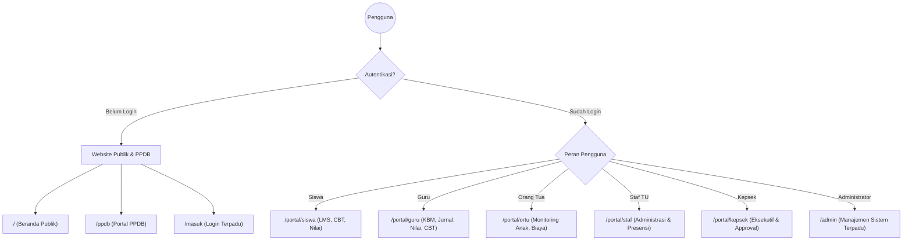
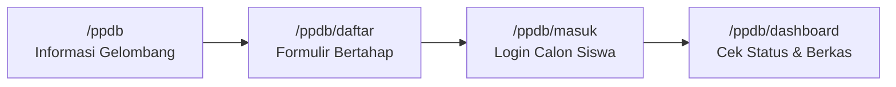
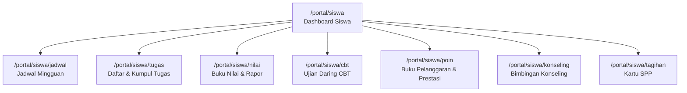
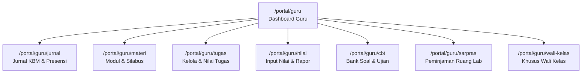
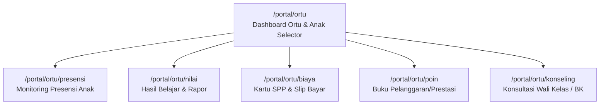
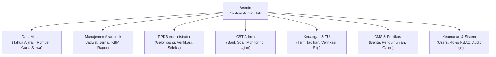

# DOKUMENTASI LENGKAP LAYAR (SCREEN DIRECTORY)
## SISTEM INFORMASI SATU PINTU SMP LABORATORIUM UM (SISTLABUM)

> **Versi Dokumentasi**: 1.0.0  
> **Target Arsitektur**: Monorepo Next.js 14 (`apps/web` port 3000) & Laravel 13 REST API (`apps/api` port 8000)  
> **Basis Desain & Interaksi**: Erik Portal Prototype & Unified Monorepo Design System

---

## DAFTAR ISI
1. [Arsitektur Navigasi & Shell Aplikasi](#1-arsitektur-navigasi--shell-aplikasi)
2. [Layar Website Publik (`/`)](#2-layar-website-publik)
3. [Layar PPDB Online (`/ppdb`)](#3-layar-ppdb-online)
4. [Layar Gerbang Autentikasi (`/masuk`)](#4-layar-gerbang-autentikasi)
5. [Layar Portal Siswa (`/portal/siswa`)](#5-layar-portal-siswa)
6. [Layar Portal Guru (`/portal/guru`)](#6-layar-portal-guru)
7. [Layar Portal Orang Tua (`/portal/ortu`)](#7-layar-portal-orang-tua)
8. [Layar Portal Staf Tenaga Kependidikan (`/portal/staf`)](#8-layar-portal-staf-tenaga-kependidikan)
9. [Layar Portal Kepala Sekolah / Eksekutif (`/portal/kepsek`)](#9-layar-portal-kepala-sekolah--eksekutif)
10. [Layar Portal Admin Sistem Terpadu (`/admin`)](#10-layar-portal-admin-sistem-terpadu)
11. [Matriks Hak Akses & Kredensial Uji Coba](#11-matriks-hak-akses--kredensial-uji-coba)

---

## 1. Arsitektur Navigasi & Shell Aplikasi

Aplikasi berjalan di satu port (`http://localhost:3000`) dengan pemisahan Route Group Next.js:
- `(public)`: Shell terbuka (`PublicHeader`, `PublicFooter`) dengan identitas warna resmi institusi (Navy Deep `#062940` dan Gold `#C89332`).
- `(ppdb)`: Shell khusus pendaftaran siswa baru dengan navbar mandiri dan progress indicator bertahap.
- `(auth)`: Halaman terisolasi tanpa navigasi luar untuk keamanan proses login dan reset kredensial.
- `(portal)`: Shell portal per peran. Untuk Siswa, Guru, dan Orang Tua menggunakan **Erik Dedicated Sidebar (`w-72`)** dengan metrik profil, ringkasan presensi, dan navigasi modul yang responsif.
- `(admin)`: Shell komprehensif dengan sidebar bertingkat, breadcrumbs, search shortcut (`Ctrl+K`), quick notification, dan profil pengguna.

---

## 2. Layar Website Publik

### 2.1. Beranda Sekolah
- **Rute URL**: `/`
- **Hak Akses**: Publik (Terbuka untuk umum)
- **Komponen Utama**:
  - `HeroSection`: Slider interaktif, slogan *"Beradab, Kreatif, Berprestasi"*, tombol cepat *"Daftar PPDB"* dan *"Jelajahi Profil"*.
  - `SambutanKepsek`: Foto resmi Kepala Sekolah, kutipan sambutan keunggulan riset dan karakter.
  - `ProgramUnggulanGrid`: 4 kartu program (Bilingual Cambridge, Digital Learning Class, Riset Siswa, Tahfidz/Budi Pekerti).
  - `StatistikSekolah`: Angka siswa aktif, tenaga pendidik bersertifikasi, dan prestasi akademik/non-akademik.
  - `WartaSekolahTerbaru`: Feed artikel berita dan pengumuman resmi terbaru dari API CMS.
  - `BannerCtaPPDB`: Banner informatif pembukaan pendaftaran siswa baru.
  - `FooterLeafletMap`: Peta koordinat kampus SMP Laboratorium UM interaktif.
- **State UI**: Skeleton saat berita memuat; fallback data statis jika API CMS offline.

### 2.2. Profil Sekolah
- **Rute URL**: `/profil`
- **Hak Akses**: Publik
- **Fitur & Interaksi**:
  - Sejarah transformasi institusi sejak didirikan di bawah P2LP Universitas Negeri Malang.
  - Visi, Misi, dan 7 Nilai Dasar Keberadaban Peserta Didik.
  - Struktur Organisasi dan Dewan Tenaga Pendidik.
  - Dokumentasi fasilitas kampus (Laboratorium Komputer, Lab IPA Terpadu, Perpustakaan Digital, Lapangan Olahraga).

### 2.3. Akademik & Kurikulum
- **Rute URL**: `/akademik`
- **Hak Akses**: Publik
- **Fitur & Interaksi**:
  - Penjelasan Kurikulum Merdeka Terintegrasi Pembelajaran Aktif.
  - Metodologi *Lesson Study* dan *Mastery Learning*.
  - Daftar 12 Ekstrakurikuler Pilihan dan Prestasi Terkini.
  - Kalender Akademik semester berjalan.

### 2.4. Berita & Detail Berita
- **Rute URL**: `/berita` dan `/berita/[slug]`
- **Hak Akses**: Publik
- **Fitur & Interaksi**:
  - Filter kategori warta: Prestasi, KBM, Pengumuman, Kegiatan Kesiswaan.
  - Pencarian artikel dengan *real-time debounce*.
  - Halaman baca berita mendalam dengan tanggal rilis, penulis, gambar sampul beresolusi tinggi, dan tautan bagikan (Share WA/Twitter/FB).

### 2.5. Galeri Dokumentasi
- **Rute URL**: `/galeri`
- **Hak Akses**: Publik
- **Fitur & Interaksi**:
  - Galeri foto dan dokumentasi video kegiatan sekolah.
  - Filter album: Upacara & Hari Besar, Field Trip/Study Tour, Lomba, Pentas Seni.
  - Lightbox interaktif untuk melihat gambar resolusi penuh.

### 2.6. Kontak & Peta Lokasi
- **Rute URL**: `/kontak`
- **Hak Akses**: Publik
- **Fitur & Interaksi**:
  - Alamat resmi: Jl. Simpang Bogor No. T-7, Lowokwaru, Kota Malang.
  - Telepon: `(0341) 588550`, WhatsApp: `0851-2608-8473`, Email: `info@smplab-um.sch.id`.
  - Jam operasional layanan informasi dan TU.
  - Integrasi tautan langsung ke Google Maps resmi.

---

## 3. Layar PPDB Online

### 3.1. Landing Page PPDB
- **Rute URL**: `/ppdb`
- **Hak Akses**: Publik / Calon Siswa Baru
- **Fitur & Interaksi**:
  - Informasi gelombang pendaftaran yang sedang dibuka (Jalur Reguler, Prestasi, Afirmasi).
  - Alur 4 langkah pendaftaran: Registrasi Akun $\rightarrow$ Unggah Berkas $\rightarrow$ Uji Pemetaan $\rightarrow$ Daftar Ulang.
  - Persyaratan administratif (Kartu Keluarga, Akta Kelahiran, Rapor SD kelas 4-6).
  - Tombol CTA: *"Daftar Akun Baru"* atau *"Masuk Akun Pendaftar"*.

### 3.2. Formulir Pendaftaran Bertahap
- **Rute URL**: `/ppdb/daftar`
- **Hak Akses**: Publik (Calon Siswa)
- **Komponen & Interaksi**:
  - **Langkah 1: Akun & Jalur**: NISN, Nama Lengkap, Email, Password, Pilihan Jalur.
  - **Langkah 2: Biodata Calon Siswa**: NIK, Tempat/Tgl Lahir, Agama, Alamat Domisili.
  - **Langkah 3: Data Asal Sekolah**: Nama SD/MI Asal, Alamat Sekolah, Nomor Ijazah/SKL.
  - **Langkah 4: Data Orang Tua / Wali**: Nama Ayah & Ibu, Pekerjaan, Penghasilan, No. HP Aktif.
  - **Langkah 5: Unggah Dokumen**: Scan KK, Akta, Pas Foto 3x4, dan Bukti Prestasi (PDF/JPEG max 2MB).
  - Validasi ketat format NIK (16 digit) dan NISN (10 digit) dengan pesan error kontekstual.

### 3.3. Login Akun Pendaftar
- **Rute URL**: `/ppdb/masuk`
- **Hak Akses**: Publik / Calon Siswa Terdaftar
- **Fitur & Interaksi**:
  - Masuk menggunakan Email/NISN dan Kata Sandi pendaftar.
  - Tautan bantuan *"Lupa Password Pendaftaran"* via token email/WA.

### 3.4. Dashboard Status Pendaftar
- **Rute URL**: `/ppdb/dashboard`
- **Hak Akses**: Calon Siswa Terautentikasi
- **Fitur & Interaksi**:
  - Lencana Status: `DRAFT`, `BERKAS_LENGKAP`, `DIVERIFIKASI`, `LULUS_SELEKSI`, atau `TIDAK_LULUS`.
  - Kartu Cetak Bukti Pendaftaran (PDF resmi dengan QR Code verifikasi).
  - Jadwal sesi tes wawancara / observasi pemetaan bakat.
  - Pengumuman kelulusan dan panduan alur daftar ulang serta biaya operasional.

---

## 4. Layar Gerbang Autentikasi

### 4.1. Login Terpadu Multi-Peran
- **Rute URL**: `/masuk`
- **Hak Akses**: Semua Pengguna Belum Login
- **Komponen & Fitur**:
  - Single input cerdas: Menerima Username, Email, NISN (Siswa), atau NIP (Guru/Staf).
  - Tombol intip kata sandi (Show/Hide Password).
  - Tombol demo switch cepat (Siswa, Guru, Ortu, Staf) saat mode pengembangan lokal aktif.
  - Otomatis mengarahkan ke dashboard yang sesuai berdasarkan peran utama akun setelah token Sanctum diterbitkan.

### 4.2. Lupa & Reset Password
- **Rute URL**: `/lupa-password` & `/reset-password`
- **Fitur**: Pengiriman link/token verifikasi ke email terdaftar, validasi kekuatan kata sandi baru (minimal 8 karakter, kombinasi huruf & angka).

### 4.3. Gerbang Masuk Admin Internal
- **Rute URL**: `/admin-gateway-internal`
- **Hak Akses**: Khusus Staf IT & Operator Berwenang
- **Fitur**: Gerbang terisolasi untuk login administratif dengan proteksi tambahan (Audit log otomatis mencatat IP & User-Agent).

---

## 5. Layar Portal Siswa

Portal siswa dirancang dengan pendekatan fokus belajar, menggunakan navigasi sidebar Erik yang menyajikan ringkasan persentase kehadiran dan status tugas.

### 5.1. Dashboard Siswa
- **Rute URL**: `/portal/siswa` & `/portal/siswa/dashboard`
- **Hak Akses**: Siswa (`student`)
- **Fitur Utama**:
  - Banner sapaan personal: Nama siswa, NISN, Kelas aktif (mis. *Kelas 8-B*).
  - 4 Kartu Metrik: Kehadiran Semester Ini (%), Tugas Aktif Menunggu, Poin Kedisiplinan, Ujian Mendatang.
  - Widget Jadwal Pelajaran Hari Ini lengkap dengan waktu, nama guru, dan ruangan.
  - Widget Deadline Tugas Terdekat dengan countdown sisa waktu.
  - Pengumuman Akademik resmi dari pihak sekolah.

### 5.2. Jadwal Pelajaran
- **Rute URL**: `/portal/siswa/jadwal`
- **Fitur**:
  - Tampilan tabuler hari Senin s.d. Jumat.
  - Rincian jam ke-1 hingga ke-8, mata pelajaran, nama guru pengampu, kode ruang kelas/laboratorium.
  - Tombol unduh jadwal PDF atau simpan ke kalender.

### 5.3. Tugas & Pengumpulan
- **Rute URL**: `/portal/siswa/tugas`
- **Fitur**:
  - Filter status: *Semua*, *Belum Dikerjakan*, *Sudah Dikirim*, *Dinilai*.
  - Modal detail tugas: Deskripsi petunjuk guru, lampiran berkas materi (PDF/DOCX).
  - Form pengumpulan: Input catatan siswa dan upload berkas dokumen tugas.
  - Riwayat nilai dan umpan balik (feedback) koreksi langsung dari guru.

### 5.4. Buku Nilai & Transkrip
- **Rute URL**: `/portal/siswa/nilai`
- **Fitur**:
  - Ringkasan Rata-rata Nilai per Mata Pelajaran.
  - Rincian komponen penilaian: Tugas Mandiri, Kuis Harian, Penilaian Tengah Semester (PTS), Penilaian Akhir Semester (PAS).
  - Grafik tren perkembangan nilai siswa per semester.
  - Riwayat Capaian Kompetensi (Deskripsi Rapor Kurikulum Merdeka).

### 5.5. Ujian Daring CBT (Computer-Based Test)
- **Rute URL**: `/portal/siswa/cbt` dan `/portal/siswa/cbt/[id]`
- **Fitur & Interaksi Layar Ujian**:
  - Daftar ujian aktif, waktu mulai, durasi, dan status pengerjaan.
  - Konfirmasi kode token ujian sebelum masuk lembar kerja.
  - **Layar Pengerjaan Soal (`/cbt/[id]`)**:
    - Bilah atas: Countdown timer sisa waktu dengan indikator peringatan saat waktu < 5 menit.
    - Soal teks, rumus matematika, dan gambar pendukung.
    - Pilihan ganda interaktif / soal essay.
    - Kotak centang *"Ragu-ragu"*.
    - Grid navigasi nomor soal: Status Terjawab (Biru/Hijau), Ragu (Kuning), Belum (Abu-abu).
    - Modal konfirmasi submit akhir dengan ringkasan status soal yang belum terjawab.

### 5.6. Buku Poin Karakter & Prestasi
- **Rute URL**: `/portal/siswa/poin`
- **Fitur**:
  - Indikator saldo poin kedisiplinan (Sistem 100 poin awal).
  - Riwayat catatan pelanggaran (keterlambatan, seragam, dll.) beserta pengurangan poin dan guru pencatat.
  - Riwayat catatan prestasi (juara lomba, keaktifan kelas) beserta penambahan poin reward.

### 5.7. Layanan Bimbingan Konseling (BK)
- **Rute URL**: `/portal/siswa/konseling`
- **Fitur**:
  - Informasi kontak guru BK pendamping kelas.
  - Form permohonan sesi konseling privat (pilihan topik: Belajar, Karir/Lanjutan Sekolah, Pribadi, Sosial).
  - Riwayat janji temu dan tindak lanjut sesi konseling.

### 5.8. Informasi Tagihan & Biaya
- **Rute URL**: `/portal/siswa/tagihan`
- **Fitur**:
  - Kartu SPP bulanan: status lunas atau menunggu pembayaran.
  - Rincian nominal biaya dan petunjuk rekening resmi giro sekolah.

---

## 6. Layar Portal Guru

Portal guru memfasilitasi seluruh kegiatan operasional Kegiatan Belajar Mengajar (KBM), evaluasi hasil belajar, dan administrasi kelas.

### 6.1. Dashboard Guru
- **Rute URL**: `/portal/guru` & `/portal/guru/dashboard`
- **Hak Akses**: Guru (`teacher`)
- **Fitur Utama**:
  - Informasi identitas pengajar, NIP, dan mata pelajaran yang diampu.
  - Agenda mengajar hari ini (jam ke, rombel, materi bahasan).
  - Statistik ringkas: Jumlah siswa aktif, tugas menunggu koreksi, kelas yang diampu.
  - Tombol aksi cepat: *"Buka Jurnal KBM"*, *"Tambah Tugas"*, *"Buat Ujian CBT"*.

### 6.2. Jurnal KBM & Presensi Kelas
- **Rute URL**: `/portal/guru/jurnal`
- **Fitur & Interaksi**:
  - Pemilih Kelas (Rombel) dan Tanggal pertemuan.
  - Input Jurnal Mengajar: Judul Pokok Bahasan, Capaian Pembelajaran (CP), Catatan Kejadian Kelas.
  - Lembar Presensi Siswa: Tombol radio cepat per anak: *Hadir (H)*, *Sakit (S)*, *Izin (I)*, *Alpa (A)*.
  - Tombol *"Tandai Semua Hadir"* untuk efisiensi pengisian.
  - Tombol *"Simpan Jurnal & Presensi"* yang langsung memperbarui catatan kehadiran ke portal orang tua.

### 6.3. Repositori Materi Ajar
- **Rute URL**: `/portal/guru/materi`
- **Fitur**:
  - Manajemen berkas materi per mata pelajaran dan jenjang kelas (7, 8, 9).
  - Unggah dokumen modul, slide presentasi (PDF), dan tautan video pembelajaran interaktif.
  - Opsi keterlihatan materi: Draf atau Terbit ke Siswa.

### 6.4. Manajemen Tugas & Penilaian
- **Rute URL**: `/portal/guru/tugas` dan `/portal/guru/tugas/[id]/penilaian`
- **Fitur**:
  - Form pembuatan tugas baru: Judul, Petunjuk, Tenggat Waktu (Deadline), Bobot Nilai.
  - **Layar Penilaian (`[id]/penilaian`)**:
    - Tabel peserta: Nama siswa, Waktu pengiriman, Berkas kiriman siswa.
    - Form grading: Input nilai angka (0-100) dan kolom umpan balik/catatan perbaikan per siswa.
    - Tombol simpan massal (*Save Grades*).

### 6.5. Buku Nilai & Rekap Rapor
- **Rute URL**: `/portal/guru/nilai`
- **Fitur**:
  - Tabel entri nilai per rombel: Tugas 1, Tugas 2, UH, PTS, PAS.
  - Fitur Import / Export nilai via format file Excel (XLSX/CSV).
  - Perhitungan otomatis nilai akhir berbobot dan pemetaan predikat kelulusan (A/B/C/D) sesuai KKM.

### 6.6. CBT & Bank Soal Guru
- **Rute URL**: `/portal/guru/cbt`
- **Fitur**:
  - Pembuatan paket soal ujian: Pilihan ganda (A-B-C-D-E), kunci jawaban, dan pembahasan.
  - Editor soal mendukung formula matematis dan unggah gambar pendukung.
  - Pengaturan jadwal pelaksanaan, batas waktu, pengacakan nomor soal, dan generate token ujian.
  - Pemantauan langsung peserta yang sedang aktif mengerjakan ujian.

### 6.7. Direktori Siswa & Perizinan
- **Rute URL**: `/portal/guru/siswa` & `/portal/guru/perizinan`
- **Fitur**:
  - Pencarian biodata siswa bimbingan dan kontak orang tua darurat.
  - Verifikasi dan approval surat permohonan izin/dispensasi yang diajukan siswa.

### 6.8. Reservasi Fasilitas & Sarpras
- **Rute URL**: `/portal/guru/sarpras` & `/portal/guru/fasilitas`
- **Fitur**:
  - Jadwal ketersediaan Lab Komputer, Laboratorium IPA, dan Ruang Multimedia.
  - Formulir peminjaman fasilitas untuk jam praktikum mengajar.

### 6.9. Presensi Mandiri, Cuti & Slip Gaji Guru
- **Rute URL**: `/portal/guru/presensi-saya`, `/portal/guru/izin-cuti`, `/portal/guru/slip-gaji`
- **Fitur**:
  - Riwayat jam kehadiran mandiri guru (Clock In / Clock Out).
  - Formulir pengajuan permohonan cuti tahunan / cuti sakit kepada Kepala Sekolah.
  - Rincian penerimaan honorarium / slip gaji guru.

### 6.10. Menu Khusus Wali Kelas
- **Rute URL**: `/portal/guru/wali-kelas`
- **Hak Akses**: Guru yang ditugaskan sebagai Wali Kelas
- **Fitur**:
  - Rekapitulasi absensi bulanan satu rombel kelas.
  - Input Catatan Karakter dan Sikap Sosial/Spiritual untuk Rapor.
  - Pratinjau dan pencetakan lembar Rapor Siswa satu kelas.

---

## 7. Layar Portal Orang Tua

Portal orang tua didesain untuk memberikan transparansi penuh perkembangan anak secara real-time, dilengkapi fitur pergantian multi-anak (jika orang tua memiliki lebih dari satu anak bersekolah).

### 7.1. Dashboard Orang Tua
- **Rute URL**: `/portal/ortu` & `/portal/ortu/dashboard`
- **Hak Akses**: Orang Tua / Wali Siswa (`guardian`)
- **Fitur Utama**:
  - **Selector Anak**: Tombol pemilih anak aktif (mis. beralih antara anak di kelas 7 dan kelas 9).
  - Kartu Ringkasan Anak: Kelas, Wali Kelas, Status Kehadiran Hari Ini (Hadir/Tidak), Saldo Poin Disiplin.
  - Pemberitahuan mendesak (peringatan keterlambatan atau tagihan SPP jatuh tempo).
  - Jadwal pelajaran anak untuk hari ini.

### 7.2. Monitoring Presensi Anak
- **Rute URL**: `/portal/ortu/presensi`
- **Fitur**:
  - Kalender kehadiran bulanan anak dengan kode warna (Hijau = Hadir, Kuning = Izin/Sakit, Merah = Alpa).
  - Jam presensi masuk dan pulang sekolah.
  - Tombol pengajuan surat pemberitahuan sakit / izin ke wali kelas disertai unggahan foto surat dokter.

### 7.3. Nilai & Laporan Belajar Anak
- **Rute URL**: `/portal/ortu/nilai`
- **Fitur**:
  - Tampilan nilai tugas harian yang telah dinilai guru.
  - Hasil Ujian Tengah Semester dan Akhir Semester.
  - Rapor Tengah Semester dan Rapor Akhir Semester (bisa diunduh dalam format PDF resmi).

### 7.4. Keuangan & Biaya SPP
- **Rute URL**: `/portal/ortu/biaya`
- **Fitur & Interaksi**:
  - Kartu SPP tahun ajaran berjalan (daftar bulan Juli s.d. Juni).
  - Status tiap bulan: *LUNAS*, *BELUM DIBAYAR*, atau *MENUNGGU VERIFIKASI TU*.
  - Rincian nomor rekening resmi giro operasional sekolah (Bank Jatim / BNI Mitra).
  - Form konfirmasi transfer: Upload foto bukti/slip transfer bank, nama pengirim, dan tanggal transfer untuk diverifikasi staf TU.

### 7.5. Buku Poin & Karakter Anak
- **Rute URL**: `/portal/ortu/poin`
- **Fitur**:
  - Catatan objektif perilaku anak di sekolah: Penghargaan prestasi atau catatan pelanggaran tata tertib beserta sanksi edukatif yang diberikan sekolah.

### 7.6. Bimbingan Konseling & Komunikasi Sekolah
- **Rute URL**: `/portal/ortu/konseling`
- **Fitur**:
  - Saluran konsultasi langsung dengan Guru BK dan Wali Kelas.
  - Pengajuan janji temu tatap muka di sekolah untuk membahas perkembangan belajar anak.

---

## 8. Layar Portal Staf Tenaga Kependidikan

- **Rute URL**: `/portal/staf`
- **Hak Akses**: Staf Tata Usaha & Tenaga Kependidikan (`staff`)
- **Fitur Utama**:
  - **Dashboard Operasional**: Ringkasan tugas administrasi harian.
  - **Presensi Mandiri (`/staf/presensi-saya`)**: Jam kedatangan dan kepulangan kerja staf.
  - **Pengajuan Cuti (`/staf/izin-cuti`)**: Form permohonan cuti resmi.
  - **Slip Gaji (`/staf/slip-gaji`)**: Rekapitulasi penghasilan dan slip gaji bulanan.
  - **Tiket Layanan (`/staf/tiket`)**: Helpdesk pengaduan internal (fasilitas rusak, kendala jaringan/perangkat IT).

---

## 9. Layar Portal Kepala Sekolah / Eksekutif

- **Rute URL**: `/portal/kepsek`
- **Hak Akses**: Kepala Sekolah & Wakil Kepala Sekolah (`principal`, `executive`)
- **Fitur Utama**:
  - **Dashboard Eksekutif**: Metrik tingkat kehadiran sekolah harian, efektivitas KBM, tren pencapaian akademik, dan serapan operasional.
  - **Lembar Persetujuan (`/portal/kepsek/approvals`)**:
    - Approval izin/cuti guru dan staf.
    - Approval pengadaan barang / fasilitas sarpras.
    - Pengesahan kelulusan seleksi PPDB.
    - Penandatanganan digital dokumen kelulusan / rapor.

---

## 10. Layar Portal Admin Sistem Terpadu

Gerbang administrasi sentral yang digunakan oleh Administrator Sistem, Koordinator Kurikulum, Tim PPDB, dan Bendahara TU.

### 10.1. Dashboard Utama Admin
- **Rute URL**: `/admin`
- **Fitur**: Statistik ringkasan seluruh entitas database (Jumlah Siswa, Guru, Kelas, Tagihan Aktif, Log Aktivitas Hari Ini, Status Server & Database).

### 10.2. Modul Master Data
- `/admin/master/academic-years`: Atur tahun pelajaran (mis. 2025/2026) dan status semester aktif (Ganjil/Genap).
- `/admin/master/classes`: Manajemen rombongan belajar (tingkat 7, 8, 9), alokasi ruang kelas, penetapan NIP guru sebagai Wali Kelas.
- `/admin/master/subjects`: Konfigurasi mata pelajaran, kelompok wajib/muatan lokal, dan KKM standar.
- `/admin/master/teachers`: Direktori seluruh guru & tenaga pendidik, NIP, status kepegawaian, kontak.
- `/admin/master/students`: Database induk siswa, NISN, status aktif/mutasi/alumni, detail wali murid.
- `/admin/master/guardians`: Database orang tua/wali siswa beserta relasi keluarga.

### 10.3. Modul Akademik Sentral
- `/admin/academic/schedules`: Generator dan matriks jadwal pelajaran terpadu untuk mencegah jadwal bentrok guru/ruangan.
- `/admin/academic/attendance`: Rekapitulasi absensi seluruh kelas per periode tanggal, ekspor laporan ke Excel.
- `/admin/academic/staff-attendance`: Rekapitulasi kehadiran harian guru dan staf tata usaha.
- `/admin/academic/journals`: Audit jurnal mengajar seluruh mata pelajaran per minggu.
- `/admin/academic/grades` & `report-cards`: Generator rapor digital, cetak buku rapor massal satu angkatan.

### 10.4. Modul PPDB Administrator
- `/admin/ppdb/waves`: Buka/tutup gelombang pendaftaran, tentukan kuota penerimaan dan tanggal seleksi.
- `/admin/ppdb/applicants`: Tabel calon siswa pendaftar, pemeriksaan lampiran berkas asli, tombol ubah status *Verifikasi Diterima* / *Ditolak*.
- `/admin/ppdb/selection`: Perhitungan bobot nilai pendaftaran (Nilai Rapor + Uji Pemetaan + Prestasi), penetapan nomor keputusan kelulusan.

### 10.5. Modul CBT Administrator
- `/admin/cbt/questions`: Bank soal terpusat seluruh mata pelajaran tingkat sekolah.
- `/admin/cbt/exams`: Konfigurasi jadwal ujian sekolah, alokasi ruang ujian, dan token generate.
- `/admin/cbt/monitor`: Layar pengawas ujian daring real-time (melihat siswa yang sedang login, durasi tersisa, dan tombol *Reset Login* jika ada siswa mengalami putus jaringan).

### 10.6. Modul Keuangan & SPP (TU)
- `/admin/finance/fee-types`: Master jenis biaya sekolah (SPP Bulanan, Uang Seragam, Biaya Kegiatan Ekstrakurikuler).
- `/admin/finance/invoices`: Pembuatan tagihan massal otomatis setiap awal bulan.
- `/admin/finance/payments`: Loket verifikasi pembayaran; TU memeriksa bukti transfer manual dari orang tua lalu menekan *"Verifikasi & Terbitkan Kuitansi"*.
- `/admin/finance/arrears`: Rekapitulasi tunggakan siswa per kelas dengan tombol ekspor daftar tagihan.
- `/admin/finance/reports`: Laporan kas masuk harian dan bulanan.

### 10.7. Modul Kesiswaan & Bimbingan Konseling
- `/admin/student-affairs/points`: Master katalog pelanggaran (ringan, sedang, berat) dan poin sanksi.
- `/admin/student-affairs/extracurriculars`: Daftar pembina dan jadwal ekstrakurikuler.
- `/admin/counseling/early-warnings`: Sistem deteksi dini otomatis bagi siswa dengan ketidakhadiran tinggi (> 3 hari alpa) atau penurunan nilai drastis.

### 10.8. Modul Sarpras & Perpustakaan
- `/admin/assets`: Inventarisasi barang inventaris sekolah, nomor registrasi aset, lokasi ruang, dan kondisi barang (Baik/Rusak).
- `/admin/facilities`: Manajemen permohonan sewa/pinjam ruang aula dan lab.
- `/admin/library`: Sirkulasi buku perpustakaan (peminjaman, batas pengembalian, hitung denda keterlambatan).

### 10.9. Modul CMS & Publikasi Humas
- `/admin/cms`: Form penulisan berita dengan rich-text editor (upload cover image, slug URL SEO-friendly, status publikasi).
- `/admin/public-relations`: Manajemen agenda kegiatan sekolah dan buku tamu digital.

### 10.10. Modul Pengaturan, Keamanan & Audit Trail
- `/admin/settings/users`: Manajemen pembuatan akun, reset kata sandi massal, dan penonaktifan akun.
- `/admin/settings/roles`: Pengaturan izin (RBAC Matrix) untuk tiap grup peran.
- `/admin/settings/audit-logs`: Rekam jejak audit digital: Setiap aksi insert, update, delete, login, dan transaksi dicatat lengkap dengan timestamp UTC, User ID, Modul, IP, dan payload sebelum/sesudah perubahan.

---

## 11. Matriks Hak Akses & Kredensial Uji Coba

| Peran | Username Uji | Password Uji | Rute Akses Utama | Hak Akses Modul |
|---|---|---|---|---|
| **Siswa** | `siswa` | `Password123!` | `/portal/siswa` | LMS, CBT, Tugas, Nilai, Poin, Jadwal, Tagihan Mandiri |
| **Guru** | `gurumtk` | `Password123!` | `/portal/guru` | Jurnal KBM, Presensi Siswa, Input Nilai, Kelola Tugas, Buat Soal CBT |
| **Orang Tua** | `ortu` | `Password123!` | `/portal/ortu` | Presensi Anak, Laporan Nilai, Konfirmasi SPP, Catatan Karakter Anak |
| **Staf TU** | `staf` | `Password123!` | `/portal/staf` & `/admin/finance` | Presensi Staf, Verifikasi Slip SPP, Administrasi Dokumen |
| **Kepsek** | `kepsek` | `Password123!` | `/portal/kepsek` | Dashboard Eksekutif, Pengesahan & Lembar Persetujuan Dokumen |
| **Administrator** | `admin` | `Password123!` | `/admin` | Kontrol Penuh Seluruh Modul Master, KBM, CBT, PPDB, Keuangan, & Audit Log |

---
*Dokumentasi ini disinkronkan secara resmi dengan implementasi kode pada monorepo SISTLABUM (`apps/web` dan `apps/api`).*
