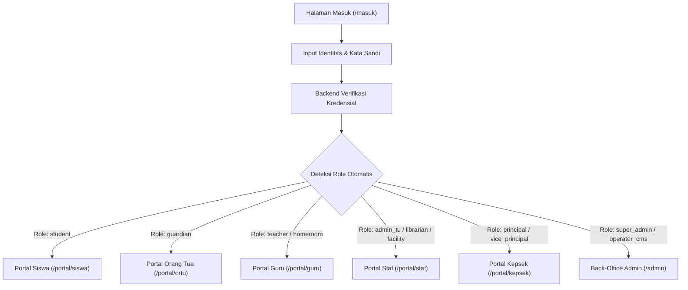
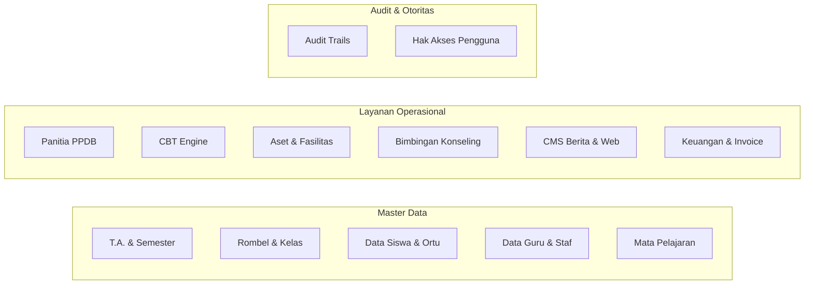

# Panduan Penggunaan Lengkap SISTLABUM (Portal Sekolah Satu Pintu)
**SMP Laboratorium Universitas Negeri Malang**

---

## Daftar Isi
1. [Tentang SISTLABUM & Cara Masuk (Login) Satu Pintu](#1-tentang-sistlabum--cara-masuk-satu-pintu)
2. [Panduan untuk Siswa (`/portal/siswa`)](#2-panduan-untuk-siswa)
3. [Panduan untuk Orang Tua / Wali Murid (`/portal/ortu`)](#3-panduan-untuk-orang-tua--wali-murid)
4. [Panduan untuk Guru & Wali Kelas (`/portal/guru`)](#4-panduan-untuk-guru--wali-kelas)
5. [Panduan untuk Staf Tata Usaha & Karyawan (`/portal/staf`)](#5-panduan-untuk-staf-tata-usaha--karyawan)
6. [Panduan untuk Administrator Back-Office (`/admin`)](#6-panduan-untuk-administrator-back-office)
7. [Panduan untuk Kepala Sekolah, Wakil Kepala Sekolah, & Pengawas (`/portal/kepsek` & Eksekutif)](#7-panduan-untuk-kepala-sekolah--pengawas)
8. [Fitur Keamanan, 2FA, & Pemulihan Kata Sandi](#8-fitur-keamanan--pemulihan-kata-sandi)
9. [Tanya Jawab & Bantuan Teknis (FAQ)](#9-tanya-jawab--bantuan-teknis)

---

## 1. Tentang SISTLABUM & Cara Masuk Satu Pintu

SISTLABUM (**Sistem Informasi Sekolah Terpadu Laboratorium UM**) adalah platform digital terintegrasi yang menyatukan seluruh layanan akademik, kesiswaan, kepegawaian, sarana-prasarana, dan administrasi sekolah dalam satu pintu.

### Alur Masuk Cerdas (Smart Single Sign-On)
Pengguna tidak perlu memilih role atau portal secara manual. Cukup gunakan satu form login terpadu pada:
📍 **URL Masuk:** `/masuk`

> [!NOTE]
> **Identitas Pengguna yang Dapat Digunakan:**
> - **Siswa:** NISN, NIS, atau Username akun siswa.
> - **Orang Tua / Wali:** Alamat Email, Nomor WhatsApp terdaftar, atau Username.
> - **Guru & Staf:** NIP, Email resmi sekolah, atau Username.
> - **Admin:** Username atau Email resmi administrator.

---

## 2. Panduan untuk Siswa

Portal Siswa dirancang khusus untuk mendukung kegiatan belajar mandiri, monitoring capaian pembelajaran, serta pengerjaan ujian daring.

### Fitur Utama Siswa
| Menu | URL | Fungsi Utama |
|---|---|---|
| **Dashboard** | `/portal/siswa` | Ringkasan jadwal hari ini, pengumuman terbaru, status kehadiran, dan tugas aktif. |
| **Jadwal Pelajaran** | `/portal/siswa/jadwal` | Kalender mingguan mata pelajaran, jam KBM, dan nama guru pengampu. |
| **Tugas Belajar** | `/portal/siswa/tugas` | Daftar tugas daring, instruksi pengerjaan, batas waktu (deadline), dan pengunggahan berkas jawaban. |
| **Ujian CBT Online** | `/portal/siswa/cbt` | Pengerjaan kuis, asesmen sumatif, dan ujian sekolah berbantuan komputer secara langsung. |
| **Buku Nilai & Rapor** | `/portal/siswa/nilai` | Nilai harian, ulangan tengah semester, nilai akhir semester, dan pratinjau e-rapor. |
| **Poin & Karakter** | `/portal/siswa/poin` | Rekapitulasi poin prestasi dan catatan kedisiplinan siswa. |
| **Kelas Cambridge** | `/portal/siswa/cambridge` | Khusus kelas ICP (International Class Program): modul kurikulum Cambridge, silabus, dan nilai checkpoint. |
| **Hafalan & Tahfidz** | `/portal/siswa/hafalan` | Rekam mutaba'ah hafalan Al-Qur'an (Juz 'Amma / Tahfidz), riwayat setoran tasmi', dan nama penguji. |
| **Projek P5** | `/portal/siswa/p5` | Portofolio Projek Penguatan Profil Pelajar Pancasila, tema kegiatan, dan penilaian dimensi karakter. |
| **Layanan BK** | `/portal/siswa/konseling` | Pengajuan jadwal konsultasi pribadi dengan guru Bimbingan Konseling secara terjaga kerahasiaannya. |
| **Status Tagihan** | `/portal/siswa/tagihan` | Informasi tagihan administrasi sekolah / SPP yang telah diterbitkan. |

### Panduan Mengikuti Ujian CBT
1. Masuk ke menu **CBT** (`/portal/siswa/cbt`).
2. Pilih jadwal ujian yang berstatus **"Sedang Berlangsung"**.
3. Masukkan **Token Ujian** yang diberikan oleh guru pengawas di kelas.
4. Jawab soal satu per satu (pilihan ganda, esai, atau menjodohkan). Jawaban tersimpan otomatis secara berkala.
5. Klik **"Selesaikan Ujian"** setelah memastikan semua soal bertanda hijau (sudah terjawab).

---

## 3. Panduan untuk Orang Tua / Wali Murid

Portal Orang Tua memberikan transparansi penuh mengenai perkembangan putra-putri tercinta di sekolah secara *real-time*.

### Fitur Utama Orang Tua
| Menu | URL | Fungsi Utama |
|---|---|---|
| **Dashboard Ortu** | `/portal/ortu` | Ringkasan informasi anak, notifikasi sekolah penting, dan ringkasan akademik. |
| **Peralihan Anak** | `/portal/ortu/anak/[id]` | Berpindah tampilan pemantauan jika wali murid memiliki lebih dari 1 anak di sekolah. |
| **Presensi Anak** | `/portal/ortu/presensi` | Pantauan kehadiran harian pintu gerbang & jam pelajaran (Hadir, Sakit, Izin, Alpa) dengan stempel waktu riil. |
| **Perkembangan Nilai** | `/portal/ortu/nilai` | Nilai capaian kompetensi per mata pelajaran dan riwayat capaian e-rapor tiap semester. |
| **Poin & Kedisiplinan** | `/portal/ortu/poin` | Catatan pembinaan akhlak, poin pelanggaran, serta penghargaan prestasi siswa. |
| **Konseling & Catatan BK**| `/portal/ortu/konseling` | Konsultasi terpadu dengan wali kelas atau guru BK terkait pendampingan belajar anak di rumah. |
| **Tagihan & Biaya** | `/portal/ortu/biaya` | Rincian tagihan resmi (SPP, kegiatan, seragam), riwayat invoice, dan status pelunasan. |

> [!TIP]
> **Orang Tua dengan Multi-Anak:**
> Anda tidak perlu membuat beberapa akun. Cukup gunakan satu akun login orang tua, lalu pilih profil anak yang ingin dilihat melalui kartu anak di bagian atas dashboard.

---

## 4. Panduan untuk Guru & Wali Kelas

Portal Guru menyediakan instrumen lengkap untuk pengelolaan pembelajaran digital (LMS) dan administrasi kelas.

### 4.1 Guru Pengampu Mata Pelajaran
| Fitur | URL | Petunjuk Penggunaan |
|---|---|---|
| **Presensi Siswa** | `/portal/guru/presensi` | Buka kelas aktif, tandai status kehadiran siswa per pertemuan KBM, lalu klik Simpan. |
| **Jurnal Mengajar** | `/portal/guru/jurnal` | Catat materi ajar, capaian pembelajaran (TP/ATP), dan kondisi kelas pada hari KBM. |
| **Bahan & Tugas** | `/portal/guru/materi` & `/tugas` | Unggah modul materi ajar dan buat tugas terstruktur beserta batas pengumpulan. |
| **Penilaian Tugas** | `/portal/guru/tugas/[id]/penilaian` | Periksa kiriman berkas siswa, beri skor angka, serta feedback langsung kepada siswa. |
| **Buku Nilai Mapel** | `/portal/guru/nilai` | Input nilai sumatif lingkup materi, asesmen tengah semester, dan asesmen akhir semester. |
| **Ujian CBT** | `/portal/guru/cbt` & `/ujian` | Jadwalkan kuis daring kelas dan rilis token ujian ke ruang kelas. |
| **Izin / Cuti Guru** | `/portal/guru/izin-cuti` | Formulir pengajuan cuti dinas, sakit, atau izin pribadi ke Kepala Sekolah. |
| **Presensi Mandiri** | `/portal/guru/presensi-saya` | Rekam kehadiran jam kerja kedatangan & kepulangan pengajar. |
| **Slip Gaji** | `/portal/guru/slip-gaji` | Unduh rincian slip honorarium dan gaji bulanan secara privat. |
| **Booking Fasilitas**| `/portal/guru/fasilitas` | Pengajuan reservasi laboratorium komputer, aula, lapangan, atau proyektor multimedia. |

### 4.2 Fitur Tambahan Khusus Wali Kelas
Bagi guru yang ditugaskan sebagai Wali Kelas, menu **`/portal/guru/wali-kelas`** akan aktif otomatis:
- **Leger Kelas:** Rekapitulasi perolehan seluruh mata pelajaran siswa satu rombel.
- **Catatan Sikap & Karakter:** Pengisian deskripsi capaian dimensi Profil Pelajar Pancasila.
- **Validasi Nilai Ekstrakurikuler & Presensi Semester:** Rekap ketidakhadiran sebelum rapor dicetak.
- **Cetak Rapor:** Pratinjau draf laporan hasil belajar sebelum ditandatangani Kepala Sekolah.

---

## 5. Panduan untuk Staf Tata Usaha & Karyawan

Portal Staf (`/portal/staf`) melayani kebutuhan operasional dan administrasi mandiri tenaga kependidikan:
- **Presensi Staf Mandiri (`/portal/staf/presensi-saya`):** Pencatatan log kehadiran harian pegawai non-guru.
- **Pengajuan Cuti (`/portal/staf/izin-cuti`):** Pengajuan izin sakit/keperluan penting dengan upload surat dokter/keterangan.
- **Slip Gaji Pegawai (`/portal/staf/slip-gaji`):** Arsip digital bukti pembayaran gaji bulanan.
- **Helpdesk & Tiket Operasional (`/portal/staf/tiket`):** Pelaporan kendala sarana-prasarana, kelistrikan, internet, atau perlengkapan kantor ke tim teknisi sekolah.

---

## 6. Panduan untuk Administrator Back-Office (`/admin`)

Khusus staf manajemen sekolah, sistem menyediakan panel kendali lengkap yang dilindungi otorisasi bertingkat.

### 6.1 Administrator Tata Usaha (`admin_tu`)
- **Master Data Siswa & Pegawai:** Input data pokok siswa, penentuan NISN, pemetaan wali murid, dan rombongan belajar.
- **Penjadwalan:** Pemetaan jam KBM mingguan per ruangan dan guru pengampu.
- **Penerbitan E-Rapor:** Finalisasi perhitungan rapor kurikulum nasional dan pencetakan massal PDF rapor resmi.

### 6.2 Panitia PPDB (`ppdb_committee`)
- **Gelombang Pendaftaran (`/admin/ppdb/waves`):** Atur kuota penerimaan, tanggal buka/tutup, dan jalur pendaftaran (Reguler, Prestasi, Afirmasi).
- **Verifikasi Berkas Pendaftar (`/admin/ppdb/applicants`):** Periksa kelengkapan KK, Akta Kelahiran, dan piagam prestasi calon siswa baru.
- **Seleksi Otomatis (`/admin/ppdb/selection`):** Jalankan perangkingan otomatis berbasis bobot nilai dan aturan seleksi sekolah secara transparan.

### 6.3 Pengelola Sarana & Prasarana (`facility_staff`)
- **Inventaris Aset Ber-QR Code (`/admin/assets`):** Pendaftaran aset sekolah, cetak label QR Code untuk meja/kursi/elektronik, dan pelacakan kondisi barang (Baik, Rusak Ringan, Rusak Berat).
- **Penanganan Tiket Keluhan (`/admin/tickets`):** Penerimaan tiket kerusakan fasilitas dari guru/staf dan perubahan status penanganan (Dalam Antrean → Dikerjakan → Selesai).

### 6.4 Operator CMS & Publikasi Web (`operator_cms` / `public_relations`)
- **Berita & Artikel (`/admin/cms`):** Publikasi rilis kegiatan sekolah ke beranda publik (`/berita`).
- **Agenda & Unduhan:** Mengunggah kalender kegiatan sekolah dan berkas pengumuman resmi ke halaman `/agenda` dan `/unduhan`.
- **Pengaturan Profil Sekolah:** Pembaruan sambutan kepala sekolah, visi-misi, media sosial resmi, dan program unggulan sekolah.

### 6.5 Guru Bimbingan Konseling (`counselor`)
- **Pencatatan Kasus Konseling (`/admin/counseling`):** Ruang privat pendokumentasian konseling siswa.
- **Sistem Peringatan Dini / Early Warning (`/admin/counseling/early-warnings`):** Algoritma mendeteksi dini siswa yang memiliki tren penurunan kehadiran atau lonjakan poin pelanggaran agar dapat segera ditangani secara humanis.

> [!CAUTION]
> **Kerahasiaan Data Konseling (BK):**
> Seluruh catatan kasus konseling bersifat sangat rahasia (*strictly confidential*). Hanya Guru BK dan Kepala Sekolah yang memiliki akses; data ini tidak pernah dipublikasikan di buku rapor umum.

---

## 7. Panduan untuk Kepala Sekolah & Pengawas

### 7.1 Kepala Sekolah & Wakil Kepala Sekolah (`principal` / `vice_principal`)
- **Dashboard Eksekutif (`/portal/kepsek` & `/admin/executive`):** Menampilkan indeks KPI sekolah: tingkat kehadiran siswa dan guru, capaian target kuota PPDB, tren akademik, dan serapan anggaran sarpras.
- **Pusat Persetujuan / Approvals (`/portal/kepsek/approvals`):** Otorisasi satu klik untuk:
  - Persetujuan permohonan cuti dinas & izin pegawai.
  - Otorisasi pengesahan e-rapor semester.
  - Persetujuan pengadaan sarpras penting.

### 7.2 Komite Sekolah & Pengawas Dinas (`committee` / `supervisor`)
- **Mode Tinjauan Mutu Agregat (`/admin/reports`):** Hak akses dirancang khusus **Baca-Saja (*Read-Only*)** untuk keperluan pengawasan independen.
- **Kepatuhan Privasi Data (UU PDP):** Identitas personal siswa (nama lengkap, NIK, alamat rumah) otomatis disamarkan (*anonymized*) pada pratinjau tabel pengawas guna melindungi data pribadi anak.
- **Ekspor Laporan:** Mengunduh ringkasan performa sekolah dalam format CSV dan PDF resmi.

---

## 8. Fitur Keamanan, 2FA, & Pemulihan Kata Sandi

1. **Pemulihan Kata Sandi Mandiri (`/lupa-password`):**
   - Masukkan email atau username terdaftar.
   - Periksa tautan pemulihan aman yang dikirimkan ke email atau hubungi staf Tata Usaha untuk reset darurat.
2. **Autentikasi Dua Faktor (2FA/MFA) untuk Administrator:**
   - Akun staf pengelola back-office dilengkapi pengamanan tambahan dengan aplikasi Authenticator (Google Authenticator / Microsoft Authenticator).
   - Fitur *"Percayai perangkat ini selama 30 hari"* dapat diaktifkan pada perangkat kerja pribadi yang aman.
3. **Audit Log Keamanan (`/admin/settings/audit-logs`):**
   - Setiap aktivitas penting (perubahan nilai, persetujuan rapor, hapus akun, verifikasi PPDB) mencatat stempel waktu, IP address, ID pengguna, dan correlation ID untuk akuntabilitas.

---

## 9. Tanya Jawab & Bantuan Teknis (FAQ)

**T: Saya lupa kata sandi akun siswa / orang tua saya, bagaimana solusinya?**  
*J:* Anda dapat memanfaatkan menu **Lupa kata sandi?** di halaman login. Jika belum mendaftarkan email pemulihan, silakan melapor ke Wali Kelas atau bagian Tata Usaha Sekolah dengan membawa kartu identitas siswa/NISN.

**T: Kenapa tampilan di akun saya berbeda dengan akun rekan saya?**  
*J:* SISTLABUM menerapkan sistem akses berbasis peran (RBAC). Menu yang tampil di layar Anda disesuaikan secara otomatis dengan tugas dan tanggung jawab resmi Anda di sekolah.

**T: Apakah saya bisa mengakses portal melalui ponsel pintar (smartphone)?**  
*J:* Ya. Seluruh halaman web portal telah responsif dan dioptimalkan untuk perangkat mobile. Selain itu, presensi harian siswa dan orang tua juga terintegrasi dengan aplikasi native Android SISTLABUM.

---
*Dokumen ini diterbitkan oleh Tim Pengembang SISTLABUM — Laboratorium Universitas Negeri Malang.*