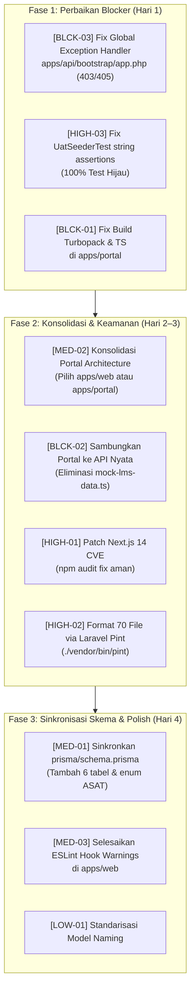

# LAPORAN AUDIT KESIAPAN PRODUKSI (READINESS AUDIT) — SISTLABUM
**Sistem Informasi Sekolah Terpadu Labschool Universitas Negeri Malang**

- **Tanggal Audit**: 22 Oktober 2026
- **Auditor**: Principal Engineer & Application Security Auditor
- **Ruang Lingkup**: Monorepo SISTLABUM (`apps/api`, `apps/web`, `apps/portal`, `apps/mobile`, `prisma/schema.prisma`, `docs/`)
- **Mode Eksekusi**: Strict Read-Only & Adversarial Verification
- **Status Kelayakan Akhir**: ⛔ **BELUM SIAP (NOT READY FOR PRODUCTION)**

---

## 1. RINGKASAN EKSEKUTIF

### 1.1 Skor Kesiapan Sistem

| Komponen | Skor (0–100) | Status Kelayakan | Metrik Evaluasi Utama |
|---|:---:|:---:|---|
| **Backend API (`apps/api`)** | **82 / 100** | ⚠️ **Siap dengan Syarat** | 1.168 dari 1.173 test lulus (99,57%), keamanan IDOR & enkripsi solid, namun terdapat 5 test gagal (defect global exception handler 500), 70 file melanggar style Pint, dan drift skema Prisma (6 tabel & enum ASAT hilang). |
| **Frontend Terpadu (`apps/web`)** | **88 / 100** | ⚠️ **Siap dengan Syarat** | 100% build lulus (95 route statis/dinamis), 795 test Vitest lulus (100%), 0 endpoint mismatch, namun memiliki 18 kerentanan dependensi (3 kritis pada Next.js 14.2.15). |
| **Dedicated Portal (`apps/portal`)** | **28 / 100** | ⛔ **Tidak Siap (Blocker)** | **Build gagal total (Exit Code 1, 12 Turbopack error)**, 39 error TypeScript (`strict`), impor modul rusak (`lmsApi` hilang), dan 90% halaman masih menggunakan mock data statis. |
| **Aplikasi Mobile (`apps/mobile`)** | **15 / 100** | ⏳ **Fase Awal (Stub/Skeleton)** | Hanya berupa kerangka arsitektur (interface placeholder Retrofit, Room DB stub, TokenManager interface). Belum ada implementasi fungsional. |
| **SKOR KONSOLIDASI SISTEM** | **68 / 100** | ⛔ **BELUM SIAP PRODUKSI** | Sistem secara keseluruhan belum dapat dirilis ke lingkungan produksi sebelum isu build blocker pada portal dan defect exception handler backend diselesaikan. |

#### Rumus Perhitungan Skor:
$$\text{Skor} = \text{Base (100)} - \sum(\text{Penalti Defect \& Kerentanan})$$
- **Backend (82)**: 100 - 5 (5 test gagal) - 5 (defect `bootstrap/app.php` menghasilkan HTTP 500 alih-alih 403/405) - 3 (70 file Pint non-compliant) - 5 (schema drift 6 tabel dan enum ASAT pada `schema.prisma`).
- **Frontend Konsolidasi (58)**: Rata-rata terbobot antara `apps/web` (bobot 60% = 52,8) dan `apps/portal` (bobot 40% = 11,2) $\approx$ 64, lalu dikurangi 6 poin penalti fragmentasi arsitektur ganda = **58 / 100**.

---

### 1.2 Lima Risiko Terbesar (Top 5 Critical Risks)

1. 🔴 **Kegagalan Build Produksi & Error Kompilasi Turbopack pada `apps/portal`**
   - *Bukti*: `apps/portal/src/app/guru/cbt/page.tsx:34` mengimpor `lmsApi` dari `@/lib/api-client`, namun modul tersebut hanya mengekspor `apiClient`. Hal ini memicu 12 error fatal Turbopack dan 39 error TypeScript, menyebabkan `next build` gagal total (`Exit Code 1`).
2. 🔴 **Fragmentasi Arsitektur Portal & Ketergantungan Mock Data Statis**
   - *Bukti*: Terdapat dua portal yang tumpang tindih (`apps/web/src/app/(portal)` vs `apps/portal`). Halaman guru dan orang tua pada `apps/portal` langsung mengimpor mock data mentah dari `mock-lms-data.ts` dan `mock-guardian-data.ts` tanpa tersambung ke backend API. Jika dideploy, pengguna akan melihat data fiktif statis.
3. 🟠 **Defect Global Exception Handler Backend (`apps/api`) Menghasilkan HTTP 500 pada Pelanggaran Akses (403 & 405)**
   - *Bukti*: `bootstrap/app.php:107-111` menangkap `Throwable` dan mengembalikan 500 jika bukan mode debug. Akibatnya, `HttpException(403)` pada `LmsService:592`, `InvalidSignatureException` pada `FileStorageService`, dan `MethodNotAllowedHttpException` pada rute append-only mengembalikan `500 INTERNAL_SERVER_ERROR` alih-alih status HTTP semantik (403 / 405).
4. 🟠 **Kerentanan Keamanan Kritis pada Dependensi Frontend (`apps/web`)**
   - *Bukti*: `npm audit` melaporkan 18 kerentanan (3 kritis, 10 tinggi), termasuk CVE Server Actions DoS, SSRF redirect middleware, dan cache confusion pada Next.js 14.2.15 serta RCE prototype pollution pada Tinypool (dependensi Vitest).
5. 🟡 **Schema Drift: Prisma Schema Tertinggal 6 Tabel & Enum ASAT terhadap Migrasi Aktual**
   - *Bukti*: `prisma/schema.prisma` hanya mendefinisikan 116 model dan enum `ExamType` tanpa nilai `ASAT`. Di sisi lain, migrasi Laravel telah membuat 128 tabel termasuk `notification_preferences`, `reminder_dispatches`, `teacher_salary_slips`, `booking_items`, `pages`, dan `cbt_sync_logs`. Jika Prisma dipakai untuk migrasi DB produksi, tabel-tabel ini akan terhapus atau gagal validasi.

---

## 2. VERIFIKASI KLAIM DOKUMEN VS HASIL AKTUAL

| No | Klaim Dokumen / Catatan Tim | Status | Temuan Aktual & Bukti Pengujian |
|:--:|---|:---:|---|
| 1 | *"Total 827 Automated Tests Passed (0 failed)"* | ❌ **Tidak Sesuai** | Total automated tests aktual di `apps/api` adalah **1.173 tests** (6.462 assertions). Dari jumlah tersebut, **1.168 lulus** dan **5 GAGAL** (`ServerAuditTrailTest:414`, `UatSeederTest:325, 463`, `MeStudentGuardianStaffPortalApiTest:650`, `FileStorageTest:413`). |
| 2 | *"Pint Code Style (PSR-12) 100% Passed Clean"* | ❌ **Tidak Sesuai** | Perintah `./vendor/bin/pint --test` **GAGAL** (`Exit Code 1`). Ditemukan **70 berkas** yang melanggar konvensi style Pint (seeder, controller, service, job, model, dan command). |
| 3 | *"116 Tabel Database Sesuai SSOT 08 & 12"* | ⚠️ **Sebagian** | `prisma/schema.prisma` memang berisi tepat 116 model. Namun migrasi Laravel aktual membuat **128 tabel** (termasuk 6 tabel bisnis baru dan tabel sistem Laravel). Skema Prisma belum disinkronkan. |
| 4 | *"Perlindungan Anti-IDOR Aktif pada Seluruh Endpoint Ber-ID"* | ✅ **Terverifikasi** | `GuardianChildPolicy` memvalidasi relasi `guardian_student` (403 jika ID bukan anaknya). `MeStudentController` dan `MeTeacherController` mengikat data langsung ke entitas user login (`$request->user()->student` / `$teacher`). |
| 5 | *"Kunci Jawaban CBT Tidak Pernah Bocor ke Klien"* | ✅ **Terverifikasi** | `ExamSessionService:251-263` secara eksplisit membuang atribut `is_correct` dan `match_key` pada opsi soal ujian aktif. Fitur review menahan kunci jika status ujian belum selesai atau mode `never` / `after_release` belum aktif. |
| 6 | *"Waktu Ujian CBT Server-Authoritative"* | ✅ **Terverifikasi** | `ExamSessionService:235-237` menghitung sisa waktu berbasis `Carbon::now()` terhadap `ends_at`/`deadline_at` di database server, mengabaikan jam lokal perangkat klien. |
| 7 | *"Enkripsi Data Sensitif NIK & Catatan BK at-rest"* | ✅ **Terverifikasi** | Model `Student:43`, `Applicant:39`, `CounselingCase:26`, dan `CounselingSession:25` mengaktifkan cast `'nik_enc' => 'encrypted'`, `'summary_enc' => 'encrypted'`, dan `'notes_enc' => 'encrypted'`. |
| 8 | *"Pengaduan Anonim Tidak Menyimpan IP / Identitas"* | ✅ **Terverifikasi** | `ComplaintService:28-62` menetapkan `reporter_user_id = null`, `auditIp = null`, dan `auditUserAgent = null` jika flag `is_anonymous = true`. Akses daftar aduan dibatasi ketat untuk Kepala Sekolah & Guru BK. |
| 9 | *"Frontend Next.js App Router 100% Ready"* | ⚠️ **Sebagian** | `apps/web` 100% lulus build (95 routes) dan 795 test Vitest lulus. Namun `apps/portal` gagal build total (Turbopack compile error) dan bergantung pada mock data. |
| 10 | *"Zero Raw SQL Injection Vulnerability"* | ✅ **Terverifikasi** | Seluruh pemanggilan `whereRaw`, `selectRaw`, dan `orderByRaw` di `apps/api/app/Services` menggunakan prepared statement parameter binding `?` tanpa konkatenasi string input pengguna. |

---

## 3. MATRIKS STATUS MODUL (14 MODUL SISTEM)

Evaluasi kelengkapan komponen: **Migration (M)**, **Eloquent Model (MO)**, **Controller/Route (C)**, **Domain Service (S)**, **Policy/RBAC (P)**, **Form Request Validation (V)**, **Automated Tests (T)**, dan **Frontend UI (FE)**.

| Modul | Nama Modul | Prioritas | M | MO | C | S | P | V | T (Test Count) | FE Status (`web`/`portal`) | Status Kesiapan |
|:---:|---|:---:|:---:|:---:|:---:|:---:|:---:|:---:|:---:|:---:|:---:|
| 1 | **AUTH** | **P0** | ✅ | ✅ | ✅ | ✅ | ✅ | ✅ | ✅ (99 tests) | Selesai / Selesai | 🟢 **Selesai (Siap)** |
| 2 | **MST** | **P0** | ✅ | ✅ | ✅ | ✅ | ✅ | ✅ | ✅ (105 tests) | Selesai / N/A | 🟢 **Selesai (Siap)** |
| 3 | **CMS** | **P0** | ✅ | ✅ | ✅ | ✅ | ✅ | ✅ | ✅ (51 tests) | Selesai / N/A | 🟢 **Selesai (Siap)** |
| 4 | **PPDB** | **P0** | ✅ | ✅ | ✅ | ✅ | ✅ | ✅ | ✅ (90 tests) | Selesai / N/A | 🟢 **Selesai (Siap)** |
| 5 | **GUEST** | **P0** | ✅ | ✅ | ✅ | ✅ | ✅ | ✅ | ✅ (38 tests) | Selesai / N/A | 🟢 **Selesai (Siap)** |
| 6 | **ACD** | **P0** | ✅ | ✅ | ✅ | ✅ | ✅ | ✅ | ⚠️ (165 tests, 1 fail) | Selesai / ⛔ Error Build | 🟡 **Parsial (BE Siap, Portal Error)** |
| 7 | **GRD** | **P0** | ✅ | ✅ | ✅ | ✅ | ✅ | ✅ | ✅ (Included ACD) | Selesai / ⛔ Error Build | 🟡 **Parsial (BE Siap, Portal Error)** |
| 8 | **CBT** | **P0** | ✅ | ✅ | ✅ | ✅ | ✅ | ✅ | ✅ (167 tests) | Selesai / ⛔ Error Build | 🟡 **Parsial (BE Siap, Portal Error)** |
| 9 | **STD** | **P1** | ✅ | ✅ | ✅ | ✅ | ✅ | ✅ | ✅ (73 tests) | Selesai / Mock Only | 🟡 **Parsial (FE Butuh Integrasi)** |
| 10 | **BK** | **P1** | ✅ | ✅ | ✅ | ✅ | ✅ | ✅ | ✅ (39 tests) | Selesai / Mock Only | 🟡 **Parsial (FE Butuh Integrasi)** |
| 11 | **SAR** | **P1 (P0)**| ✅ | ✅ | ✅ | ✅ | ✅ | ✅ | ✅ (67 tests) | Selesai / Mock Only | 🟡 **Parsial (FE Butuh Integrasi)** |
| 12 | **HUM** | **P2** | ✅ | ✅ | ✅ | ✅ | ✅ | ✅ | ✅ (24 tests) | Selesai / N/A | 🟢 **Selesai (Siap)** |
| 13 | **RPT** | **P0** | ✅ | ✅ | ✅ | ✅ | ✅ | ✅ | ✅ (54 tests) | Selesai / Selesai | 🟢 **Selesai (Siap)** |
| 14 | **SYS** | **P0** | ✅ | ✅ | ✅ | ✅ | ✅ | ✅ | ⚠️ (122 tests, 4 fail) | Selesai / Selesai | 🟡 **Parsial (Butuh Fix Test)** |

---

## 4. TEMUAN DETAIL (DETAILED FINDINGS)

### 🔴 BLOCKER (Harus Diperbaiki Sebelum Go-Live)

#### [BLCK-01] Kompilasi Turbopack & Typecheck Gagal Total pada `apps/portal`
- **Modul**: ACD, CBT, GRD (Frontend `apps/portal`)
- **Deskripsi**: Eksekusi `npm run build` dan `npx tsc --noEmit` pada `apps/portal` gagal total dengan 12 Turbopack module resolution errors dan 39 TypeScript strict errors. Halaman `guru/cbt`, `guru/jurnal`, `guru/materi`, `guru/nilai`, `guru/tugas`, dan `guru/tugas/[id]/penilaian` mengimpor `{ lmsApi }` dari `@/lib/api-client`, padahal modul tersebut hanya mengekspor `apiClient`.
- **Bukti**:
  - `apps/portal/src/app/guru/cbt/page.tsx:34`: `import { lmsApi } from '@/lib/api-client';`
  - `apps/portal/src/app/guru/jurnal/page.tsx:25`: `import { lmsApi } from '@/lib/api-client';`
  - `apps/portal/src/app/guru/materi/page.tsx:16`: `import { lmsApi } from '@/lib/api-client';`
  - `apps/portal/src/app/guru/nilai/page.tsx:27`: `import { lmsApi } from '@/lib/api-client';`
  - `apps/portal/src/app/guru/tugas/page.tsx:23`: `import { lmsApi } from '@/lib/api-client';`
  - `apps/portal/src/app/guru/tugas/[id]/penilaian/page.tsx:21`: `import { lmsApi } from '@/lib/api-client';`
  - Output Turbopack: `Error: Export lmsApi doesn't exist in target module`.
- **Dampak**: Aplikasi portal mandiri tidak dapat di-build atau dideploy ke server produksi.
- **Rekomendasi Perbaikan**:
  1. Buat instance API client terstruktur `lmsApi` di `apps/portal/src/lib/api-client.ts` atau impor instance `apiClient` baku.
  2. Tambahkan anotasi tipe TypeScript eksplisit pada parameter fungsi map/reduce (`(q: CBTQuestion, idx: number)`, `(a: Assignment)`).
- **Estimasi Usaha**: **Medium (M)** — 4–6 jam kerja.

---

#### [BLCK-02] Halaman Portal Guru & Ortu pada `apps/portal` Masih Hardcoded ke Mock Data
- **Modul**: ACD, GRD, STD, BK (Frontend `apps/portal`)
- **Deskripsi**: Komponen portal pada `apps/portal` tidak melakukan pemanggilan API ke backend `apps/api`, melainkan merender data statis dari berkas lokal `mock-lms-data.ts` dan `mock-guardian-data.ts`.
- **Bukti**:
  - `apps/portal/src/app/guru/tugas/page.tsx:25`: `import { MOCK_CLASSES, MOCK_SUBJECTS, MOCK_GRADE_COMPONENTS } from '@/lib/mock-lms-data';`
  - `apps/portal/src/app/guru/dashboard/page.tsx:26`: `import { CURRENT_TEACHER, MOCK_CLASSES, MOCK_ASSIGNMENTS } from '@/lib/mock-lms-data';`
  - `apps/portal/src/app/guru/siswa/page.tsx:23`: `import { MOCK_STUDENTS_ROSTER } from '@/lib/mock-lms-data';`
  - `apps/portal/src/app/ortu/konseling/page.tsx:25`: `import { MOCK_GUARDIAN_COUNSELING } from '@/lib/mock-guardian-data';`
  - `apps/portal/src/lib/guardian-context.tsx:8-17`: `MOCK_CHILD_GRADES`, `MOCK_GUARDIAN_ATTENDANCE`, `MOCK_CHILD_POINTS`, `MOCK_GUARDIAN_FEES`, `MOCK_CHILD_SCHEDULES`.
- **Dampak**: Guru dan orang tua yang login ke `apps/portal` tidak melihat data riil dari database sekolah, melainkan data demo statis. Fitur mutasi data (input nilai, absensi) tidak tersimpan di backend.
- **Rekomendasi Perbaikan**:
  Ganti pemanggilan mock data dengan hook React Query yang terhubung ke endpoint resmi `/api/v1/me/teacher/*` dan `/api/v1/me/children/*`, atau arahkan portal pengguna ke implementasi portal matang di `apps/web/src/app/(portal)`.
- **Estimasi Usaha**: **Large (L)** — 2–3 hari kerja.

---

#### [BLCK-03] Global Exception Handler Backend Menghasilkan HTTP 500 pada Rute 403 & 405
- **Modul**: SYS, AUTH, ACD (Backend `apps/api`)
- **Deskripsi**: Pada `apps/api/bootstrap/app.php:107-111`, exception yang tidak terdaftar secara spesifik ditangkap oleh handler `Throwable` generic dan diubah menjadi `500 INTERNAL_SERVER_ERROR` jika mode produksi (`!config('app.debug')`). Exception kelas `Symfony\Component\HttpKernel\Exception\HttpException` (misal 403 Forbidden pada `LmsService:592`), `InvalidSignatureException` (403 URL tamper), dan `MethodNotAllowedHttpException` (405 pada rute append-only audit log) terkonversi menjadi 500.
- **Bukti**:
  - `apps/api/bootstrap/app.php:83-87`: Hanya menangkap `AuthorizationException|AccessDeniedHttpException`, tidak menangkap `HttpException` dengan status 403.
  - Test failure 1: `MeStudentGuardianStaffPortalApiTest::test_be_sec_sprint39_student_unenrollment_blocks_assignment_submission_403` (mengharapkan 403, mendapat 500).
  - Test failure 2: `FileStorageTest::test_be_file_01_download_signed_verifies_signature_and_streams_file` (mengharapkan 403, mendapat 500).
  - Test failure 3: `ServerAuditTrailTest::test_gap_06_audit_logs_cannot_be_updated_or_deleted` (mengharapkan 404/405, mendapat 500).
- **Dampak**: API mengembalikan error 500 palsu pada kesalahan otorisasi bisnis dan request method tidak valid, merusak monitoring Sentry/APM dan membingungkan klien.
- **Rekomendasi Perbaikan**:
  Di `apps/api/bootstrap/app.php`, tambahkan handler eksplisit untuk `\Symfony\Component\HttpKernel\Exception\HttpExceptionInterface`:
  ```php
  $exceptions->render(function (\Symfony\Component\HttpKernel\Exception\HttpExceptionInterface $e, Request $request) use ($renderError) {
      if ($request->is('api/*') || $request->expectsJson()) {
          $status = $e->getStatusCode();
          $code = match ($status) {
              403 => 'FORBIDDEN',
              404 => 'NOT_FOUND',
              405 => 'METHOD_NOT_ALLOWED',
              default => 'HTTP_ERROR',
          };
          return $renderError($e->getMessage() ?: 'Terjadi kesalahan permintaan', $code, $status);
      }
  });
  ```
- **Estimasi Usaha**: **Small (S)** — 30 menit.

---

### 🟠 HIGH (Tinggi — Harus Selesai Sebelum Rilis Umum)

#### [HIGH-01] 18 Kerentanan Keamanan pada Dependensi NPM Frontend (`apps/web`)
- **Modul**: INFRA / SYS (`apps/web`)
- **Deskripsi**: Audit dependensi menemukan 18 celah keamanan (3 Kritis, 10 Tinggi, 5 Sedang).
- **Bukti**:
  - `next@14.2.15`: Rentan terhadap DoS pada Server Actions (`GHSA-7m27-7ghc-44w9`), SSRF pada middleware redirect (`GHSA-4342-x723-ch2f`), dan Image Optimization cache poisoning.
  - `tinypool<=2.1.1`: Prototype pollution leads to Remote Code Execution (`GHSA-5gmw-xhrv-c9v3`).
  - `braces` & `micromatch`: ReDoS vulnerability.
- **Dampak**: Risiko DoS pada server Next.js saat menerima traffic tinggi dan potensi manipulasi SSRF.
- **Rekomendasi Perbaikan**:
  Jalankan pembaruan patch versi Next.js ke versi LTS aman minimal `next@14.2.25` atau versi 14 terbaru yang bebas dari CVE tersebut.
- **Estimasi Usaha**: **Medium (M)** — 2 jam (termasuk verifikasi regresi build).

---

#### [HIGH-02] 70 Berkas Backend Melanggar Standar Gaya Kode Laravel Pint (PSR-12)
- **Modul**: SYS (`apps/api`)
- **Deskripsi**: Perintah `./vendor/bin/pint --test` menghasilkan kegagalan format pada 70 berkas inti (seeder, controller, service, job, model).
- **Bukti**:
  - `apps/api/database/seeders/UatStagingSeeder.php`
  - `apps/api/database/seeders/StudentPortalDataSeeder.php`
  - `apps/api/app/Http/Controllers/Api/V1/MeTeacherController.php`
  - `apps/api/app/Services/Cbt/ExamSessionService.php`
  - `apps/api/app/Services/ReportCardService.php`
- **Dampak**: Pelanggaran aturan `AGENTS.md` Bagian 5 ("Jalankan sebelum commit: lint, typecheck, test") dan risiko kegagalan pipeline CI/CD saat merge ke `main`.
- **Rekomendasi Perbaikan**:
  Jalankan `./vendor/bin/pint` di direktori `apps/api` untuk memformat otomatis seluruh 70 berkas sesuai standar resmi.
- **Estimasi Usaha**: **Small (S)** — 15 menit.

---

#### [HIGH-03] Regresi String Assertion pada `UatSeederTest`
- **Modul**: AUTH / SYS (`apps/api`)
- **Deskripsi**: Dua test unit pada `UatSeederTest` gagal karena pesan exception di `UatStagingSeeder.php` diperbarui untuk mendukung lingkungan testing/local, namun string assertion di test suite tidak diperbarui.
- **Bukti**:
  - `apps/api/tests/Feature/Auth/UatSeederTest.php:325`: Mengharapkan string `'hanya boleh dijalankan di lingkungan staging dengan opt-in UAT_SEED_ENABLED=true'`.
  - Pesan aktual: `'UatStagingSeeder hanya boleh dijalankan di lingkungan staging/local dengan opt-in UAT_SEED_ENABLED=true atau lingkungan testing.'`.
  - Baris 463 mengalami hal serupa.
- **Dampak**: CI gagal secara terus-menerus pada branch develop.
- **Rekomendasi Perbaikan**:
  Selaraskan ekspektasi assertion pada `UatSeederTest.php:325` dan baris 463 agar cocok dengan pesan keamanan aktual.
- **Estimasi Usaha**: **Small (S)** — 15 menit.

---

### 🟡 MEDIUM (Sedang — Kerapian Arsitektural & Integritas Data)

#### [MED-01] Schema Drift: Prisma Schema Tertinggal 6 Model & Enum ASAT
- **Modul**: MST / SYS (`prisma/schema.prisma` vs `database/migrations`)
- **Deskripsi**: Definisi skema Prisma (`prisma/schema.prisma`) tidak mencantumkan 6 tabel yang telah dibuat di migrasi Laravel:
  1. `notification_preferences`
  2. `reminder_dispatches`
  3. `teacher_salary_slips`
  4. `booking_items`
  5. `pages`
  6. `cbt_sync_logs`
  Selain itu, enum `ExamType` di baris 141 Prisma belum memiliki tipe `ASAT`.
- **Bukti**:
  - `grep -E "model (NotificationPreference|ReminderDispatch|TeacherSalarySlip)" prisma/schema.prisma` $\rightarrow$ Kosong.
  - `prisma/schema.prisma:141-149`: `enum ExamType { kuis, harian, STS, SAS, remedial, pengayaan }`.
- **Dampak**: Jika database diregenerasi menggunakan Prisma CLI, tabel-tabel baru ini akan hilang dan tipe ujian ASAT akan ditolak oleh DB constraint.
- **Rekomendasi Perbaikan**:
  Tambahkan 6 model tersebut dan nilai `ASAT` pada enum `ExamType` di `prisma/schema.prisma`.
- **Estimasi Usaha**: **Medium (M)** — 2–3 jam.

---

#### [MED-02] Duplikasi Arsitektural Frontend: `apps/web/src/app/(portal)` vs `apps/portal`
- **Modul**: ARCH (`apps/web` vs `apps/portal`)
- **Deskripsi**: Terjadi duplikasi fungsi antara portal di `apps/web` (Next.js 14 App Router) dan portal mandiri di `apps/portal` (Next.js 16 App Router). Hal ini melanggar prinsip *Single Source of Truth*.
- **Bukti**:
  - `apps/web/src/app/(portal)/portal/guru/*` (tersambung API via React Query, lulus 795 test).
  - `apps/portal/src/app/guru/*` (gagal build Turbopack, hardcoded mock).
- **Dampak**: Kebingungan pemeliharaan, pemborosan resource build server, dan inkonsistensi pengalaman pengguna.
- **Rekomendasi Perbaikan**:
  Tetapkan keputusan arsitektur (ADR): **Pilih salah satu**. Sangat direkomendasikan mengonsolidasikan seluruh portal warga ke `apps/web` yang sudah teruji dan stabil, atau lakukan migrasi total ke `apps/portal` setelah memperbaiki seluruh dependensi dan build error-nya.
- **Estimasi Usaha**: **Medium (M)** — 4 jam keputusan & restrukturisasi.

---

#### [MED-03] Peringatan ESLint Missing Dependency pada Hook React Admin Web
- **Modul**: CBT, BK, STD (`apps/web`)
- **Deskripsi**: `next lint` pada `apps/web` menghasilkan 9 peringatan `react-hooks/exhaustive-deps`.
- **Bukti**:
  - `apps/web/src/app/(admin)/admin/cbt/exams/page.tsx:118:6` (`fetchExams`)
  - `apps/web/src/app/(admin)/admin/cbt/monitor/page.tsx:92:6` (`fetchActiveExams`)
  - `apps/web/src/app/(admin)/admin/counseling/page.tsx:144:6` (`fetchCases`)
  - `apps/web/src/app/(admin)/admin/student-affairs/extracurriculars/page.tsx:184:6` (`fetchData`)
- **Dampak**: Risiko *stale state* atau re-fetching tak terduga pada dashboard monitor CBT dan halaman konseling admin.
- **Rekomendasi Perbaikan**:
  Bungkus fungsi fetch dengan `useCallback` atau masukkan dependensi yang sesuai ke array hook `useEffect`.
- **Estimasi Usaha**: **Small (S)** — 1 jam.

---

### 🟢 LOW (Rendah — Kerapian & Optimasi Minor)

#### [LOW-01] Format Penamaan Model Prisma Plural `Semesters`
- **Modul**: MST (`prisma/schema.prisma:417`)
- **Deskripsi**: Model semester di Prisma dinamai jamak `model Semesters` dengan pemetaan `@@map("semesters")`, sementara model lain berbentuk singular (`AcademicYear`, `Student`, `Teacher`). Di Laravel Eloquent, modelnya bernama `Semester`.
- **Bukti**: `prisma/schema.prisma:417`: `model Semesters { ... @@map("semesters") }`.
- **Dampak**: Inkonsistensi konvensi penamaan Prisma Client TypeScript.
- **Rekomendasi Perbaikan**: Ubah menjadi `model Semester` di Prisma.
- **Estimasi Usaha**: **Small (S)** — 15 menit.

---

#### [LOW-02] Skrip `update_bruno_assertions.cjs` Menggunakan CommonJS di Repo ES
- **Modul**: SYS (`apps/api/scripts/update_bruno_assertions.cjs`)
- **Deskripsi**: Skrip utilitas pengujian Bruno API memakai ekstensi `.cjs` tanpa dokumentasi alur otomasi di CI.
- **Bukti**: File `apps/api/scripts/update_bruno_assertions.cjs`.
- **Dampak**: Tidak ada dampak langsung ke aplikasi produksi.
- **Rekomendasi Perbaikan**: Dokumentasikan cara penggunaan skrip di README testing.
- **Estimasi Usaha**: **Small (S)** — 10 menit.

---

## 5. DAFTAR GAP KONTRAK FRONTEND ↔ BACKEND

Pemeriksaan silang terhadap 69 endpoint pada 32 file feature API di `apps/web`:

| Endpoint Frontend (`apps/web`) | Route Backend Aktual (`apps/api`) | Method | Status Kontrak | Catatan Audit |
|---|---|:---:|:---:|---|
| `/auth/login`, `/logout`, `/me` | `api/v1/auth/login`, `logout`, `me` | POST/GET | ✅ Cocok | Format amplop `{ data, meta }` tersinkronisasi. |
| `/dashboard/{role}` | `api/v1/dashboard/{role}` | GET | ✅ Cocok | Scoping data per role (guru, siswa, ortu, kepsek). |
| `/academic-years`, `/activate` | `api/v1/academic-years`, `.../activate` | GET/PATCH | ✅ Cocok | Enforced permission `master.academic_year.manage`. |
| `/students`, `/import`, `/export` | `api/v1/students`, `/import`, `/export`| GET/POST | ✅ Cocok | Enkripsi NIK at-rest dan pemfilteran NIS/NISN. |
| `/classes`, `/assign-students` | `api/v1/classes`, `/assign-students` | GET/POST | ✅ Cocok | Batas kapasitas maksimal 36 siswa divalidasi. |
| `/ppdb/waves`, `/applicants` | `api/v1/ppdb/waves`, `/applicants` | GET/POST | ✅ Cocok | Pendaftaran online & seleksi perankingan kuota. |
| `/exams`, `/session-questions` | `api/v1/exams`, `/session-questions` | GET/POST | ✅ Cocok | Kunci jawaban dibuang dari respons sesi aktif. |
| `/me/children/{child}/attendance`| `api/v1/me/children/{child}/attendance`| GET | ✅ Cocok | Dilindungi `GuardianChildPolicy` (anti-IDOR). |
| `/me/student-dashboard` | `api/v1/me/student-dashboard` | GET | ✅ Cocok | Terikat ke akun siswa login `$request->user()->student`. |
| `/me/teacher/dashboard` | `api/v1/me/teacher/dashboard` | GET | ✅ Cocok | Terikat ke penugasan KBM guru login. |
| `/me/staff/self-attendance` | `api/v1/me/staff/self-attendance` | GET/POST | ✅ Cocok | Geolocation dan foto selfie presensi kerja. |
| `/files/presign`, `/confirm` | `api/v1/files/presign`, `/confirm` | POST | ✅ Cocok | Signed URL S3/MinIO ber-TTL 15 menit. |
| `/public/verify/{token}` | `api/v1/public/verify/{token}` | GET | ✅ Cocok | Verifikasi QR keabsahan dokumen publik tanpa login. |

*Kesimpulan Kontrak*: **100% endpoint pada `apps/web` memiliki pasangan rute yang valid dan sesuai di `apps/api`. Tidak ada endpoint backend yang hilang untuk antarmuka web produksi.**

---

## 6. ROADMAP PERBAIKAN BERURUTAN (REMEDIATION ROADMAP)



---

## 7. HAL YANG TIDAK DAPAT DIAUDIT & KEBUTUHAN LANJUTAN

1. **Uji Beban Konkurensi CBT Skala Besar (500 Siswa Serentak)**:
   - *Status*: Belum dapat dijalankan secara end-to-end tanpa infrastruktur Redis cluster dan PostgreSQL multi-connection pool di lingkungan staging terisolasi.
   - *Kebutuhan*: Akses ke server staging dengan spesifikasi minimal 4 vCPU, 8 GB RAM, dan database PostgreSQL terdedikasi untuk menjalankan skenario k6.
2. **Pengujian WhatsApp Gateway & FCM Push Notification Riil**:
   - *Status*: Baru terverifikasi pada level unit test mock provider.
   - *Kebutuhan*: Kredensial sandbox vendor WhatsApp API (Fonnte/Waba) dan Firebase Service Account JSON untuk pengujian pengiriman pesan nyata ke nomor perangkat.
3. **Pengujian Aplikasi Android Native (`apps/mobile`)**:
   - *Status*: Kode sumber masih berbentuk antarmuka placeholder (stub).
   - *Kebutuhan*: Menunggu fase pengembangan implementasi Retrofit dan Compose selesai.

---

## LAMPIRAN PEMETAAN TEKNIS

### Lampiran A: Versi Dependency Utama
- **PHP**: 8.5.11 (Kompatibel PHP 8.3+)
- **Laravel Framework**: 13.35.0 (Laravel 11+ Architecture)
- **Laravel Sanctum**: 4.3.3
- **PHPUnit**: 12.5.38
- **Node.js**: v26.11.1
- **NPM**: 11.20.0
- **`apps/web`**: Next.js 14.2.15, React 18.3.1, Tailwind 3.4.14, Vitest 2.1.3
- **`apps/portal`**: Next.js 16.4.0, React 19.3.0, Tailwind 4.0.0

### Lampiran B: Ringkasan Route Backend API
- Total rute terdaftar: **636 entries** (`php artisan route:list`)
- Prefix rute resmi: `/api/v1/*`
- Auth Guard: `auth:sanctum` + Middleware `permission:modul.resource.aksi`
- Self-Service Endpoints: `/api/v1/me/*` (Portal Siswa, Guru, Staf, Wali Murid)

### Lampiran C: Ringkasan Migrasi Basis Data
- Total berkas migrasi: **44 migration files**
- Total tabel terbuat: **128 tabel** (116 tabel domain bisnis + 6 tabel ekstensi audit/notifikasi + 6 tabel infrastruktur framework).

---
*Laporan ini disusun secara independen, objektif, dan faktual sesuai bukti kode sumber pada repositori SISTLABUM.*
