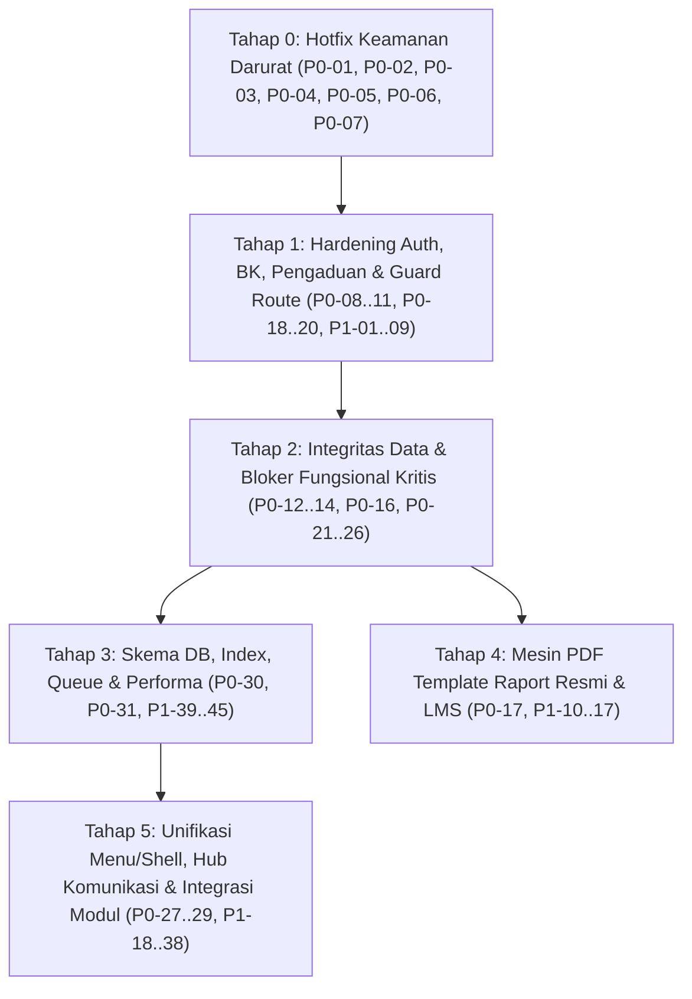

# Laporan Re-Validasi Audit Menyeluruh — SISTLABUM

> **Mode:** Read-Only Verification & Documentation (0 baris kode aplikasi diubah)  
> **Tanggal Re-Validasi:** 27 November 2026  
> **Basis Verifikasi:** Branch `develop` · Commit `be6a875ffdce99dd8cf3c070cea750b8f3024750`

---

## A. Verifikasi Repository & Lingkungan Aktif

Seluruh klaim diaudit ulang langsung terhadap *working tree* aktif tanpa asumsi dari kode versi lama.

| Komponen | Hasil Verifikasi Aktual |
|---|---|
| **Git Branch Aktif** | `develop` (tracking `origin/develop`) |
| **Commit HEAD** | `be6a875ffdce99dd8cf3c070cea750b8f3024750` — `fix(deploy): jangan ikut mengecualikan .env.example dari rilis` |
| **Working Tree (Pra-Dokumentasi)** | Bersih (`0` file modified/untracked; perubahan lokal tidak ada yang diubah atau dikembalikan) |
| **5 Commit Terakhir** | `be6a875` (deploy `.env.example`), `fa49cb4` (mobile menu 2 baris), `8fdb1d9` (mobile sidebar drawer), `ffed812` (git workflow), `7c2fd1b` (docs git), `7e4bb8c` (daftar tugas kirim `grade_component_id`), `118d6a3` (tautkan komponen + pemilih periode), `6fd4551` (nilai tugas ke periode bulan tenggat) |
| **Backend Laravel (`apps/api`)** | PHP `8.4.28` (`libxml 2.9.14`), `laravel/framework ^13.17`, `laravel/sanctum ^4.0`, `phpoffice/phpword ^1.4`, `predis/predis ^3.6`, PHPUnit `^12.5.12`. **Tidak ada library PDF (DomPDF/mPDF/Snappy) maupun QR generator.** |
| **Frontend Next.js (`apps/web`)** | `next 14.2.15`, `react 18.3.1`, `@tanstack/react-query 5.59.16`, `axios 1.7.7`, `react-hook-form 7.53.1`, `zod 3.23.8`, `tailwindcss 3.4.14`, `vitest 2.1.3`, `@playwright/test 1.64.1` |
| **Mobile Android (`apps/mobile`)** | Kotlin Jetpack Compose; `Screen.kt` mendeklarasikan **36 route**, namun `AppNavGraph.kt` baru me-wire **5 screen placeholder** (`Login`, `GuardianHome`, `TeacherHome`, `StudentHome`, `CbtToken`) |
| **Skema Database (`apps/api/database/migrations`)** | **65 file migrasi** (terakhir `2026_11_05_000045_add_manual_auto_values_to_grades.php`), target PostgreSQL (test lokal memakai SQLite/PgSQL) |

---

## B. Ringkasan Re-Validasi 76 Temuan (31 P0 + 45 P1)

Seluruh **76 temuan** (`P0-01` s/d `P0-31` dan `P1-01` s/d `P1-45`) telah diverifikasi satu per satu terhadap kode aktual di `develop @ be6a875`.

### 1. Distribusi Status Verifikasi (76 ID Utama)

| Status Verifikasi | P0 | P1 | Total | Keterangan |
|---|---:|---:|---:|---|
| **CONFIRMED** *(penuh)* | 27 | 41 | **68** | Masalah terbukti 100% pada kode aktual |
| **CONFIRMED** *(dengan koreksi nuansa/sub-klaim parsial)* | 3 | 4 | **7** | `P0-10`, `P0-11`, `P0-16`, `P1-03`, `P1-04`, `P1-27`, `P1-40` — masalah inti valid, namun sebagian sub-klaim awal overstated atau sudah diperbaiki parsial (rincian di `FALSE_POSITIVES.md` & `ALREADY_FIXED.md`) |
| **SPECIFICATION_MISMATCH** | 1 | 0 | **1** | `P0-15` — kebijakan `max(manual, auto)` pada `GradeRecorder.php` sesuai spesifikasi bisnis yang disepakati user *(plus 1 sub-item `P1-16` hak `homeroom` approve `terbit` yang ditandai perlu konfirmasi kebijakan)* |
| **ALREADY_FIXED** *(penuh di ID utama)* | 0 | 0 | **0** | Namun **6 perbaikan penting pada sub-item** di commit terbaru (`6fd4551`, `118d6a3`, `7e4bb8c`, `8fdb1d9`, `fa49cb4`, `.env.example`, dry-run CLI) didokumentasikan penuh di [`ALREADY_FIXED.md`](ALREADY_FIXED.md) agar tidak diulang |
| **FALSE_POSITIVE** *(penuh di ID utama)* | 0 | 0 | **0** | Namun **11 sub-klaim overstated/tidak akurat** disaring oleh audit skeptis dan didokumentasikan penuh di [`FALSE_POSITIVES.md`](FALSE_POSITIVES.md) |
| **OUTDATED** | 0 | 0 | **0** | Seluruh audit ulang dilakukan pada commit HEAD aktual `be6a875` |
| **NEEDS_INVESTIGATION** | 0 | 0 | **0** | 2 pengecekan runtime staging (eksekusi payload XXE di `libxml 2.9.14` dan audit isi JSON `site_settings`/`posts`/`questions` di DB produksi) dimasukkan ke checklist pra-eksekusi |
| **TOTAL** | **31** | **45** | **76** | **75 CONFIRMED + 1 SPECIFICATION_MISMATCH** |

### 2. Pemisahan 76 Temuan Berdasarkan 5 Domain

| Domain | Jumlah | ID Temuan | Dokumen Rincian |
|---|---:|---|---|
| **Keamanan** | **28** | `P0-01`, `P0-03`, `P0-04`, `P0-05`, `P0-06`, `P0-07`, `P0-08`, `P0-09`, `P0-10`, `P0-11`, `P0-18`, `P0-19`, `P0-20`, `P0-22`, `P1-01`, `P1-02`, `P1-03`, `P1-04`, `P1-05`, `P1-06`, `P1-07`, `P1-08`, `P1-09`, `P1-11`, `P1-24`, `P1-29`, `P1-30`, `P1-31` | [`CONFIRMED_FINDINGS.md`](CONFIRMED_FINDINGS.md) & [`SECURITY_FIX_PLAN.md`](SECURITY_FIX_PLAN.md) |
| **Integritas Data** | **13** | `P0-02`, `P0-12`, `P0-14`, `P0-21`, `P0-23`, `P0-25`, `P0-26`, `P0-30`, `P1-14`, `P1-28`, `P1-41`, `P1-42`, `P1-44` | [`CONFIRMED_FINDINGS.md`](CONFIRMED_FINDINGS.md) |
| **Fungsionalitas & UX** | **29** | `P0-16`, `P0-17`, `P0-24`, `P0-27`, `P0-28`, `P0-29`, `P1-10`, `P1-12`, `P1-13`, `P1-15`, `P1-16`, `P1-17`, `P1-18`, `P1-19`, `P1-20`, `P1-21`, `P1-22`, `P1-23`, `P1-25`, `P1-26`, `P1-27`, `P1-32`, `P1-33`, `P1-34`, `P1-35`, `P1-36`, `P1-37`, `P1-38`, `P1-45` | [`CONFIRMED_FINDINGS.md`](CONFIRMED_FINDINGS.md) |
| **Performa & Skalabilitas** | **5** | `P0-13`, `P0-31`, `P1-39`, `P1-40`, `P1-43` *(+ aspek performa pada `P0-12`, `P0-22`, `P0-25`, `P0-30`)* | [`CONFIRMED_FINDINGS.md`](CONFIRMED_FINDINGS.md) |
| **Perbedaan Spesifikasi** | **1** *(+1 nuansa)* | `P0-15` (`max(manual, auto)`), serta nuansa `P1-16` (hak `homeroom` menerbitkan `terbit`) | [`FALSE_POSITIVES.md`](FALSE_POSITIVES.md) |

---

## C. Pemeriksaan Prioritas Pertama: 3 Masalah Paling Berbahaya

### C.1 — XXE pada `DocxQuestionParser.php` (`P0-01` · **CONFIRMED**)

- **Lokasi File & Baris:** `apps/api/app/Services/Cbt/DocxQuestionParser.php:60-65`
- **Kode Aktual:**
  ```php
  protected function parseXmlContent(string $xmlContent): array
  {
      $dom = new DOMDocument;
      // Supress warnings for OpenXML namespaces
      @$dom->loadXML($xmlContent, LIBXML_NOENT | LIBXML_XINCLUDE | LIBXML_NOERROR | LIBXML_NOWARNING);
  ```
- **Catatan Skeptis:** Jalur fallback `parseViaPhpWord()` (`:512-515`) **tidak terpengaruh** karena `PhpOffice\PhpWord\Shared\XMLReader::getDomFromString()` (baris 96–97) tidak memakai `LIBXML_NOENT`. Kerentanan terjadi spesifik pada jalur utama `parseXmlContent()` yang selalu dieksekusi pertama kali ketika `word/document.xml` ada di dalam file `.docx`.
- **Skenario Reproduksi:**
  1. Login sebagai pengguna ber-izin `cbt.bank.write` (guru/admin CBT).
  2. Buat arsip ZIP berekstensi `.docx` dengan `word/document.xml` berisi deklarasi `<!DOCTYPE foo [ <!ENTITY xxe SYSTEM "file:///etc/hostname"> ]>` dan elemen `<w:t>1. &xxe;</w:t>` (atau payload XInclude `<xi:include href="file:///..."/>`).
  3. Unggah via `POST /api/v1/question-banks/{id}/import-docx`.
  4. `QuestionImportService` menjalankan `ParseQuestionImportJob::dispatchSync()` → `DocxQuestionParser::parseXmlContent()` memuat XML dengan `LIBXML_NOENT | LIBXML_XINCLUDE`.
  5. Inspeksi draf hasil impor via `GET /api/v1/question-imports/{jobId}` — teks soal berisi isi berkas sistem/konfigurasi jika entitas diekspansi oleh `libxml`.
- **Dampak Keamanan:** Arbitrary local file disclosure (potensi eksposur `.env` / `APP_KEY` / kredensial DB PostgreSQL), SSRF melalui URI eksternal, serta Billion Laughs DoS (entity expansion bomb).
- **Solusi Teknis:**
  1. Tolak dokumen XML jika mengandung `<!DOCTYPE`, `<!ENTITY`, atau `xinclude` (case-insensitive) sebelum `loadXML`.
  2. Hapus `LIBXML_NOENT` dan `LIBXML_XINCLUDE`; ganti dengan `LIBXML_NONET | LIBXML_NOERROR | LIBXML_NOWARNING`.
  3. Batasi ukuran tidak terkompresi `word/document.xml` (mis. maks 5 MB) sebelum ekstraksi dari `ZipArchive` (anti zip-bomb).
- **Test Case Wajib:**
  - `BE-CBT-13-SEC-01`: Unggah DOCX berisi `<!DOCTYPE` + `<!ENTITY xxe SYSTEM "file:///etc/passwd">` → ditolak / tidak mengekspansi konten file eksternal.
  - `BE-CBT-13-SEC-02`: Unggah DOCX berisi `<xi:include>` → tidak menyertakan file eksternal.
  - `BE-CBT-13-REG-01`: Impor DOCX template normal (tabel & blok paragraf) tetap berhasil 100%.

---

### C.2 — `OrphanFileService` Berpotensi Menghapus Lampiran Pengaduan & Berkas Non-FK (`P0-02` · **CONFIRMED**)

- **Lokasi File & Baris:**
  - `apps/api/app/Services/Storage/OrphanFileService.php:21-54` (`CANONICAL_REFERENCES`), `:60-98` (`discoverAllFileReferences`), `:104-133` (`checkFileReferences`), `:201-255` (`purgeOrphans`).
  - `apps/api/app/Models/Complaint.php:49-52` (relasi polimorfik `files.owner_type = 'complaint'`).
  - `apps/api/database/migrations/2026_10_29_000029_create_schools_table.php:24` (`schools.logo_file_id` tanpa FK).
  - `apps/api/database/migrations/2026_11_03_000043_create_program_khusus_tables.php:20,58,73` (`program_materials.file_id`, `program_tasks.file_id`, `program_task_submissions.file_id` tanpa FK).
- **Kode Aktual:**
  ```php
  // OrphanFileService.php:79-89 — hanya memeriksa foreign key tabel lain -> files
  if (method_exists(Schema::class, 'getForeignKeys')) {
      $foreignKeys = Schema::getForeignKeys($tableName);
      foreach ($foreignKeys as $fk) {
          if (($fk['foreign_table'] ?? '') === 'files') { ... }
      }
  }
  // Complaint.php:49-52 — referensi polimorfik tanpa FK!
  public function attachments(): HasMany {
      return $this->hasMany(File::class, 'owner_id')->where('owner_type', 'complaint');
  }
  ```
- **Audit Menyeluruh Seluruh Referensi File & Relasi Polymorphic di Codebase:**

  | Kategori Referensi | Tabel / Kolom / `owner_type` | Ada FK ke `files`? | Tercakup `CANONICAL_REFERENCES`? | Terdeteksi Saat Ini? | Risiko Terhapus? |
  |---|---|:---:|:---:|:---:|:---:|
  | **FK Kanonis (32 kolom)** | `achievements` (2), `activity_documents`, `albums`, `announcements`, `applicant_documents`, `assignment_submissions`, `assignments`, `bulletins` (2), `downloads`, `guests` (2), `jobs.result_file_id`, `learning_materials`, `leave_requests`, `library_books` (2), `media_items`, `partnerships`, `posts`, `progress_reports`, `report_cards`, `staff_attendances`, `student_points`, `students`, `teacher_salary_slips`, `teachers`, `teaching_materials`, `ticket_events`, `tickets`, `trips` | Ya | Ya (32) | Ya | Aman |
  | **FK Baru (belum masuk kanonis)** | `payments.proof_file_id`, `question_import_jobs.source_file_id` | Ya | Tidak | Ya (hanya bila `getForeignKeys()` sukses) | Rendah (rawan bila fallback) |
  | **Kolom UUID Non-FK (4 kolom)** | `schools.logo_file_id`, `program_materials.file_id`, `program_tasks.file_id`, `program_task_submissions.file_id` | **TIDAK** | **TIDAK** | **TIDAK** | **PASTI TERHAPUS (>24 jam)** |
  | **Relasi Polymorphic (2 nilai)** | `files.owner_type = 'complaint'` (`owner_id = complaints.id`), `files.owner_type = 'complaint_pending'` (draft <24j) | **TIDAK** | **TIDAK** | **TIDAK** | **PASTI TERHAPUS (>24 jam)** |
  | **Referensi JSON/URL String** | `site_settings.setting_value` (`logo_url`, `favicon_url`, `principal_photo_url`), potensi URL tertanam di `posts.content`, `pages.content`, `questions.body` | **TIDAK** | **TIDAK** | **TIDAK** | **BERISIKO TERHAPUS (>24 jam)** |
  | **Nilai `owner_type` Lain (terverifikasi)** | `Student`, `Teacher`, `Applicant`, `Guest`, `User`/`user`, `question_import` | — | Terikat lewat kolom FK masing-masing kecuali jika file yatim sejati | Tergantung kolom FK di atas | Aman jika kolom FK terdaftar |

- **Skenario Reproduksi (Dry-Run Aman):**
  1. Buat pengaduan publik dengan foto bukti (`files.owner_type = 'complaint'`, `owner_id = $complaint->id`), plus 1 `ProgramMaterial` dengan `file_id`, ubah `created_at` kedua file mundur 25 jam.
  2. Jalankan **`php artisan files:cleanup-orphans`** (mode **dry-run default**, tidak menghapus).
  3. Kedua file aktif tersebut muncul di daftar `orphan_candidates`. Jika `--execute` dijalankan, keduanya langsung dihapus permanen dari tabel `files` dan disk `local`.
- **Dampak Keamanan & Integritas Data:** Kehilangan permanen barang bukti hukum/whistleblowing (kasus bullying/kekerasan), hilangnya logo sekolah, dan rusaknya seluruh materi/tugas/pengumpulan siswa Program Khusus (Tahfidz/ICP/Inklusi).
- **Status Proteksi Sementara:** Command `files:cleanup-orphans` **tidak terjadwal** di `routes/console.php` dan **mode default-nya adalah dry-run** (tidak menghapus tanpa `--execute`). **DILARANG keras menjalankan `--execute` sebelum perbaikan diterapkan.**
- **Solusi Teknis:**
  1. Tambahkan `schools.logo_file_id`, `program_materials.file_id`, `program_tasks.file_id`, `program_task_submissions.file_id`, `payments.proof_file_id`, dan `question_import_jobs.source_file_id` ke `CANONICAL_REFERENCES` + migrasi non-destruktif penambahan FK pada 4 kolom non-FK.
  2. Tambahkan pemeriksaan eksplisit relasi polimorfik di `checkFileReferences()`: jika `$file->owner_type === 'complaint'` dan `Complaint::where('id', $file->owner_id)->exists()`, tandai sebagai **aktif direferensikan** (`complaints.polymorphic`).
  3. Tambahkan pemeriksaan referensi URL `object_key` di `site_settings.setting_value` (dan lindungi file bertipe `site_asset`/tercantum di `site_settings`).
  4. Optimalkan `scanOrphans()` dari 17.500 query sekuensial menjadi batch `WHERE IN` per tabel (~40 query).
  5. Wajib jalankan dry-run di staging dan audit manual daftar kandidat sebelum menyalakan jadwal otomatis.
- **Test Case Wajib:**
  - `BE-FILE-ORPHAN-01`: File lampiran pengaduan (`owner_type = 'complaint'`) berumur 48 jam TIDAK masuk `orphan_candidates` dan TIDAK dihapus `purgeOrphans()`.
  - `BE-FILE-ORPHAN-02`: File pada `program_materials`, `program_tasks`, `program_task_submissions`, `schools.logo_file_id`, `payments.proof_file_id`, `question_import_jobs.source_file_id`, dan `site_settings` berumur 48 jam TIDAK terdeteksi orphan.
  - `BE-FILE-ORPHAN-03`: File yatim sejati (`owner_type = 'User'`, tidak direferensikan di mana pun, umur >24 jam) tetap terdeteksi orphan; file `complaint_pending` >24 jam tanpa `Complaint` terhubung terdeteksi orphan.

---

### C.3 — Horizontal IDOR File Privat pada `FileStorageService.php` (`P0-03` · **CONFIRMED**)

- **Lokasi File & Baris:**
  - `apps/api/app/Services/Storage/FileStorageService.php:290-386` (khususnya **baris 365–368**)
  - `apps/api/app/Http/Controllers/Api/V1/Storage/FileController.php:88-89` (`ttl` tanpa batas atas)
- **Kode Aktual:**
  ```php
  // FileStorageService.php:365-368
  // 4. Staf akademik & pengajar (sarpras, ppdb, pustakawan) untuk berkas operasional sekolah non-siswa
  if ($user->hasRole(['teacher', 'homeroom', 'counselor', 'facility_staff', 'ppdb_committee', 'librarian'])) {
      return;
  }
  ```
  ```php
  // FileController.php:88-89
  $ttl = (int) $request->query('ttl', 300);
  $result = $this->fileStorageService->getFileUrl($id, $request->user(), $ttl);
  ```
- **Skenario Reproduksi:**
  1. Guru A memiliki slip gaji privat (`teacher_salary_slips.file_id`, `files.owner_type = 'Teacher'`, `owner_id = $teacherA->id`, `visibility = 'privat'`). Pendaftar PPDB memiliki akta/KK (`owner_type = 'Applicant'`).
  2. Login sebagai Guru B (atau Pustakawan `librarian` / Staf Sarpras `facility_staff`).
  3. Panggil `GET /api/v1/files/{slipGajiGuruA_FileId}/url?ttl=315360000`.
  4. `authorizeFileAccess()` melewati blok `complaint` (L293), bukan pemilik langsung (L306), bukan `owner_type = 'Student'` (L312) dan bukan `leave_requests` (L316) → jatuh ke **baris 366** dan langsung `return;` (diizinkan!).
  5. Server mengembalikan signed download URL untuk slip gaji Guru A (atau berkas KK/Akta PPDB / bukti transfer siswa / rapor) yang valid selama **10 tahun** tanpa autentikasi.
- **Dampak Keamanan:** Kebocoran dokumen privat sensitif lintas pengguna: slip gaji seluruh guru/staf, KK/Akta/Ijazah calon siswa PPDB, bukti pembayaran SPP, foto presensi staf, dan e-rapor — ditambah signed URL berumur hampir permanen (melanggar batas `<= 5 menit` pada `09_SECURITY_PRIVACY.md`).
- **Solusi Teknis:**
  1. **Hapus total fallback blanket baris 365–368.**
  2. Terapkan resolusi kepemilikan eksplisit berbasis tabel pemilik (*deny-by-default*):
     - `teacher_salary_slips`: hanya guru pemilik (`teacher.user_id === user.id`), `bendahara`/`admin_tu` ber-permission, atau `super_admin`.
     - `applicant_documents`: hanya pendaftar pemilik (`applicant.user_id === user.id`), `ppdb_committee` (`ppdb.applicant.read`/`verify`), atau `super_admin`.
     - `payments.proof_file_id`: hanya siswa/wali pemilik invoice, `bendahara` (`finance.payment.verify`/`finance.report.view`), atau `super_admin`.
     - `assignment_submissions` / `program_task_submissions` / `report_cards` / `progress_reports`: hanya siswa ybs, wali sah, guru pengampu/wali kelas terkait, atau admin akademik.
     - `staff_attendances`: hanya staf ybs atau HR/Admin TU/Kepsek.
     - Berkas operasional sarpras/tiket/booking/perpus: hanya pembuat/pelapor atau staf ber-permission modul terkait.
  3. Batasi `$ttl = max(30, min((int) $request->query('ttl', 300), 300));` di `FileController::url()` dan di `FileStorageService::getFileUrl()`.
- **Test Case Wajib:**
  - `BE-FILE-IDOR-01`: Guru B / Pustakawan / Sarpras memanggil `GET /files/{slipGajiGuruA}/url` → **403 Forbidden**.
  - `BE-FILE-IDOR-02`: Guru B / Sarpras memanggil `GET /files/{dokumenPPDB}/url` dan `GET /files/{buktiBayarSPP}/url` → **403 Forbidden**; Panitia PPDB diizinkan untuk dokumen PPDB saja, Bendahara diizinkan untuk bukti bayar saja.
  - `BE-FILE-IDOR-03`: Request `GET /files/{id}/url?ttl=9999999` → `ttl_seconds` ter-clamp maksimal `300`.
  - `BE-FILE-IDOR-04`: Pemilik asli, Guru pengampu untuk tugas kelasnya, dan `super_admin` tetap mendapat **200 OK**.

---

## D. Kepatuhan Terhadap Spesifikasi Bisnis yang Dipertahankan

1. **Kebijakan Nilai `max(manual, auto)` DIPERTAHANKAN (`P0-15` → `SPECIFICATION_MISMATCH`):**
   - `apps/api/app/Services/GradeRecorder.php:9-17,154-171` dan `apps/api/tests/Feature/Academic/GradebookProtectionTest.php:120-249` secara eksplisit menerapkan kebijakan *"NILAI TERTINGGI MENANG"*. Rekomendasi audit awal untuk menggantinya menjadi rata-rata **dibatalkan** dan diklasifikasikan `SPECIFICATION_MISMATCH`.
   - Satu catatan teknis kecil non-bisnis yang tetap dicatat terpisah: `GradeRecorder.php:87-90` dapat ditambah `lockForUpdate()` di dalam transaksi agar bebas race condition bila ada penulisan konkuren ke sel yang sama, tanpa mengubah rumus `max(manual, auto)`.
2. **Distorsi Bobot Lintas Bulan Diperiksa Terpisah (`P0-14` → `CONFIRMED`):**
   - Di `ReportCardService.php:241-271`, bug terjadi **setelah** `grades` terbentuk: seluruh baris `grades` satu semester lintas bulan dijumlahkan flat `$totalWeight += $weight` per baris tanpa merata-ratakan per `component_id` lebih dulu, ditambah query `orWhereHas('component', ...)` yang dapat menarik nilai lintas semester. Ini terpisah 100% dari kebijakan `max(manual, auto)` per periode.
3. **Verifikasi Payload `grade_component_id` & Periode Pasca Commit `6fd4551`, `118d6a3`, `7e4bb8c`:**
   - **Sudah fixed (jangan diulang):** `TeacherLmsController::assignments()` (`:158-159`), `LmsService::gradeSubmission()` penentuan periode (`6fd4551`), endpoint `GET /me/teacher/periods` & fitur tautkan komponen di halaman daftar tugas (`118d6a3`).
   - **Regresi aktual ditemukan:** `TeacherLmsController::showAssignment()` (`:387-412`, endpoint `GET /me/teacher/assignments/{id}`) **luput** dari commit `7e4bb8c` — tidak mengembalikan `grade_component_id`, sementara halaman SpeedGrader (`penilaian/page.tsx:113`) memblokir penyimpanan jika `!assignment?.grade_component_id`. Ini adalah hotfix kecil 4 baris yang tidak merusak fitur yang sudah selesai.
4. **Kompatibilitas Data Lama:** Seluruh rekomendasi skema & perbaikan dilarang menjalankan migrasi destruktif dan wajib mendukung data historis (dibahas di `SECURITY_FIX_PLAN.md` Bagian 4).

---

## E. Verifikasi Khusus 8 Bug Fungsional

Seluruh 8 bug fungsional yang diminta user diverifikasi langsung di kode aktual dan **semuanya 100% CONFIRMED**:

| # | Area Bug | Lokasi Aktual | Bukti Singkat & Skenario Reproduksi | Test Case Regresi |
|---|---|---|---|---|
| **1** | **`FinanceReportController` & `payment_method`** (`P0-24`) | `FinanceReportController.php:104-106,141,156-157,176`; migrasi `2026_10_26_000031:25-27` | Migrasi `000031` menghapus kolom `payment_method` dari `payments`, namun controller masih query `where('payment_method', ...)` (**SQL 500 error** saat filter dipakai) & menjumlahkan `cash_income`/`transfer_income` dari kolom non-eksisten (selalu `0`). **Reproduksi:** `GET /api/v1/finance/reports/income?payment_method=transfer` → 500 `Undefined column`. | `BE-FIN-RPT-01`: `GET /finance/reports/income?channel=Transfer+Bank` mengembalikan 200 dengan total pemasukan akurat per `channel` & CSV tanpa 500. |
| **2** | **Generator PDF Raport** (`P0-17`) | `ReportCardService.php:900-1014`; `ProgressReportService.php:702-830`; `composer.json:8-15` | Tidak ada library PDF/QR. PDF dirakit manual `%PDF-1.4` font `/Courier` 9pt, garis ASCII `====`, nama mapel dipotong `substr(..., 0, 25)`, tanpa kop/logo/tabel/QR gambar/TTD, nama sekolah hardcoded. **Reproduksi:** `GET /api/v1/report-cards/{id}/pdf` → buka PDF hasil unduhan. | `BE-GRD-PDF-01`: PDF hasil unduhan valid (`%PDF`), memuat nama sekolah dari `SiteSetting`, nama mapel utuh (UTF-8), QR valid, & blok TTD tanpa pemotongan 25 char. |
| **3** | **Perhitungan Bobot Komponen Nilai** (`P0-14`) | `ReportCardService.php:241-271,730-734` | Flat loop `$totalWeight += $weight` per baris `grades` lintas bulan + `orWhereHas('component', ...)`. **Reproduksi:** Buat komponen Tugas (bobot 40) terisi 5 bulan (nilai 80) & SAS (bobot 60) terisi 1 bulan (nilai 100). Nilai seharusnya `(80×40 + 100×60)/100 = 92.0`, tetapi sistem menghasilkan `(5×80×40 + 100×60)/(200+60) = 84.62`! | `BE-GRD-WGT-01`: Multi-bulan per komponen menghasilkan rata-rata per `component_id` dulu baru dibobotkan (`92.0`), dan nilai semester lain tidak bocor. |
| **4** | **Agregasi Presensi Gerbang & Sesi Kelas** (`P0-26`) | `ReportCardService.php:300-310`; `ProgressReportService.php:190-201`; `EarlyWarningService.php:317-331` | Query `Attendance` tanpa membedakan `source = 'gerbang'` vs `'kelas'` → 1 hari alpa di 1 gerbang + 6 sesi kelas dihitung `alpa = 7 hari`. `ProgressReportService:192` hanya `whereMonth` tanpa tahun (campur tahun lalu). Status `terlambat` hilang di rapor. **Reproduksi:** Input 1 `gerbang` alpa + 5 `kelas` alpa di tanggal sama → generate rapor → tertulis `Alpa: 6 hari`. | `BE-ATT-AGG-01`: 1 tanggal dengan 1 `gerbang` + 6 `kelas` alpa dihitung tepat **1 hari alpa**; data tahun lalu tidak masuk bulan ini; `terlambat` tercatat konsisten. |
| **5** | **Validator & Penyimpanan Data PPDB** (`P0-21`) | `UpdatePPDBApplicationStepRequest.php:11-32`; `ppdb/dashboard/page.tsx:227,289-305` | `$request->validated()` membuang field yang dikirim FE: `nik`, `nisn` (Step 1), `father_name`/`mother_name` (Step 2), dan seluruh `origin_school`/`average_score`/`rapor_details` (Step 3 tersimpan `[]`). Baris `:227` FE hardcode NIK `3579000000000000`. **Reproduksi:** Simpan Step 3 di `/ppdb/dashboard` → reload halaman → seluruh asal sekolah & nilai rapor kosong. | `BE-PPDB-STEP-01`: Autosave Step 1–4 menyimpan `nisn`, data orang tua, `origin_school`, `average_score`, dan `rapor_details` dan terhidrasi utuh saat GET ulang. |
| **6** | **Perhitungan Skor CBT Multi-Paket** (`P0-12`) | `ExamGradingService.php:52,198,571,594-619` | `ExamQuestion::where('exam_id', ...)->get()` tidak memfilter `package_code` peserta (Paket A 10 soal + Paket B 10 soal → `$totalMax = 20`, siswa Paket A benar semua 10/10 hanya dapat skor **50.0**!) + N+1 `$eq->question?->weight`. **Reproduksi:** Buat ujian 2 paket (`A` & `B`, masing-masing 2 soal bobot 1), siswa Paket A jawab benar 2/2 → finish → `session.score = 50.0`. | `BE-CBT-PKG-01`: Siswa Paket A menjawab benar 100% soal Paket A mendapat skor tepat `100.0` dengan jumlah query konstan (tanpa N+1). |
| **7** | **Autosave Jawaban Esai CBT** (`P0-13`) | `apps/web/src/app/(portal)/portal/siswa/ujian/[id]/page.tsx:332-344,534-563,650-690,738-750,1254,1270` | `<Input>` isian (L1254) & `<Textarea>` uraian (L1270) memanggil `handleAnswerChange` (langsung `POST` + `localStorage`) pada setiap `onChange` tanpa debounce; `blur`+`visibilitychange` double-count; `clearOfflineQueues()` jalan sebelum `flushPendingOfflineData()`. **Reproduksi:** Ketik 20 huruf di esai → tab Network menampilkan 20 `POST` paralel. | `FE-CBT-AUTOSAVE-01`: Mengetik cepat 50 karakter hanya memicu 1 `POST` setelah debounce 800ms; submit wajib flush queue dulu sebelum clear; blur+visibility <1.5s = 1 pelanggaran. |
| **8** | **Integritas Transaksi Keuangan** (`P0-25`) | `FinanceService.php:183-190,283-325`; `InvoiceGeneratorService.php:25-59,131` | `verifyPayment` tanpa `lockForUpdate()` pada `Payment`/`Invoice` (race overpayment & tabrakan kuitansi) dan tidak menolak invoice berstatus `dibatalkan`; `submitPayment` abaikan nominal `menunggu_verifikasi`; `generateInvoiceNumber` full-pluck O(N²) tanpa lock. **Reproduksi:** Batalkan invoice → panggil `POST /payments/{id}/verify` pada slip lama → 200 OK & kuitansi resmi terbit untuk invoice batal! | `BE-FIN-TX-01`: Verifikasi slip pada invoice `dibatalkan` ditolak 422; verifikasi paralel 2 cicilan melebihi tagihan menolak salah satunya; generate nomor invoice/kuitansi paralel tanpa duplikat. |

---

## H. Ringkasan Risiko Tertinggi (Top 10), Urutan Perbaikan, & Kesiapan Eksekusi

### Top 10 Masalah Paling Berbahaya Berdasarkan Risiko Aktual

1. **`P0-05` + `P0-06` — Kebocoran NIK Plaintext Massal (`Student`/`Applicant` tanpa `$hidden` + `GET /guardians` tanpa deny-by-default):** Risiko eksposur PII 16-digit seluruh siswa/wali ke akun siswa/non-admin.
2. **`P0-03` — Horizontal IDOR File Privat (`FileStorageService:366` + `ttl` tanpa batas):** Sembarang guru/pustakawan/sarpras dapat mengunduh slip gaji guru lain, KK/Akta PPDB, dan bukti transfer SPP dengan link aktif bertahun-tahun.
3. **`P0-02` — `OrphanFileService` Menghapus Permanen Bukti Pengaduan & Berkas Program Khusus:** Kehilangan barang bukti whistleblowing/bullying & data akademik begitu `--execute` dijalankan.
4. **`P0-01` — XXE pada Impor DOCX (`DocxQuestionParser:64`):** Ekspansi entitas eksternal & XInclude pada upload DOCX oleh user non-superadmin.
5. **`P0-04` — Stored XSS `.svg`, Spoofing `owner_type='complaint'`, & Upload Tanpa Verifikasi Signature/Magic Bytes (`FileStorageService`):** Injeksi berkas ke tiket pengaduan + eksekusi JS di origin.
6. **`P0-07` — Privilege Escalation ke `super_admin` via `POST/PUT /users`:** Pemegang `auth.user.write` dapat mengangkat diri menjadi `super_admin`.
7. **`P0-18` + `P1-07` — Kebocoran Data Sensitif BK & Pengaduan Anonim (Plaintext + Akses Lintas Role + Tracker Tanpa Throttle):** Melanggar janji privasi siswa & `09_SECURITY_PRIVACY.md`.
8. **`P0-12` + `P0-13` — Kegagalan Ujian CBT Serentak (Skor Multi-Paket 50% + Banjir Request Esai Tanpa Debounce + N+1 di `lockForUpdate`):** Berpotensi melumpuhkan ujian sekolah & merusak nilai siswa.
9. **`P0-16` + `P0-14` + `P0-26` — Bloker SpeedGrader (`showAssignment` tanpa `grade_component_id`) + Distorsi Bobot Rapor & Inflasi Presensi:** Menghentikan penilaian tugas di portal guru dan menghasilkan angka rapor tidak akurat.
10. **`P0-21` + `P0-23` + `P0-24` + `P0-25` — Kehilangan Data Formulir PPDB, Waitlist Deadlock 422, SQL 500 Laporan Keuangan, & Verifikasi Invoice Batal:** Mengganggu dua alur operasional publik/finansial paling vital.

### Urutan Perbaikan & Dependensi Antarmodul



### Indeks 6 Dokumen Hasil Verifikasi
1. **`docs/audit/AUDIT_REVALIDATION.md`** *(dokumen ini)* — Ringkasan eksekutif, verifikasi repo, deep-dive 3 prioritas C, kepatuhan spesifikasi D, 8 bug fungsional E, Top 10 risiko, & roadmap dependensi.
2. **[`docs/audit/CONFIRMED_FINDINGS.md`](CONFIRMED_FINDINGS.md)** — Tabel 10-kolom lengkap seluruh **75 temuan CONFIRMED** terpisah per domain (Keamanan, Integritas Data, Fungsionalitas, Performa).
3. **[`docs/audit/FALSE_POSITIVES.md`](FALSE_POSITIVES.md)** — Daftar **11 sub-klaim overstated/false positive** + **1 `SPECIFICATION_MISMATCH` (`P0-15`)** + **1 nuansa kebijakan (`P1-16`)**.
4. **[`docs/audit/ALREADY_FIXED.md`](ALREADY_FIXED.md)** — Daftar **6 perbaikan yang sudah ada di HEAD `be6a875`** agar tidak dikerjakan ulang.
5. **[`docs/audit/SECURITY_FIX_PLAN.md`](SECURITY_FIX_PLAN.md)** — Rencana teknis perbaikan keamanan, analisis dampak API contract Web & Android, risiko data lama, dan prosedur rollback.
6. **[`docs/audit/REGRESSION_TEST_PLAN.md`](REGRESSION_TEST_PLAN.md)** — Rencana pengujian regresi PHPUnit, Vitest, Playwright, dan dry-run verification.

> **STATUS EKSEKUSI (Update 27 Nov 2026):**
> - **Tier 0 + Surgical Fix `P0-16` + Tier 1A + Tier 1B:** **SELESAI & PUSHED** ke `origin/develop` (`6f08240`).
> - **Tier 2A (`P0-24`, `P0-25`, `P0-21`, `P0-23`, `P0-12`, `P0-13`, `P0-14`, `P0-26`):** **SELESAI LOKAL** (`31bfc29..dad38d3`, menunggu review & persetujuan push sebelum masuk Tier 2B/3).
> - **Tier 2B s/d Tier 5:** Belum dieksekusi — menunggu persetujuan eksplisit dari pemilik sistem.
