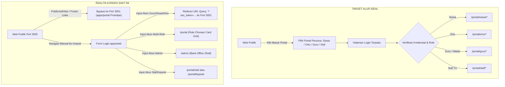
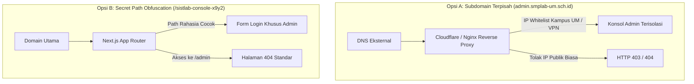
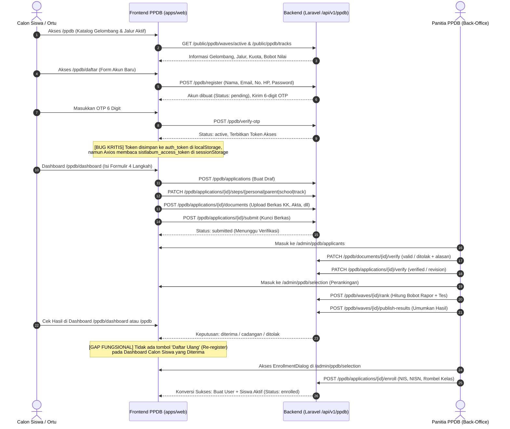
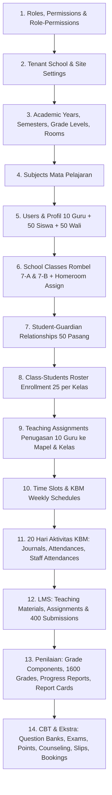
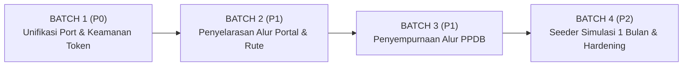

# LAPORAN AUDIT SISTEM SISTLABUM
**Sistem Informasi Sekolah Terpadu Labschool Universitas Negeri Malang**  
**Audit Mutu Frontend (`apps/web`), Backend (`apps/api`), Prototipe Port 3001, Keamanan, Alur PPDB, & Kesiapan Dataset Seeder**  
**Tanggal Dokumen:** 25 Oktober 2026  
**Status Audit:** Audit Saja (Tanpa Modifikasi Kode Aplikasi)

---

## 1. Ringkasan Eksekutif

Audit independen terhadap repositori **SISTLABUM** mengidentifikasi sejumlah kesenjangan mendasar antara arsitektur target yang direncanakan dengan kondisi operasional di lapangan:

1. **Dual Frontend & Desinkronisasi Port 3001:**
   - Yang dilayani di **Port 3001** saat ini adalah **`apps/portal`**, sebuah prototipe terpisah (Next.js 16 / React 19) yang **menggunakan mock data statis** (`mock-lms-data.ts`, `mock-guardian-data.ts`), tidak memiliki pengujian otomatis (0 test), dan gagal linting ESLint 9.
   - Sedangkan aplikasi produksi resmi **`apps/web`** (Next.js 14 / React 18) yang memiliki **69 test suites / 809 automated tests (100% PASS)** dan terhubung penuh ke API Laravel sesungguhnya berjalan di **Port 3000**.
   - `apps/web` **sudah memiliki modul portal lengkap** (`/portal/guru`, `/portal/siswa`, `/portal/ortu`, `/portal/staf`, `/portal/kepsek`), namun akses publiknya justru dialihkan (*hijacked*) ke prototipe Port 3001.

2. **Celah Keamanan Kritis (SSO Token Leakage via URL):**
   - Alur masuk pada `apps/web/src/app/(auth)/masuk/page.tsx` mentransfer JWT access token dan refresh token civitas ke Port 3001 melalui parameter kueri URL mentah:  
     `window.location.href = '${portalBaseUrl}/login?sso_token=' + encodeURIComponent(token)...`
   - Hal ini melanggar `09_SECURITY_PRIVACY.md` karena token terekspos di browser history, log reverse proxy, log web server, dan header `Referer`.

3. **Cacat Autentikasi SPMB/PPDB (Token Storage Key Mismatch):**
   - Halaman login dan aktivasi PPDB (`ppdb/masuk/page.tsx:48` & `ppdb/daftar/page.tsx:180`) menyimpan token ke `localStorage.setItem('auth_token', ...)`.
   - Namun Axios HTTP client (`api-client.ts:55`) mengambil token dari `tokenStorage.getAccessToken()` (`token-storage.ts`) yang membaca `sessionStorage.getItem('sistlabum_access_token')`. Akibatnya, pada runtime riil, pemanggilan endpoint privat pendaftar (`/api/v1/ppdb/me`) ditolak dengan HTTP 401 Unauthenticated.

4. **Kondisi Keamanan Login Admin:**
   - Tidak ada link langsung ke `/admin` di header/footer publik (aman secara tampilan).
   - Rate limit backend aktif (5 kali gagal / 15 menit), pesan error generik uniform 401 (aman dari *user enumeration*).
   - **Kelemahan:** Menggunakan endpoint login bersama (`/api/v1/auth/login`) tanpa guard terpisah, belum ada 2FA/MFA untuk peran super admin, dan path `/admin` bersifat standar serta mudah ditebak.

---

## 2. Pemetaan Rute `apps/web` & Alur Login

### 2.1. Perbandingan Alur: Target vs Aktual

### 2.2. Analisis Penyimpangan (Deviations)
1. **Penyimpangan Navigasi Publik ke Port 3001:**
   - Pada `apps/web/src/components/shell/public/PublicAuthNav.tsx:20-28`, tombol `"Masuk Portal"` menghubungkan pengunjung langsung ke `portalBaseUrl` (`http://localhost:3001`) dengan atribut `target="_blank"`, melompati rute login resmi di `apps/web`.
   - Pada `apps/web/src/features/public-site/content/navigation.ts:58-64`, `FOOTER_PORTAL_LINKS` mengarahkan pengunjung ke `http://localhost:3001/siswa/dashboard`, `http://localhost:3001/guru/dashboard`, dan `http://localhost:3001/ortu/dashboard`.
2. **Penyimpangan Pemilihan Portal (Role Picker):**
   - Alur target menghendaki pemilihan portal dilakukan **sebelum login** (misal: "Pilih: Portal Siswa / Portal Guru / Portal Wali Murid" $\rightarrow$ menampilkan formulir login sesuai konteks identifier NISN / NIP / No. HP).
   - Di `apps/web`, pemilihan peran (`/portal/page.tsx:35-156`) baru muncul **setelah pengguna terautentikasi** jika pengguna memiliki lebih dari satu peran (*multi-peran*).
3. **Penyimpangan Pembelahan Sesi (Session Splitting):**
   - Halaman `/masuk/page.tsx:20-33` secara sengaja memotong sesi internal dan membuang pengguna ke prototipe 3001 jika peran pengguna adalah guru, siswa, atau orang tua.

---

### 2.3. Peta Lengkap Rute `apps/web`

| Grup Rute | Path URL | Komponen / Halaman | Hak Akses / Guard | Tautan Menu di Shell |
|---|---|---|---|---|
| **Publik** | `/` | `(public)/page.tsx` | Publik | Header, Footer |
| | `/profil` | `(public)/profil/page.tsx` | Publik | Header, Footer |
| | `/akademik` | `(public)/akademik/page.tsx` | Publik | Header, Footer |
| | `/berita` | `(public)/berita/page.tsx` | Publik | Header, Footer |
| | `/berita/[slug]` | `(public)/berita/[slug]/page.tsx` | Publik | Daftar Berita |
| | `/galeri` | `(public)/galeri/page.tsx` | Publik | Header, Footer |
| | `/kontak` | `(public)/kontak/page.tsx` | Publik | Header, Footer |
| **Auth** | `/masuk` | `(auth)/masuk/page.tsx` | Publik (Guest) | Tidak ada di Header langsung |
| **PPDB** | `/ppdb` | `(ppdb)/ppdb/page.tsx` | Publik | Header CTA, Footer |
| | `/ppdb/daftar` | `(ppdb)/ppdb/daftar/page.tsx` | Publik | PPDB Hero CTA |
| | `/ppdb/masuk` | `(ppdb)/ppdb/masuk/page.tsx` | Publik | PPDB Header Nav |
| | `/ppdb/dashboard` | `(ppdb)/ppdb/dashboard/page.tsx` | Calon Siswa (Role: `guest`) | PPDB Masuk |
| **Portal Hub** | `/portal` | `(portal)/portal/page.tsx` | Authenticated (Multi-peran) | Role Switcher |
| | `/portal/notifikasi` | `(portal)/portal/notifikasi/page.tsx` | Authenticated | Topbar Bell Icon |
| **Portal Siswa** | `/portal/siswa` | `(portal)/portal/siswa/page.tsx` | Role: `student` | Portal Navbar |
| | `/portal/siswa/jadwal` | `(portal)/portal/siswa/jadwal/page.tsx` | Role: `student` | Portal Navbar |
| | `/portal/siswa/nilai` | `(portal)/portal/siswa/nilai/page.tsx` | Role: `student` | Portal Navbar |
| | `/portal/siswa/cbt` | `(portal)/portal/siswa/cbt/page.tsx` | Role: `student` | Portal Navbar |
| | `/portal/siswa/ujian/[id]`| `(portal)/portal/siswa/ujian/[id]/page.tsx` | Role: `student` + Exam Token | Dari `/portal/siswa/cbt` |
| | `/portal/siswa/tugas` | `(portal)/portal/siswa/tugas/page.tsx` | Role: `student` | **Yatim di Navbar** (hanya link di Beranda) |
| | `/portal/siswa/konseling` | `(portal)/portal/siswa/konseling/page.tsx` | Role: `student` | **Yatim di Navbar** (hanya link di Beranda) |
| | `/portal/siswa/poin` | `(portal)/portal/siswa/poin/page.tsx` | Role: `student` | **Yatim di Navbar** (hanya link di Beranda) |
| **Portal Ortu** | `/portal/ortu` | `(portal)/portal/ortu/page.tsx` | Role: `guardian` | Portal Navbar |
| | `/portal/ortu/anak/[id]` | `(portal)/portal/ortu/anak/[id]/page.tsx` | Role: `guardian` (Scoping ID) | Dari Kartu Anak di `/portal/ortu` |
| **Portal Guru** | `/portal/guru` | `(portal)/portal/guru/page.tsx` | Role: `teacher`, `homeroom` | Portal Navbar |
| | `/portal/guru/jadwal` | `(portal)/portal/guru/jadwal/page.tsx` | Role: `teacher` | Portal Navbar |
| | `/portal/guru/presensi` | `(portal)/portal/guru/presensi/page.tsx` | Role: `teacher` | Portal Navbar |
| | `/portal/guru/jurnal` | `(portal)/portal/guru/jurnal/page.tsx` | Role: `teacher` | Portal Navbar |
| | `/portal/guru/nilai` | `(portal)/portal/guru/nilai/page.tsx` | Role: `teacher` | Portal Navbar |
| | `/portal/guru/materi` | `(portal)/portal/guru/materi/page.tsx` | Role: `teacher` | Portal Navbar |
| | `/portal/guru/tugas` | `(portal)/portal/guru/tugas/page.tsx` | Role: `teacher` | Portal Navbar |
| | `/portal/guru/tugas/[id]/penilaian` | `(portal)/portal/guru/tugas/[id]/penilaian/page.tsx` | Role: `teacher` | Dari Detail Tugas |
| | `/portal/guru/ujian` | `(portal)/portal/guru/ujian/page.tsx` | Role: `teacher` | Portal Navbar |
| | `/portal/guru/wali-kelas` | `(portal)/portal/guru/wali-kelas/page.tsx` | Role: `homeroom` | Portal Navbar (Kondisional) |
| | `/portal/guru/izin-cuti` | `(portal)/portal/guru/izin-cuti/page.tsx` | Role: `teacher` | Portal Navbar |
| | `/portal/guru/slip-gaji` | `(portal)/portal/guru/slip-gaji/page.tsx` | Role: `teacher` | Portal Navbar |
| | `/portal/guru/presensi-saya`| `(portal)/portal/guru/presensi-saya/page.tsx` | Role: `teacher` | Portal Navbar |
| | `/portal/guru/fasilitas` | `(portal)/portal/guru/fasilitas/page.tsx` | Role: `teacher` | Portal Navbar |
| **Portal Staf** | `/portal/staf` | `(portal)/portal/staf/page.tsx` | Role: `admin_tu`, `facility_staff`, dll | Portal Navbar |
| | `/portal/staf/presensi-saya`| `(portal)/portal/staf/presensi-saya/page.tsx` | Role: Staf | Portal Navbar |
| | `/portal/staf/izin-cuti` | `(portal)/portal/staf/izin-cuti/page.tsx` | Role: Staf | Portal Navbar |
| | `/portal/staf/slip-gaji` | `(portal)/portal/staf/slip-gaji/page.tsx` | Role: Staf | Portal Navbar |
| | `/portal/staf/tiket` | `(portal)/portal/staf/tiket/page.tsx` | Role: Staf | Portal Navbar |
| **Portal Kepsek** | `/portal/kepsek` | `(portal)/portal/kepsek/page.tsx` | Role: `principal`, `vice_principal` | Portal Navbar |
| | `/portal/kepsek/approvals`| `(portal)/portal/kepsek/approvals/page.tsx` | Role: `principal`, `vice_principal` | Portal Navbar |
| **Admin Back-Office** | `/admin` | `(admin)/admin/page.tsx` | Guard: `canAccessShell(..., 'admin')` | Admin Sidebar |
| | `/admin/executive` | `(admin)/admin/executive/page.tsx` | `executive.dashboard.view` | Admin Sidebar |
| | `/admin/executive/approvals` | `(admin)/admin/executive/approvals/page.tsx` | `executive.approval.manage` | Admin Sidebar |
| | `/admin/master/academic-years` | `(admin)/admin/master/academic-years/page.tsx` | `master.academic_year.manage` | Admin Sidebar |
| | `/admin/master/students` | `(admin)/admin/master/students/page.tsx` | `master.student.read` | Admin Sidebar |
| | `/admin/master/teachers` | `(admin)/admin/master/teachers/page.tsx` | `master.teacher.manage` | Admin Sidebar |
| | `/admin/master/guardians` | `(admin)/admin/master/guardians/page.tsx` | `master.guardian.manage` | Admin Sidebar |
| | `/admin/master/classes` | `(admin)/admin/master/classes/page.tsx` | `master.class.manage` | Admin Sidebar |
| | `/admin/master/subjects` | `(admin)/admin/master/subjects/page.tsx` | `master.subject.manage` | Admin Sidebar |
| | `/admin/academic/schedules` | `(admin)/admin/academic/schedules/page.tsx` | `academic.schedule.manage` | Admin Sidebar |
| | `/admin/academic/journals` | `(admin)/admin/academic/journals/page.tsx` | `academic.journal.write` | Admin Sidebar |
| | `/admin/academic/attendance` | `(admin)/admin/academic/attendance/page.tsx` | `academic.attendance.write` | Admin Sidebar |
| | `/admin/academic/grades` | `(admin)/admin/academic/grades/page.tsx` | `academic.grade.write` | Admin Sidebar |
| | `/admin/academic/progress-reports` | `(admin)/admin/academic/progress-reports/page.tsx` | `academic.report.generate` | Admin Sidebar |
| | `/admin/academic/report-cards` | `(admin)/admin/academic/report-cards/page.tsx` | `academic.report.generate` | Admin Sidebar |
| | `/admin/cbt/questions` | `(admin)/admin/cbt/questions/page.tsx` | `cbt.bank.write` | Admin Sidebar |
| | `/admin/cbt/exams` | `(admin)/admin/cbt/exams/page.tsx` | `cbt.exam.manage` | Admin Sidebar |
| | `/admin/cbt/monitor` | `(admin)/admin/cbt/monitor/page.tsx` | `cbt.exam.read` | Admin Sidebar |
| | `/admin/ppdb/waves` | `(admin)/admin/ppdb/waves/page.tsx` | `ppdb.wave.manage` | Admin Sidebar |
| | `/admin/ppdb/applicants` | `(admin)/admin/ppdb/applicants/page.tsx` | `ppdb.applicant.verify` | Admin Sidebar |
| | `/admin/ppdb/selection` | `(admin)/admin/ppdb/selection/page.tsx` | `ppdb.selection.run` | Admin Sidebar |
| | `/admin/student-affairs/points` | `(admin)/admin/student-affairs/points/page.tsx` | `student.point.read` | Admin Sidebar |
| | `/admin/student-affairs/extracurriculars` | `(admin)/admin/student-affairs/extracurriculars/page.tsx` | `student.point.read` | Admin Sidebar |
| | `/admin/student-affairs/competitions` | `(admin)/admin/student-affairs/competitions/page.tsx` | `student.point.read` | Admin Sidebar |
| | `/admin/counseling` | `(admin)/admin/counseling/page.tsx` | `counseling.case.read` | Admin Sidebar |
| | `/admin/facilities` | `(admin)/admin/facilities/page.tsx` | `facility.booking.manage` | Admin Sidebar |
| | `/admin/assets` | `(admin)/admin/assets/page.tsx` | `facility.asset.manage` | Admin Sidebar |
| | `/admin/tickets` | `(admin)/admin/tickets/page.tsx` | `facility.booking.manage` | Admin Sidebar |
| | `/admin/library` | `(admin)/admin/library/page.tsx` | `library.book.manage` | Admin Sidebar |
| | `/admin/public-relations` | `(admin)/admin/public-relations/page.tsx` | `guest.book.read` | Admin Sidebar |
| | `/admin/reports` | `(admin)/admin/reports/page.tsx` | `reports.view` | Admin Sidebar |
| | `/admin/cms` | `(admin)/admin/cms/page.tsx` | `cms.site.manage` | Admin Sidebar |
| | `/admin/notifications` | `(admin)/admin/notifications/page.tsx` | Authenticated | Admin Sidebar |
| | `/admin/settings/users` | `(admin)/admin/settings/users/page.tsx` | `auth.user.read` | Admin Sidebar |
| | `/admin/settings/roles` | `(admin)/admin/settings/roles/page.tsx` | `auth.role.manage` | Admin Sidebar |
| | `/admin/settings/audit-logs` | `(admin)/admin/settings/audit-logs/page.tsx` | `audit.read` | Admin Sidebar |

---

### 2.4. Daftar Rute Yatim (Orphan Routes)
Rute yang memiliki berkas halaman (`page.tsx`) dan logika controller aktif, namun **tidak memiliki tautan navigasi langsung di sidebar/navbar**:

1. **Admin Back-Office (`apps/web`):**
   - `/admin/academic/teaching-materials`: Pengawasan modul ajar kurikulum oleh admin. Terdaftar di `ADDITIONAL_ADMIN_ROUTES`, tetapi tidak ada di `ADMIN_NAV_SECTIONS`.
   - `/admin/academic/assignments`: Monitoring penugasan guru secara global. Tidak ada di sidebar.
   - `/admin/academic/leave-requests`: Daftar permohonan izin/cuti pegawai untuk diverifikasi TU. Tidak ada di sidebar (hanya ada di portal kepsek).
   - `/admin/academic/staff-attendance`: Rekapitulasi absensi mandiri tap-in/tap-out staf dan guru. Tidak ada di sidebar.
   - `/admin/academic/character-notes`: Rekapitulasi catatan karakter dari wali kelas. Tidak ada di sidebar.
   - `/admin/counseling/early-warnings`: Dashboard sistem peringatan dini (Early Warning Matrix) kasus siswa. Tidak ada di sidebar utama.

2. **Portal Siswa (`apps/web`):**
   - `/portal/siswa/tugas`: Halaman pengumpulan tugas siswa. Tidak dimasukkan ke dalam navbar `portal-shell.tsx:50-58` (siswa hanya bisa menjangkaunya lewat tombol di kartu dashboard).
   - `/portal/siswa/konseling`: Form pengajuan jadwal konseling privat dengan guru BK. Tidak ada di navbar.
   - `/portal/siswa/poin`: Buku poin kedisiplinan dan apresiasi prestasi siswa. Tidak ada di navbar.

---

### 2.5. Daftar Rute Duplikasi & Redirect Usang
1. **Duplikasi Pengguna Admin:**
   - `/admin/users/page.tsx` hanyalah wrapper *server redirect* ke `/admin/settings/users`.
   - **Rekomendasi:** Hapus folder `apps/web/src/app/(admin)/admin/users/` untuk merapikan struktur pohon rute.
2. **Duplikasi Perpustakaan:**
   - `/admin/facilities/library/page.tsx` mengimpor dan merender ulang komponen dari `/admin/library/page.tsx`.
   - **Rekomendasi:** Konsolidasikan tautan navigasi ke `/admin/library`.
3. **Redirect Usang CBT Siswa:**
   - `/portal/siswa/cbt/[id]/page.tsx` bernama `DeprecatedCbtIdRedirectPage` yang me-redirect ke `/portal/siswa/ujian/[id]`.
4. **Redirect Usang Notifikasi Portal:**
   - `/portal/siswa/notifications/page.tsx` dan `/portal/ortu/notifications/page.tsx` keduanya berisi redirect statis ke `/portal/notifikasi`.

---

## 3. Audit Keamanan Login Admin

### 3.1. Evaluasi Keamanan Aktual

| Parameter Keamanan | Status | Bukti & Implementasi Kode | Keterangan |
|---|---|---|---|
| **Ketersembunyian Link** | ✅ **AMAN** | `PublicHeader.tsx`, `PublicFooter.tsx` | Tidak ada tautan langsung ke `/admin` pada antarmuka publik atau footer situs sekolah. |
| **Path Obfuscation** | ⚠️ **LEMAH** | `(admin)/admin/layout.tsx:18` | Menggunakan path baku `/admin`. Jika belum login diarahkan ke `/masuk?redirect=/admin`. Sangat mudah dipindai oleh *automated vulnerability scanner*. |
| **Rate Limiting** | ✅ **AMAN** | `AuthService.php:36-47` | Dibatasi maksimal 5 percobaan gagal per 15 menit menggunakan kunci komposit `sha1(identifier + ip)`. Mengembalikan HTTP 429 jika melampaui batas. |
| **Pemisahan Guard (Backend)** | ⚠️ **PARSIAL** | `api.php:154` | Tidak ada guard atau controller login terpisah untuk admin. Kredensial super admin dikirim ke endpoint yang sama persis dengan siswa dan wali murid (`POST /api/v1/auth/login`). |
| **Pemisahan Shell (Frontend)** | ✅ **AMAN** | `evaluator.ts:160-185`, `AdminLayout.tsx:32-42` | `canAccessShell(roles, 'admin')` secara ketat menolak peran siswa (`student`) dan wali murid (`guardian`) untuk merender shell admin dan menampilkan layar `<AccessDenied>`. |
| **Multi-Factor Auth (2FA)** | ❌ **TIDAK ADA** | `AuthService.php` | Backend belum memiliki tabel/skema TOTP (Google Authenticator) atau WebAuthn untuk peran administrator. Login hanya bergantung pada *single-factor* password. |
| **Pesan Error Generik** | ✅ **AMAN** | `AuthService.php:57-67` | Pesan kegagalan login seragam: *"Kredensial yang diberikan tidak cocok dengan data kami."* Tidak membocorkan apakah username atau email terdaftar di database. |

---

### 3.2. Usulan Opsi Arsitektur Login Admin

Untuk melindungi konsol manajemen sekolah dari serangan *credential stuffing* dan *brute force*, berikut perbandingan opsi arsitektur:

#### Matriks Perbandingan Opsi
| Parameter Evaluasi | Opsi A: Subdomain Terpisah (`admin.smplab-um.sch.id`) | Opsi B: Secret Path (`/sistlab-console-x9y2`) |
|---|---|---|
| **Tingkat Keamanan** | **Sangat Tinggi (Recommended)** | Sedang (*Security through Obscurity*) |
| **Pemisahan Jaringan & WAF** | Dapat dibatasi via IP Whitelist (khusus jaringan UM / VPN staf) di layer DNS/Nginx. | Sulit membedakan traffic WAF antara civitas biasa dan admin karena berada di host yang sama. |
| **Manajemen Cookie & Sesi** | Isolasi cookie domain penuh (cookie admin tidak dapat dibaca oleh subdomain portal atau website publik). | Cookie domain terbagi sama di seluruh path `/` bila tidak diatur path-specific cookie. |
| **Kompleksitas Infrastruktur** | Memerlukan entri DNS baru dan konfigurasi sertifikat TLS/SSL *wildcard* (`*.smplab-um.sch.id`). | Sangat mudah diterapkan di kode Next.js tanpa perubahan infrastruktur server/DNS. |
| **Ketahanan terhadap *Leakage*** | Tingkat kebocoran rendah jika akses dibatasi VPN/WAF. | Jika URL rahasia bocor di riwayat browser atau tangkapan layar, perlindungan hilang. |
| **Kebutuhan 2FA / MFA** | Wajib ditambahkan (TOTP Authenticator). | Wajib ditambahkan (TOTP Authenticator). |

**Rekomendasi Auditor:**
Terapkan **Opsi A** untuk lingkungan staging dan produksi dengan menambahkan guard 2FA (TOTP) pada backend Laravel, dipadukan dengan pemblokiran akses ke subdomain `admin.*` bagi IP publik di luar jaringan kampus jika memungkinkan.

---

## 4. Verifikasi Port 3001 & Sisa Kode Legacy

### 4.1. Fakta Status Port 3001
Berdasarkan inspeksi proses kontainer aktif (`docker ps`) dan konfigurasi `docker-compose.yml:95-135`:
- **Port 3000** melayani layanan `web` (`build: ./apps/web`). Ini adalah kode produksi Next.js 14 yang lengkap, memiliki 809 unit test, mengimplementasikan RBAC evaluator, dan terhubung ke backend Laravel.
- **Port 3001** melayani layanan `portal` (`build: ./apps/portal`). Ini adalah kode **prototipe/eksperimental Next.js 16** yang berisi data mock tiruan dan tidak lulus pengujian.
- **Kesimpulan:** Yang saat ini dilayani di Port 3001 **BUKAN** `apps/web` SISTLABUM, melainkan **prototipe legacy `apps/portal`**.

---

### 4.2. Bukti Mock Data & Kelemahan Teknis di `apps/portal`
1. **Mock Data LMS:** `apps/portal/src/lib/mock-lms-data.ts:20-60` memuat hardcoded profil guru `Budi Santoso, S.Kom., M.T.` dan kelas fiktif `cls-7a` s.d. `cls-9b`.
2. **Mock Data Wali Murid & Keuangan:** `apps/portal/src/lib/mock-guardian-data.ts:1-60` memuat struktur `ChildScheduleItem`, rekap presensi, dan nomor rekening fiktif BSI.
3. **Uji Mutu Nihil:** `apps/portal` tidak memiliki folder pengujian Vitest/Jest, linting gagal total dengan exit code 2 (ESLint 9 konfigurasi hilang).
4. **Kebocoran SSO:** `apps/portal/src/app/login/page.tsx:37-67` mengambil `sso_token` dari URL query string untuk dimasukkan ke `tokenStorage`.

---

### 4.3. Daftar Sisa Kode Legacy / Artefak yang Membingungkan

| Artefak / Lokasi | Deskripsi Masalah | Dampak bagi Developer / Sistem |
|---|---|---|
| **Direktori `apps/portal/`** | Seluruh basis kode prototipe Next.js 16 yang berjalan paralel di port 3001. | Menyebabkan kebingungan repositori mana yang menjadi sumber kebenaran (*single source of truth*) antarmuka portal. |
| **Direktori `apps/admin/`** | Folder hantu (*ghost directory*) yang hanya berisi 1 berkas: `next-env.d.ts`. | Developer mengira modul admin dibangun terpisah, padahal seluruh kode admin sudah ada di `apps/web/src/app/(admin)`. |
| **`docker-compose.yml:118-135`** | Service definition `portal` yang mengekspos `./apps/portal` ke port 3001. | Menghabiskan memori kontainer Docker dan menyajikan aplikasi palsu yang tidak teruji. |
| **`apps/web/.env` & `docker-compose.yml`** | Variabel lingkungan `NEXT_PUBLIC_PORTAL_URL=http://localhost:3001`. | Menyebabkan aplikasi web produksi mengarahkan pengguna ke luar sistem dirinya sendiri. |
| **`PublicAuthNav.tsx:20`** | Pemanggilan `PORTAL_BASE_URL` yang me-redirect link "Masuk Portal" ke port 3001. | Pengguna publik tidak pernah masuk ke portal riil di `apps/web`. |
| **`masuk/page.tsx:20-33`** | Kode pemindahan token (`sso_token`) dan banner kartu "Portal Terpadu KBM (Port 3001)". | Celah keamanan privasi token dan pengalaman pengguna yang terpecah. |
| **`mock-mode.ts`** | Sisa konfigurasi fallback mock di `apps/web`. | Sebagian file masih mengimpor helper mock, meski di level production sudah dinonaktifkan. |

---

## 5. Matriks Gap Fitur & Sinkronisasi DB/API Lintas Portal

Tabel di bawah menguji apakah modul data yang dikelola Administrator di `/admin` tersedia dan tersinkronisasi pada masing-masing portal civitas terkait (`guru`, `siswa`, `ortu`, `staf`), serta apakah benar-benar terhubung ke backend API Laravel (`apps/api`) yang sama:

| No | Modul / Fitur Data | Admin Back-Office (`/admin`) | Portal Guru (`/portal/guru`) | Portal Siswa (`/portal/siswa`) | Portal Ortu (`/portal/ortu`) | Portal Staf (`/portal/staf`) | Status Sinkronisasi | Bukti File : Baris |
|:--:|---|---|---|---|---|---|:---:|---|
| 1 | **Jurnal Mengajar KBM** | ✅ `/admin/academic/journals` | ✅ `/portal/guru/jurnal` | N/A | N/A | N/A | **OK** | `admin/academic/journals/page.tsx:18` `portal/guru/jurnal/page.tsx:8` `api.php:218` (`/me/teacher/journals`) |
| 2 | **Presensi KBM Harian Siswa** | ✅ `/admin/academic/attendance` | ✅ `/portal/guru/presensi` | ✅ `/portal/siswa` (Widget) | ✅ `/portal/ortu/anak/[id]` (Tab Presensi) | N/A | **OK** | `admin/academic/attendance/page.tsx:18` `portal/guru/presensi/page.tsx:8` `portal/ortu/anak/[id]/page.tsx:43` `api.php:191` (`/me/children/{child}/attendance`) |
| 3 | **Presensi Mandiri Kerja Pegawai** | ✅ `/admin/academic/staff-attendance` | ✅ `/portal/guru/presensi-saya` | N/A | N/A | ✅ `/portal/staf/presensi-saya` | **OK** | `portal/guru/presensi-saya/page.tsx` `portal/staf/presensi-saya/page.tsx` `api.php:234` (`/me/teacher/self-attendance`) |
| 4 | **Modul & Materi Ajar** | ✅ `/admin/academic/teaching-materials` | ✅ `/portal/guru/materi` | ⚠️ Terselip di Tab Tugas | N/A | N/A | **PARSIAL** | `admin/academic/teaching-materials/page.tsx` `portal/guru/materi/page.tsx` Siswa belum punya katalog materi tersendiri. |
| 5 | **Tugas Siswa & SpeedGrader** | ✅ `/admin/academic/assignments` | ✅ `/portal/guru/tugas` & `/penilaian` | ✅ `/portal/siswa/tugas` | ✅ `/portal/ortu/anak/[id]` (Tab Perkembangan) | N/A | **OK** | `portal/guru/tugas/page.tsx` `portal/siswa/tugas/page.tsx` `api.php:204` (`/me/tasks`) |
| 6 | **Buku Nilai Mata Pelajaran** | ✅ `/admin/academic/grades` | ✅ `/portal/guru/nilai` | ✅ `/portal/siswa/nilai` | ✅ `/portal/ortu/anak/[id]` | N/A | **OK** | `admin/academic/grades/page.tsx` `portal/guru/nilai/page.tsx` `api.php:203` (`/me/grades`) |
| 7 | **E-Rapor & Snapshot Nilai** | ✅ `/admin/academic/report-cards` | ✅ `/portal/guru/wali-kelas` | ✅ `/portal/siswa/nilai` | ✅ `/portal/ortu/anak/[id]` (Tab Rapor) | N/A | **OK** | `portal/guru/wali-kelas/page.tsx` `portal/ortu/anak/[id]/page.tsx:44` `api.php:193` (`/me/children/{child}/report-cards`) |
| 8 | **Ujian CBT & Bank Soal** | ✅ `/admin/cbt` (Bank, Paket, Monitor) | ✅ `/portal/guru/ujian` | ✅ `/portal/siswa/cbt` & `/ujian/[id]` | N/A | N/A | **OK** | `portal/guru/ujian/page.tsx` `portal/siswa/ujian/[id]/page.tsx` `api.php:224-233` (`/me/teacher/question-banks`) |
| 9 | **Pembayaran SPP / Biaya Sekolah** | ❌ Belum Dibangun (Keputusan Bisnis Fase 4) | N/A | ❌ Tidak Ada di `apps/web` | ❌ Di `apps/web` Tidak Ada (⚠️ Di `apps/portal` berupa **MOCK**) | N/A | **MOCK DI PROTOTIPE** | `apps/portal/src/app/ortu/biaya/page.tsx:28-80` Backend Laravel tidak memiliki tabel `tuition_fees` (`finance-module-assessment.md`). |
| 10 | **Sarpras & Fasilitas Booking** | ✅ `/admin/facilities` | ✅ `/portal/guru/fasilitas` | N/A | N/A | ✅ `/portal/staf/tiket` | **OK** | `portal/guru/fasilitas/page.tsx` `admin/facilities/page.tsx` `api.php:485-492` |
| 11 | **Inventaris Aset & Barcode** | ✅ `/admin/assets` | N/A | N/A | N/A | ⚠️ Terbatas via Helpdesk | **PARSIAL** | `admin/assets/page.tsx` Aset dikelola oleh admin sarpras; staf hanya melaporkan kerusakan lewat tiket. |
| 12 | **Bimbingan Konseling (BK)** | ✅ `/admin/counseling` | ✅ Rujukan Guru | ✅ `/portal/siswa/konseling` | ⚠️ Di `apps/web` Tidak Ada (⚠️ Di `apps/portal` berupa **MOCK**) | N/A | **PARSIAL** | `admin/counseling/page.tsx` `portal/siswa/konseling/page.tsx` `api.php:205` (`/me/counseling-requests`) |
| 13 | **Poin Pelanggaran & Tata Tertib** | ✅ `/admin/student-affairs/points` | ✅ Input Poin Binaan | ✅ `/portal/siswa/poin` | ✅ `/portal/ortu/anak/[id]` (Tab Karakter) | N/A | **OK** | `portal/siswa/poin/page.tsx` `portal/ortu/anak/[id]/page.tsx:45` `api.php:194` (`character-notes`) |
| 14 | **Permohonan Izin / Cuti Pegawai** | ✅ `/admin/academic/leave-requests` & Kepsek | ✅ `/portal/guru/izin-cuti` | N/A | N/A | ✅ `/portal/staf/izin-cuti` | **OK** | `portal/guru/izin-cuti/page.tsx` `portal/staf/izin-cuti/page.tsx` `api.php:232` (`/me/teacher/leave-requests`) |
| 15 | **Slip Gaji / Honorarium** | ✅ Cetak Slip Master | ✅ `/portal/guru/slip-gaji` | N/A | N/A | ✅ `/portal/staf/slip-gaji` | **OK** | `portal/guru/slip-gaji/page.tsx` `portal/staf/slip-gaji/page.tsx` `api.php:180` (`/salary-slips`) |
| 16 | **Katalog Perpustakaan & Buku** | ✅ `/admin/library` | ❌ Belum Ada | ❌ Belum Ada | N/A | ✅ Pengelola Pustaka | **TIDAK ADA DI SISWA/GURU** | `admin/library/page.tsx` Hanya tersedia di back-office administrator. Siswa/guru belum memiliki katalog peminjaman mandiri. |

---

## 6. Audit Alur SPMB / PPDB End-to-End

### 6.1. Diagram Siklus Hidup Pendaftaran PPDB

### 6.2. Daftar Kelemahan & Hal yang Belum Sempurna pada PPDB

1. **Bug Kritis Token Storage Mismatch:**
   - `ppdb/masuk/page.tsx:48` & `ppdb/daftar/page.tsx:180` menyimpan token ke `localStorage.setItem('auth_token', ...)`.
   - Modul API `api-client.ts:55` mengambil Bearer token dari `tokenStorage.getAccessToken()`.
   - Akibatnya, pada lingkungan tanpa mock (`NODE_ENV=production` atau `NEXT_PUBLIC_MOCK_MODE=false`), pemanggilan `ppdbApi.getMe()` di dashboard pendaftar gagal dengan HTTP 401 Unauthenticated dan memantul kembali ke layar login.

2. **Ketiadaan Antarmuka Daftar Ulang Mandiri (Re-Registration UI):**
   - Backend Laravel menyediakan endpoint `POST /api/v1/ppdb/applications/{id}/re-register` (`api.php:712`) dan `ppdbApi.reRegister` di frontend.
   - Namun pada `ppdb/dashboard/page.tsx`, ketika status pendaftar adalah `decision === 'diterima'`, **tidak ada tombol atau modal** bagi pendaftar untuk melakukan registrasi ulang atau mengunggah surat pernyataan kesanggupan. Pendaftar hanya melihat badge hijau statis.

3. **Cetak Bukti Pendaftaran Mengandalkan `window.print()` Browser:**
   - Pada `ppdb/dashboard/page.tsx:422`, tombol "Cetak Tanda Bukti" langsung memanggil `window.print()`, yang hanya mencetak tampilan DOM browser dengan layout seadanya.
   - Backend sebenarnya menyediakan endpoint tanda bukti kanonis ber-QR code `GET /api/v1/ppdb/applications/{id}/receipt` (`api.php:719`), namun tidak dipanggil oleh frontend.

4. **Input Nilai Rapor Masih Tunggal (`average_score`):**
   - Pada form pendaftaran langkah 3 (`ppdb/dashboard/page.tsx:155`), calon siswa hanya mengisi satu field teks rata-rata nilai rapor.
   - Sistem perankingan otomatis di backend mendukung kalkulasi skor berbasis bobot mata pelajaran (Matematika, IPA, Bahasa Indonesia semester 1 s.d. 5). Ketiadaan form rincian nilai di UI menyebabkan kalkulasi ranking hanya menggunakan fallback nilai rata-rata kasar.

5. **Ketiadaan Validasi Client-Side pada Upload Berkas:**
   - Pada `ppdb/dashboard/page.tsx:782-805`, input berkas tidak memvalidasi ukuran file (maksimal 2MB) dan tidak memiliki penanganan `.catch((err) => ...)` jika server menolak berkas (misal HTTP 422 karena format tidak sesuai), sehingga pengguna tidak mendapatkan pesan error yang jelas jika upload gagal.

---

## 7. Inventarisasi Data Seeder Simulasi Civitas (1 Bulan Penuh)

Untuk memungkinkan pengujian dan demo UAT secara realistis pada seluruh portal persona, diperlukan perancangan seeder komprehensif dengan volume:
- **50 Siswa** (terbagi rata ke 2 rombel: Kelas 7-A dan 7-B).
- **10 Guru Mata Pelajaran** (termasuk 2 Wali Kelas dan 1 Guru BK).
- **50 Wali Murid / Orang Tua** (relasi perwalian 1:1 terhadap 50 siswa).
- **Aktivitas 1 Bulan Riil** (20 hari KBM: presensi harian, jurnal KBM, nilai berkala, CBT, tugas LMS, poin karakter, dan izin).

### 7.1. Daftar Tabel & Relasi Kunci Database

| Domain | Nama Tabel | Relasi & Kunci Asing (Foreign Keys) | Kebutuhan Dataset 1 Bulan |
|---|---|---|---|
| **Identitas & Akses** | `users` | `id` UUID v7 | 110 Akun (50 Siswa, 10 Guru, 50 Wali) dengan password baku hash Argon2id. |
| | `roles` | `code`: `student`, `teacher`, `homeroom`, `guardian`, `counselor` | 5 Role referensi utama. |
| | `user_roles` | `user_id` $\rightarrow$ `users.id`, `role_id` $\rightarrow$ `roles.id` | 112 Relasi (2 guru merangkap `teacher` + `homeroom`). |
| | `devices` | `user_id` $\rightarrow$ `users.id`, `platform`: `web` / `android` | Token sesi aktif agar notifikasi dapat terkirim. |
| **Master Akademik** | `academic_years` | `name`: 2026/2027, `is_active`: true | 1 Tahun Ajaran Aktif. |
| | `semesters` | `academic_year_id`, `semester`: 1 (Ganjil), `is_active`: true | 1 Semester Aktif. |
| | `grade_levels` | `name`: Kelas VII | 1 Tingkat Jenjang. |
| | `rooms` | `name`: Lab Komputer 1, R. 7-A, R. 7-B | 5 Ruangan fisik. |
| | `school_classes` | `grade_level_id`, `homeroom_teacher_id` $\rightarrow$ `teachers.id` | 2 Rombel (Kelas 7-A & 7-B) masing-masing dinaungi 1 wali kelas. |
| | `teachers` | `user_id` $\rightarrow$ `users.id`, `nip`, `full_name`, `specialization` | 10 Profil Guru Lengkap. |
| | `students` | `user_id` $\rightarrow$ `users.id`, `nis`, `nisn`, `nik_hash`, `full_name` | 50 Profil Siswa Aktif. |
| | `guardians` | `user_id` $\rightarrow$ `users.id`, `nik_hash`, `phone`, `occupation` | 50 Profil Orang Tua Resmi. |
| | `student_guardians` | `student_id` $\rightarrow$ `students.id`, `guardian_id` $\rightarrow$ `guardians.id` | 50 Relasi Perwalian (Anti-IDOR). |
| | `class_students` | `class_id` $\rightarrow$ `school_classes.id`, `student_id` $\rightarrow$ `students.id` | 50 Penempatan Siswa (25 di 7-A, 25 di 7-B). |
| | `subjects` | `code`, `name` (MTK, IPA, B.Indo, B.Inggris, Informatika, dll) | 8 Mata Pelajaran Kurikulum Merdeka. |
| | `teaching_assignments` | `teacher_id`, `subject_id`, `class_id`, `semester_id` | 16 Penugasan Mengajar Guru (8 mapel $\times$ 2 rombel). |
| **KBM & Presensi** | `time_slots` | Jam Ke 1 s.d. 8 (07.00 – 14.30 WIB) | 8 Slot Waktu KBM. |
| | `schedules` | `teaching_assignment_id`, `day_of_week` (1–5), `time_slot_id` | 30 Jadwal Pelajaran Rutin per Minggu. |
| | `journals` | `schedule_id`, `teacher_id`, `date`, `topic`, `notes` | $\approx$ 120 Catatan Jurnal Mengajar Guru (20 hari KBM). |
| | `attendances` | `journal_id`, `student_id`, `status` (`hadir`, `sakit`, `izin`, `alpa`) | $\approx$ 3.000 Rekap Presensi KBM Siswa (dengan variasi wajar). |
| | `staff_attendances` | `user_id` $\rightarrow$ `teachers.id`, `date`, `tap_in`, `tap_out`, `status` | 200 Catatan Presensi Mandiri 10 Guru selama 20 hari kerja. |
| | `leave_requests` | `user_id`, `start_date`, `end_date`, `status` (`approved`) | 3 Pengajuan Cuti Guru dengan lampiran persetujuan Kepala Sekolah. |
| **LMS & Tugas** | `teaching_materials` | `teaching_assignment_id`, `title`, `file_id`, `is_published` | 16 Modul Ajar Digital (PDF & Pranala materi). |
| | `assignments` | `teaching_assignment_id`, `title`, `due_date`, `max_score` | 8 Tugas Mandiri / Proyek Siswa. |
| | `assignment_submissions` | `assignment_id`, `student_id`, `score`, `feedback`, `status` | 400 Pengumpulan Tugas & Riwayat Penilaian SpeedGrader. |
| **Penilaian & Rapor** | `grade_components` | `teaching_assignment_id`, `name` (Formatif 1, 2, Sumatif 1, 2) | 32 Komponen Penilaian Mapel. |
| | `grades` | `grade_component_id`, `student_id`, `score` (0–100) | 1.600 Entri Buku Nilai Siswa. |
| | `character_notes` | `student_id`, `academic_year_id`, `semester_id`, `note` | 50 Catatan Karakter Profil Pelajar Pancasila oleh Walas. |
| | `progress_reports` | `student_id`, `month` (10), `academic_year_id`, `summary` | 50 Lembar Laporan Kemajuan Siswa Bulanan. |
| | `report_cards` | `student_id`, `semester_id`, `status` (`locked`), `raw_data` JSONB | 50 Snapshot E-Rapor Semester Beku Resmi. |
| **CBT (Ujian Lab)** | `question_banks` | `teacher_id`, `subject_id`, `title` | 4 Bank Soal Mandiri Guru. |
| | `questions` | `question_bank_id`, `type`, `question_text`, `taxonomies` | 80 Butir Soal Variatif (PG, PG Kompleks, B/S, Isian). |
| | `exams` | `subject_id`, `title`, `duration_minutes`, `status` (`published`) | 2 Paket Asesmen Sumatif Tengah Semester (ASTS). |
| | `exam_sessions` | `exam_id`, `student_id`, `status` (`finished`), `score` | 50 Sesi Pengerjaan Siswa dengan durasi dan nilai. |
| **Kesiswaan & Operasional**| `student_points` | `student_id`, `type` (`pelanggaran` / `prestasi`), `points` | 20 Catatan Buku Poin Kedisiplinan & Piagam Lomba. |
| | `counseling_requests` | `student_id`, `counselor_id`, `topic`, `status` (`completed`) | 5 Rekam Konseling Siswa dengan Guru BK. |
| | `facilities` | `name` (Lab Komputer, Lapangan Basket, Aula Graha Lab) | 4 Fasilitas Sekolah. |
| | `bookings` | `facility_id`, `user_id` $\rightarrow$ Guru, `status` (`approved`) | 6 Riwayat Peminjaman Ruang Belajar. |
| | `tickets` | `reporter_id`, `category`, `description`, `status` (`resolved`) | 5 Tiket Layanan Perbaikan Sarpras TU. |
| | `teacher_salary_slips` | `teacher_id`, `month` (10), `year` (2026), `net_salary` | 10 Dokumen Slip Honorarium Bulanan Guru. |

---

### 7.2. Urutan Eksekusi Seeding yang Direkomendasikan
Guna menghindari kegagalan integritas foreign key (*violates foreign key constraint*), urutan eksekusi wajib dirancang sebagai berikut:

---

## 8. Daftar Temuan Kesenjangan (GAP-xx)

### Matriks Prioritas Temuan Audit

| ID Gap | Judul Kesenjangan | Tingkat Keparahan | Modul Terdampak | Estimasi Usaha |
|---|---|:---:|---|:---:|
| **GAP-SEC-01** | Kebocoran Access Token pada URL Query Transfer SSO port 3000 $\rightarrow$ 3001 | **P0 (Kritis)** | Keamanan / Auth Frontend | 0.5 Hari |
| **GAP-PPDB-01** | Token Storage Key Mismatch (`auth_token` vs `sistlabum_access_token`) pada PPDB | **P0 (Kritis)** | SPMB / PPDB Frontend | 0.5 Hari |
| **GAP-ARCH-01**| Dual Frontend Desinkronisasi Port 3001 (Prototipe Mock `apps/portal` vs `apps/web`) | **P0 (Kritis)** | Arsitektur / Docker | 1.0 Hari |
| **GAP-AUTH-01**| Alur Masuk Portal Terpisah (Bypass Login Utama & Tiada Pemilih Peran Pra-Login) | **P1 (Tinggi)** | Auth / Navigasi Publik | 1.5 Hari |
| **GAP-PPDB-02** | Ketiadaan Antarmuka Daftar Ulang (Re-registration) pada Dashboard Pendaftar | **P1 (Tinggi)** | SPMB / PPDB Frontend | 1.0 Hari |
| **GAP-PPDB-03** | Rincian Nilai Rapor Semester 1–5 Berjenjang Belum Tersedia di Form PPDB | **P1 (Tinggi)** | SPMB / PPDB Frontend | 1.5 Hari |
| **GAP-NAV-01** | Rute Yatim Navigasi Admin & Siswa (Materials, Assignments, Leave, Tasks, BK, Points) | **P1 (Tinggi)** | Navigasi Shell / UI | 1.0 Hari |
| **GAP-DUP-01** | File Duplikasi & Rute Redirect Usang di Admin dan Siswa (`/admin/users`, dll) | **P1 (Tinggi)** | Pembersihan Rute Web | 0.5 Hari |
| **GAP-SEC-02** | Ketiadaan 2FA (MFA) & Pemisahan Endpoint Login Administrator | **P2 (Sedang)**| Keamanan Admin | 2.0 Hari |
| **GAP-SEED-01**| Ketiadaan Seeder Simulasi Terpadu 1 Bulan Riil (50 Siswa, 10 Guru, 50 Wali) | **P2 (Sedang)**| Database / Seeder UAT | 2.0 Hari |
| **GAP-FIN-01** | Ketiadaan Modul Pembayaran SPP / Buku Kas Resmi (Menyebabkan Mock di Prototipe) | **P2 (Sedang)**| Keuangan (Fase 4) | Roadmap |

---

### Rincian Temuan Kesenjangan

#### GAP-SEC-01: Kebocoran Access Token pada URL Query Transfer SSO (P0 - Kritis)
- **Lokasi Kode:** `apps/web/src/app/(auth)/masuk/page.tsx:28-33`
- **Deskripsi:** Ketika pengguna login di port 3000 dengan peran guru/siswa/ortu, sistem memindahkan token ke port 3001 lewat URL:  
  `window.location.href = '${portalBaseUrl}/login?sso_token=${encodeURIComponent(token)}&sso_refresh=...'`
- **Risiko:** Token bearer tersimpan dalam teks terbuka di riwayat peramban, log server Nginx/Cloudflare, dan dapat dicuri melalui serangan *Referer header leakage*.
- **Rekomendasi:** Hapus seluruh mekanisme pengalihan SSO URL query. Satukan seluruh penyajian portal langsung di bawah `apps/web`.

#### GAP-PPDB-01: Token Storage Key Mismatch pada Modul PPDB (P0 - Kritis)
- **Lokasi Kode:** `ppdb/masuk/page.tsx:48`, `ppdb/daftar/page.tsx:180`, `api-client.ts:55`, `token-storage.ts:29`
- **Deskripsi:** Form masuk/daftar PPDB menyimpan token ke key `auth_token` di `localStorage`. Sebaliknya, `apiClient` mengambil token dari `tokenStorage.getAccessToken()` yang membaca key `sistlabum_access_token` di `sessionStorage`.
- **Risiko:** Pemanggilan API privat calon siswa (`GET /api/v1/ppdb/me`) selalu gagal dengan HTTP 401 Unauthenticated pada browser tanpa mode mock, mengunci pendaftar di luar sistem.
- **Rekomendasi:** Selaraskan login PPDB agar menyimpan token melalui `tokenStorage.setTokens(res.accessToken, res.refreshToken)` standar sistem.

#### GAP-ARCH-01: Dual Frontend & Desinkronisasi Port 3001 (P0 - Kritis)
- **Lokasi Kode:** `docker-compose.yml:118-135`, `apps/portal/`
- **Deskripsi:** Port 3001 menyajikan prototipe Next.js 16 (`apps/portal`) dengan mock statis, sementara basis kode produksi yang lengkap dan memiliki 809 test suites adalah `apps/web` (Port 3000).
- **Risiko:** Pengujian antarmuka, perbaikan bug, dan perubahan data yang dilakukan di `apps/web` tidak pernah dirasakan oleh pengguna yang membuka Port 3001.
- **Rekomendasi:** Konfigurasikan Port 3001 untuk melayani `apps/web` (atau satukan seluruh traffic domain ke `apps/web` port 3000), serta nonaktifkan kontainer `sistlabum-portal`.

#### GAP-AUTH-01: Alur Masuk Portal Terpisah & Ketiadaan Pemilih Peran Pra-Login (P1 - Tinggi)
- **Lokasi Kode:** `PublicAuthNav.tsx:20-28`, `(auth)/masuk/page.tsx`
- **Deskripsi:** Pengunjung website publik yang menekan tombol "Masuk Portal" dilempar keluar ke `localhost:3001`. Pengguna tidak diberikan layar pemilihan persona sebelum memasukkan identitas akun.
- **Rekomendasi:** Terapkan alur baru: Tombol publik mengarah ke `/masuk` $\rightarrow$ menampilkan tab/kartu peran (Siswa / Wali Murid / Guru & Staf) $\rightarrow$ form login menyesuaikan placeholder dan validasi (NISN / NIP / Email) $\rightarrow$ redirect otomatis ke `/portal/{role}`.

#### GAP-PPDB-02: Ketiadaan Antarmuka Daftar Ulang Online (P1 - Tinggi)
- **Lokasi Kode:** `ppdb/dashboard/page.tsx:380-450`
- **Deskripsi:** Dashboard pendaftar yang berstatus diterima (`decision === 'diterima'`) tidak menampilkan antarmuka atau formulir konfirmasi daftar ulang, padahal API backend `POST /api/v1/ppdb/applications/{id}/re-register` telah tersedia.
- **Rekomendasi:** Tambahkan card dan modal konfirmasi pendaftaran ulang pada dashboard pendaftar yang lolos seleksi.

#### GAP-NAV-01: Rute Yatim Navigasi Admin & Siswa (P1 - Tinggi)
- **Lokasi Kode:** `navigation.ts:172-183`, `portal-shell.tsx:50-58`
- **Deskripsi:** Halaman `/admin/academic/teaching-materials`, `assignments`, `leave-requests`, `staff-attendance` tidak memiliki menu di admin sidebar. Halaman `/portal/siswa/tugas`, `konseling`, `poin` tidak memiliki link di navbar portal siswa.
- **Rekomendasi:** Tambahkan item navigasi yang hilang ke `ADMIN_NAV_SECTIONS` dan `portal-shell.tsx`.

#### GAP-DUP-01: File Duplikasi & Rute Redirect Usang (P1 - Tinggi)
- **Lokasi Kode:** `/admin/users/page.tsx`, `/admin/facilities/library/page.tsx`, `/portal/siswa/notifications/page.tsx`, `/portal/ortu/notifications/page.tsx`
- **Deskripsi:** Terdapat berkas halaman yang hanya berfungsi sebagai redirect stub atau re-render duplikat.
- **Rekomendasi:** Hapus berkas duplikasi dan arahkan link langsung ke rute kanonis.

#### GAP-SEC-02: Ketiadaan 2FA & Pemisahan Endpoint Login Admin (P2 - Sedang)
- **Lokasi Kode:** `AuthService.php`, `routes/api.php:154`
- **Deskripsi:** Login admin masih single-factor tanpa TOTP/Google Authenticator dan menggunakan endpoint publik bersama.
- **Rekomendasi:** Rancang skema 2FA pada tabel `users` (secret TOTP) dan pisahkan controller login khusus back-office.

#### GAP-SEED-01: Ketiadaan Seeder Simulasi Terpadu 1 Bulan Riil (P2 - Sedang)
- **Lokasi Kode:** `apps/api/database/seeders/`
- **Deskripsi:** Seeder yang ada saat ini terpecah-pecah (`StudentPortalDataSeeder`, `TeacherDemoSeeder`, `AcademicEvaluationSeeder`) dan belum memuat aktivitas KBM harian berurutan selama 1 bulan kalender untuk 50 siswa dan 50 wali murid.
- **Rekomendasi:** Buat satu seeder orkestrasi `MonthlySimulationUatSeeder.php` yang menjalankan urutan seeding 14 tahapan di Bagian 7.

---

## 9. Usulan Rencana Batch Perbaikan (Phased Remediation Plan)

Untuk mengeksekusi perbaikan secara terukur, bertahap, dan tidak menimbulkan regresi (sesuai aturan emas `AGENTS.md`), perbaikan dibagi menjadi 4 batch logis:

### Batch 1: Unifikasi Port & Resolusi Keamanan Kritis (Estimasi: 1–2 Hari Kerja)
- **Tujuan:** Menjadikan `apps/web` sebagai satu-satunya aplikasi frontend resmi, mematikan prototipe Port 3001, dan menutup celah kebocoran token.
- **Cakupan Pekerjaan:**
  1. Hapus pengalihan SSO via URL query parameter di `masuk/page.tsx`.
  2. Perbaiki `PublicAuthNav.tsx` dan `navigation.ts` agar seluruh tautan "Masuk Portal" mengarah ke rute internal `/masuk` atau `/portal`.
  3. Perbarui `docker-compose.yml`: arahkan Port 3001 ke `apps/web` (atau hapus service `portal` dan gunakan port tunggal 3000 untuk seluruh antarmuka web, admin, dan portal terpadu).
  4. Perbaiki disparitas token PPDB di `ppdb/masuk/page.tsx` dan `ppdb/daftar/page.tsx` agar tersimpan melalui `tokenStorage`.
  5. Hapus folder kosong `apps/admin/` yang membingungkan.

### Batch 2: Penyelarasan Alur Masuk & Resolusi Rute Yatim / Duplikasi (Estimasi: 1.5–2 Hari Kerja)
- **Tujuan:** Mengimplementasikan target alur masuk civitas dan merapikan pohon rute antarmuka.
- **Cakupan Pekerjaan:**
  1. Rancang ulang tampilan `/masuk`: sertakan seleksi kartu portal persona (Siswa / Orang Tua / Guru / Staf) sebelum input kredensial, dengan penyesuaian label otomatis (NISN / NIP / Email).
  2. Tambahkan rute-rute yatim ke navigasi:
     - Tambahkan modul *Teaching Materials*, *Assignments*, *Leave Requests*, *Staff Attendance*, dan *Early Warnings* ke `ADMIN_NAV_SECTIONS`.
     - Tambahkan menu *Tugas*, *Konseling*, dan *Buku Poin* ke bilah navigasi siswa di `portal-shell.tsx`.
  3. Bersihkan rute duplikat dan usang: hapus `/admin/users/page.tsx`, konsolidasi `/admin/facilities/library`, dan bersihkan redirect usang notifikasi dan CBT.

### Batch 3: Penyempurnaan Alur SPMB / PPDB End-to-End (Estimasi: 1.5–2 Hari Kerja)
- **Tujuan:** Menuntaskan alur pendaftaran siswa baru hingga tahap daftar ulang.
- **Cakupan Pekerjaan:**
  1. Bangun komponen antarmuka *Daftar Ulang (Re-Registration)* pada `ppdb/dashboard/page.tsx` yang terhubung ke `ppdbApi.reRegister()`.
  2. Hubungkan tombol "Cetak Bukti Pendaftaran" dengan pemanggilan endpoint PDF/bukti resmi server `GET /api/v1/ppdb/applications/{id}/receipt`.
  3. Tambahkan validasi ukuran file ($\le 2$ MB) dan tipe ekstensi pada komponen upload berkas, serta lengkapi dengan notifikasi error inline yang informatif.
  4. Perluas form nilai rapor (langkah 3) agar dapat menampung nilai per mata pelajaran untuk mendukung perankingan otomatis jalur prestasi.

### Batch 4: Perancangan Seeder Simulasi Terpadu & Hardening Keamanan (Estimasi: 2–3 Hari Kerja)
- **Tujuan:** Menghadirkan dataset simulasi 1 bulan kalender untuk 50 siswa, 10 guru, dan 50 orang tua, serta hardening login admin.
- **Cakupan Pekerjaan:**
  1. Implementasikan seeder terpadu `MonthlySimulationUatSeeder.php` di Laravel yang menjalankan urutan 14 tahapan (Section 7).
  2. Pastikan relasi perwalian, rombel kelas, jadwal KBM 20 hari, presensi harian, nilai, tugas, dan snapshot e-rapor terisi lengkap dan realistis.
  3. Siapkan rekomendasi arsitektur 2FA (TOTP) untuk akun administrator dan opsi pemisahan subdomain admin.

---

> [!IMPORTANT]
> **Pernyataan Integritas Auditor:**  
> Sesuai instruksi pengguna dan aturan kerja `AGENTS.md`, **tidak ada kode aplikasi yang diubah** selama fase audit ini. Seluruh temuan di atas siap ditindaklanjuti ke tahap implementasi setelah rencana perbaikan di atas disetujui.
