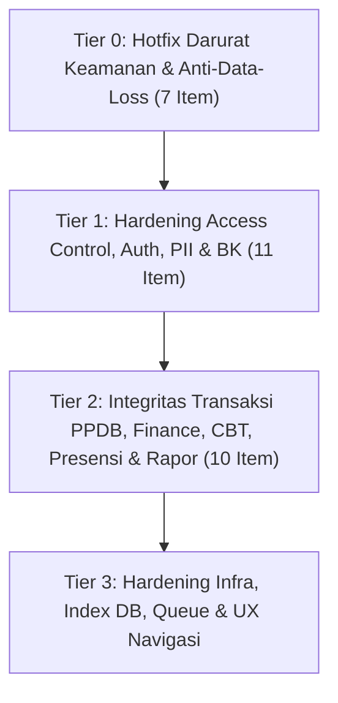

# Rencana Perbaikan Keamanan, Analisis Dampak Kontrak API, & Prosedur Rollback (`SECURITY_FIX_PLAN`)

> **Basis Verifikasi:** Branch `develop` · Commit awal `be6a875` · Push Tier 1B `6f08240` · Update Pasca-Eksekusi Tier 2A (`dad38d3`)  
> **Prinsip Eksekusi:** Perubahan kecil & terisolasi (*surgical hotfix*, bukan refactoring besar), **non-destruktif terhadap data lama**, menjaga kebijakan bisnis `max(manual, auto)` & perbaikan `grade_component_id`, serta memetakan dampak ke **Web (`apps/web`)** dan **Android (`apps/mobile`)** sebelum eksekusi.

## Status Eksekusi Terkini (Tier 0 + Surgical Fix P0-16 + Tier 1A + Tier 1B + Tier 2A — SELESAI)

| Gelombang | ID | Status | Commit | File Utama | Rollback Command |
|---|---|---|---|---|---|
| **Tier 0** | **P0-01** | **SELESAI** | `7c5903e` | `DocxQuestionParser.php`, `BeCbt13DocxImportSecurityTest.php` | `git revert 7c5903e` |
| **Tier 0** | **P0-02** | **SELESAI** | `018230e` | `OrphanFileService.php`, `OrphanFilePolymorphicProtectionTest.php` | `git revert 018230e` |
| **Tier 0** | **P0-03** | **SELESAI** | `b2c49a5` | `FileStorageService.php`, `FileController.php`, `FileStorageIdorTest.php` | `git revert b2c49a5` |
| **Tier 0** | **P0-04** | **SELESAI** | `6e15268` | `PresignFileRequest.php`, `FileStorageService.php`, `FileUploadSecurityTest.php` | `git revert 6e15268` |
| **Tier 0** | **P0-05** | **SELESAI** | `b9f00ef` | `Student.php`, `Applicant.php`, `NikSerializationProtectionTest.php` | `git revert b9f00ef` |
| **Tier 0** | **P0-06** | **SELESAI** | `279cfc3` | `GuardianService.php`, `GuardianListAuthorizationTest.php` | `git revert 279cfc3` |
| **Tier 0** | **P0-07** | **SELESAI** | `813400a` | `UserService.php`, `UserPrivilegeEscalationTest.php` | `git revert 813400a` |
| **Surgical** | **P0-16** | **SELESAI** | `66ea9bc` | `TeacherLmsController.php`, `TeacherShowAssignmentRegressionTest.php` | `git revert 66ea9bc` |
| **Tier 1A** | **P0-18** | **SELESAI** | `9d9dcd3` | `SafeEncryptedCast.php`, `EncryptLegacySensitiveDataCommand.php`, `2026_11_27_000046_widen_counseling_requests_topic_to_text.php`, `CounselingRequestService.php`, `CounselingService.php`, `ComplaintService.php`, `routes/api/guest.php`, `complaint-tracker.tsx`, `BkAndComplaintPrivacyTest.php` | `git revert 9d9dcd3` |
| **Tier 1A** | **P0-19** | **SELESAI** | `eea5450` | `LmsService.php`, `LmsNotificationPrivacyTest.php` | `git revert eea5450` |
| **Tier 1A** | **P0-22** | **SELESAI** | `9a488db` | `PPDBResultService.php`, `PPDBAccountService.php`, `PPDBAccountController.php`, `PPDBApplicationService.php`, `routes/api/ppdb.php`, `PpdbSecurityHardeningTest.php` | `git revert 9a488db` |
| **Tier 1A** | **P0-09** | **SELESAI** | `fc48d99` | `TeachingMaterialService.php`, `TeachingMaterialAuthorizationTest.php` | `git revert fc48d99` |
| **Tier 1A** | **P0-10** | **SELESAI** | `36c3bb6` | `StaffAttendanceService.php`, `StaffAttendanceController.php`, `UpdateStaffAttendanceSettingsRequest.php`, `StaffAttendanceSecurityTest.php` | `git revert 36c3bb6` |
| **Tier 1A** | **P0-11** | **SELESAI** | `6ec1be3` | `LibraryService.php`, `LabService.php`, `AssetService.php`, `AssetAuditService.php`, `PartnershipService.php`, `AlumniService.php`, 7 Controllers SAR/HUM, `SarAndHumAuthorizationTest.php` | `git revert 6ec1be3` |
| **Tier 1B** | **P1-02** | **SELESAI** | `eea01bd` | `RbacService.php`, `UserService.php`, `ProvisionsLoginAccount.php`, `RbacPermissionCacheTest.php` | `git revert eea01bd` |
| **Tier 1B** | **P1-03** | **SELESAI** | `bf0a019` | `AuthService.php`, `UserService.php`, `ChangeUserStatusRequest.php`, `UpdateUserRequest.php`, `SessionRevocationSecurityTest.php` | `git revert bf0a019` |
| **Tier 1B** | **P1-04, P1-05** | **SELESAI** | `2af243f` | `AuthService.php`, `routes/api/auth.php`, `bootstrap/app.php`, `BypassThrottle.php`, `AuthRateLimitAndProxySecurityTest.php` | `git revert 2af243f` |
| **Tier 1B** | **P1-06** | **SELESAI** | `ff462cc` | `TwoFactorAuthController.php`, `AdminAuthController.php`, `TwoFactorAuthService.php`, `routes/api/auth.php`, `TwoFactorDisabledPolicyTest.php` | `git revert ff462cc` |
| **Tier 1B** | **P0-08, P1-01** | **SELESAI** | `b956917` | `ManagesRefreshCookies.php`, `AuthController.php`, `AdminAuthController.php`, `DualModeAuthCookieTest.php`, `admin-session-cookie.ts`, `api/admin-session/route.ts`, `middleware.ts`, `token-storage.ts`, `api-client.ts`, `auth-provider.tsx`, `admin-login-form.tsx`, `batch5-middleware-and-hardening.test.ts`, `auth-security-tier1b.test.ts` | `git revert b956917` |
| **Tier 1B** | **P0-20, P1-08** | **SELESAI** | `5b6d307` | `ExamSyncService.php`, `CounselingService.php`, `AnnouncementService.php`, `MessagingService.php`, `MessagingController.php`, `ComplaintService.php`, `MultiTenantAndCbtSyncSecurityTest.php` | `git revert 5b6d307` |
| **Tier 1B** | **P1-07** | **SELESAI (via P0-18)** | `9d9dcd3` | `Complaint.php`, `ComplaintService.php`, `routes/api/guest.php`, `BkAndComplaintPrivacyTest.php` | `git revert 9d9dcd3` |
| **Tier 1B** | **P1-09** | **SELESAI** | `b9df55a` | `AuditLogService.php`, `ComplaintService.php`, `FileStorageService.php`, 15 Services/Controllers (`ip_address`→`ip`), `AuditLogHardeningTest.php` | `git revert b9df55a` |
| **Tier 1B** | **P0-08 (anti-replay)** | **SELESAI** | `6f08240` | `admin-session-cookie.ts`, `auth-security-tier1b.test.ts` | `git revert 6f08240` |
| **Tier 2A** | **P0-24, P0-25** | **SELESAI** | `31bfc29` | `FinanceReportController.php`, `FinanceService.php`, `InvoiceGeneratorService.php`, `ReceiptService.php`, `FinanceHardeningTier2ATest.php` | `git revert 31bfc29` |
| **Tier 2A** | **P0-21, P0-23** | **SELESAI** | `a8301c6` | `2026_11_27_000047_add_re_registration_deadline_at_to_applicants.php`, `Applicant.php`, `UpdatePPDBApplicationStepRequest.php`, `PPDBApplicationService.php`, `PPDBSelectionService.php`, `PPDBEnrollmentService.php`, `ppdb/dashboard/page.tsx`, `PpdbAutosaveAndEnrollmentTier2ATest.php` | `git revert a8301c6` *(migrasi aditif nullable aman di-rollback via `migrate:rollback --step=1` jika diperlukan)* |
| **Tier 2A** | **P0-12, P0-13** | **SELESAI** | `b76d252` | `ExamGradingService.php`, `CbtMultiPackageGradingTier2ATest.php`, `portal/siswa/ujian/[id]/page.tsx`, `cbt-autosave-tier2a.test.tsx` | `git revert b76d252` |
| **Tier 2A** | **P0-14, P0-26** | **SELESAI** | `dad38d3` | `AttendanceAggregator.php`, `ReportCardService.php`, `ProgressReportService.php`, `EarlyWarningService.php`, `ReportWeightAndAttendanceTier2ATest.php` | `git revert dad38d3` |
| **Batch 2B-S** | **P1-23, P1-14, P1-11, P1-28, P1-25** | **SELESAI (merged `develop`)** | `4347113` | `MeStudentController.php`, `GradeService.php`, `TeacherGradingController.php`, `ExamGradingService.php`, `ProgressReportService.php`, `Exam*Controller/Service`, `ProgramKhususService.php`, `Student.php`, `PPDBEnrollmentService.php`, `GuardianService.php`, 5 file uji hardening | `git revert -m 1 4347113` |
| **Batch 2B-2** | **P1-40** | **SELESAI (cabang `feat/tier2b-2-pagination-and-guards`)** | *(Batch 2B-2)* | `PaginationHelper.php`, `GenerateReportRequest.php`, `ReportService.php`, 11+ service berpaginasi & 11 service master, `PaginationHelperTest.php`, `PaginationClampSecurityTest.php` | `git revert <commit>` |

> **Kebijakan E-Rapor (`P1-16` — PENDING SCHOOL APPROVAL):** Alur yang direkomendasikan adalah *Guru Mapel (input & finalisasi nilai) → Wali Kelas (verifikasi kelengkapan rapor) → Kepala Sekolah (pengesahan & penerbitan rapor)*. Permission produksi **belum diubah** dan perilaku eksisting tetap dipertahankan hingga ada konfirmasi resmi dari pihak sekolah.  
> **Tier 2B & Tier 3:** Belum dieksekusi — menunggu review & persetujuan pemilik sistem.  
> **Status Push:** Tier 0 + P0-16 + Tier 1A + Tier 1B telah di-push ke `origin/develop` (`6f08240`). Seluruh commit **Tier 2A** masih berada di branch lokal `develop` menunggu review & persetujuan push.  
> **Kontrak Dual-Mode Cookie (`P1-01`) & 2FA (`P1-06`):**
> - Web mengirim header `X-Auth-Token-Transport: cookie` + `withCredentials: true` sehingga `refreshToken` dikirim eksklusif via cookie HttpOnly `sistlabum_refresh_token` (`SameSite=Lax`, `Path=/api/v1/auth`) tanpa pernah tersimpan di `localStorage` atau body JSON.
> - Klien Android/iOS (`platform: 'android'|'ios'`) tanpa header `X-Auth-Token-Transport: cookie` **tetap menerima `data.tokens.refreshToken` di JSON** dan me-refresh via JSON body (terverifikasi hijau pada `MobileClientAuthCompatibilityTest` & `DualModeAuthCookieTest`).
> - Seluruh endpoint `/api/v1/auth/2fa/{setup,verify,challenge,disable}` kini mengembalikan **`410 Gone`** (`error.code = FEATURE_DISABLED`) sesuai kebijakan `AGENTS.md §6.11`. Zero caller aktif di Web maupun Android; test lawas `AdminTrustedDeviceTest` adalah artefak era 2FA pra-penonaktifan dan sengaja tidak dihapus secara diam-diam.

---

## 1. Urutan Perbaikan Bertahap (Tier 0 → Tier 2) & Dependensi

### Tier 0 — Tindakan Pengamanan Darurat (Prioritas Tertinggi, Minim Risiko Regresi)

| Urutan | ID | Target File | Ringkasan Perbaikan Teknis | Risiko & Prosedur Rollback |
|---:|---|---|---|---|
| **1** | `P0-01` | `apps/api/app/Services/Cbt/DocxQuestionParser.php:60-65` | Tolak XML yang mengandung `<!DOCTYPE`, `<!ENTITY`, `xinclude`; ganti flag `loadXML` menjadi `LIBXML_NONET \| LIBXML_NOERROR \| LIBXML_NOWARNING`; batasi ukuran `word/document.xml` <= 5MB. | **Risiko:** Sangat rendah (DOCX normal Office/LibreOffice tidak memakai DOCTYPE/ENTITY). **Rollback:** `git revert <commit>` (1 file, 0 perubahan DB/API). |
| **2** | `P0-02` | `apps/api/app/Services/Storage/OrphanFileService.php` | Tambah cek relasi polimorfik `owner_type = 'complaint'` (verifikasi `complaints.id`), daftarkan `schools.logo_file_id`, 3 kolom `program_*`, `payments.proof_file_id`, `question_import_jobs.source_file_id`, dan proteksi URL di `site_settings.setting_value`; ubah `scanOrphans` ke batch `WHERE IN`. **Jangan jadwalkan cron sebelum dry-run diverifikasi.** | **Risiko:** Nol pada data produksi (hanya memperketat deteksi agar file aktif tidak pernah dihapus). **Rollback:** `git revert <commit>` (tetap non-destruktif; command default dry-run). |
| **3** | `P0-03` | `apps/api/app/Services/Storage/FileStorageService.php:290-386`, `FileController.php:88` | Hapus fallback wildcard baris 365–368; tambahkan resolusi pemilik eksplisit untuk `teacher_salary_slips`, `applicant_documents`, `payments`, `assignment_submissions`, `program_task_submissions`, `report_cards`, `progress_reports`, `staff_attendances`, `tickets`/`facilities`/`library`; clamp `$ttl` ke `30..300` detik. | **Risiko:** Sedang — jika ada fitur lama yang mengambil file operasional tanpa pemetaan pemilik baru, bisa terkena 403. **Mitigasi:** Jalankan full PHPUnit + audit log 403 di staging. **Rollback:** `git revert <commit>` (1 service + 1 controller, 0 perubahan DB). |
| **4** | `P0-04` | `apps/api/routes/api/auth.php:51`, `FileStorageService.php:86-171,281`, `PresignFileRequest.php`, `ConfirmFileRequest.php` | Wajibkan `$request->hasValidSignature()` & validasi magic bytes (`finfo`) di `uploadSigned()`; ganti blocklist ke allowlist (blokir `.svg`/`image/svg+xml`); abaikan/hapus input `owner_type`/`owner_id` klien di `confirmUpload()` dan wajibkan `$cacheData['owner_id'] === $user->id`; tambah `X-Content-Type-Options: nosniff` & paksa `attachment` untuk non-gambar aman. | **Risiko:** Sedang — cek apakah ada frontend/test yang mengirim `owner_type` atau upload tanpa signed URL (perlu cek `Storage*Test.php` dulu sebelum patch). **Rollback:** `git revert <commit>`. |
| **5** | `P0-05` | `apps/api/app/Models/Student.php`, `Applicant.php` | Tambah `protected $hidden = ['nik_enc', 'nik_hash'];` pada kedua model. Sediakan accessor/DTO eksplisit ter-masking (`nik_masked`) hanya di endpoint detail admin/wali yang berhak + audit baca. | **Risiko:** Sedang — cek apakah UI admin master siswa/PPDB membaca `student.nik_enc` langsung (lihat Bagian 2 Analisis Kontrak API di bawah). **Rollback:** `git revert <commit>`. |
| **6** | `P0-06` | `apps/api/app/Services/GuardianService.php:29-34` | Ubah `listGuardians()` menjadi deny-by-default: hanya `super_admin`/pemilik `master.student.read` atau `guardian` (hanya dirinya sendiri); role lain lempar `403`. | **Risiko:** Sangat rendah (siswa tidak pernah butuh daftar wali seluruh sekolah). **Rollback:** `git revert <commit>`. |
| **7** | `P0-07` | `apps/api/app/Services/UserService.php:105-128,198-218` | Tolak mutasi `roles` jika aktor tidak memiliki `auth.role.manage`; tolak pemberian role `super_admin` jika aktor bukan `super_admin`; panggil `$user->flushPermissionCache()`. | **Risiko:** Sangat rendah (sesuai prinsip least-privilege). **Rollback:** `git revert <commit>`. |

### Tier 1 — Hardening Access Control, Auth, PII, BK & Pengaduan (P0 Lanjutan + P1 Keamanan)

| Kelompok | ID | Target Utama | Tindakan Kunci |
|---|---|---|---|
| **Auth & Gateway** | `P0-08`, `P1-01..06` | `apps/web/src/middleware.ts`, `token-storage.ts`, `auth-provider.tsx`, `AuthService.php`, `AdminAuthController.php`, `RbacService.php`, `bootstrap/app.php`, `routes/api/auth.php` | Pindahkan `refreshToken` ke HttpOnly Secure Cookie; ganti header/cookie gateway admin ke secret env + signed HttpOnly cookie; panggil `flushPermissionCache()` di semua mutasi RBAC; revokasi token lain di `changePassword()`; bungkus `AuthService::refresh()` dengan `lockForUpdate()` + `throttle`; perbaiki `TRUSTED_PROXIES` & `BypassThrottle`; nonaktifkan rute `/auth/2fa/*` (`AGENTS.md §6.11`). |
| **Route & Service AuthZ** | `P0-09`, `P0-10`, `P0-11`, `P1-11`, `P1-29`, `P1-30`, `P1-31` | `TeachingMaterialService`, `StaffAttendanceService`, `LibraryService`, `LabService`, `ExamController`/`Exam*Service`, `TripService`, `AlumniService`, `PartnershipService`, `GuestService`, `PostService`, `routes/api/{academic,cbt,facilities,relations,guest}.php` | Pasang middleware `permission:` deny-by-default; wajibkan `lat`/`lng` GPS presensi staf; tutup self-return buku/lab; terapkan `GuardsExamOwnership` di seluruh CBT + escape HTML Berita Acara; scoping `/trips/{id}/participants` & `/tracer-surveys/{id}`; one-time token & magic bytes signature buku tamu; sanitasi HTML CMS. |
| **Privasi BK, Aduan, Nilai & Audit** | `P0-18`, `P0-19`, `P0-20`, `P1-07`, `P1-08`, `P1-09`, `P1-24` | `CounselingRequest*`, `CounselingSession`, `CounselingService`, `Complaint*`, `LmsService`, `ExamSyncService`, `AuditLogService`, `AnnouncementService`, `MessagingService` | Enkripsi `counseling_requests` (`topic`, `notes`), `counseling_sessions.follow_up`, dan `complaints.content` (migrasi **non-destruktif**); batasi akses curhat siswa ke Siswa+BK; naikkan entropi tiket aduan + `throttle:10,5`; sterilkan body notifikasi nilai; hapus unsalted `is_correct_hash`; tambah `use Carbon\Carbon;` & perbaiki 18 lokasi `'ip_address'` → `'ip'`; isolasi `school_id` dari `$user`. |

### Tier 2 — Integritas Transaksi & Fungsionalitas Kritis (P0 Operasional)

- **SpeedGrader & LMS (`P0-16`):** Tambah `grade_component_id`, `grade_component_name`, `max_score` di `TeacherLmsController::showAssignment()` & `storeAssignment()` (4 baris surgical fix — tidak menyentuh `assignments()` yang sudah fixed di `7e4bb8c`), lalu bereskan viewer/mock di iterasi berikutnya.
- **PPDB (`P0-21`, `P0-22`, `P0-23`):** Sinkronkan `UpdatePPDBApplicationStepRequest`, hapus NIK hardcoded `3579000000000000` di FE, pindahkan `check-nik` ke `nik_hash`, fail-closed `PPDBResultService`, atomic sequence + `lockForUpdate()` untuk `enrollApplicant`/NIS, dan tambah `re_registration_deadline_at` untuk waitlist.
- **Keuangan (`P0-24`, `P0-25`):** Fix `payment_method` → `channel` di `FinanceReportController`, tambah `lockForUpdate()` & blokir verifikasi invoice batal di `FinanceService::verifyPayment`, atomic counter di `InvoiceGeneratorService`.
- **CBT & Penilaian/Rapor (`P0-12`, `P0-13`, `P0-14`, `P0-26`):** Filter `package_code` + eager-load `question` di `ExamGradingService`; debounce esai + dedup anti-cheat + flush sebelum finish di FE CBT; rata-rata per `component_id` dulu sebelum dibobotkan di `ReportCardService` *(tanpa mengubah `max(manual, auto)` di `GradeRecorder`)*; Single Source of Truth `AttendanceAggregator` harian.

---

## 2. Analisis Dampak Kontrak API terhadap Web (`apps/web`) & Android (`apps/mobile`)

Sesuai Ketentuan F (*"Jangan mengubah API contract tanpa analisis dampak ke web dan Android"*):

| Perubahan yang Direncanakan | Dampak ke Web (`apps/web`) | Dampak ke Android (`apps/mobile`) | Strategi Kompatibilitas Mundur |
|---|---|---|---|
| **`Student`/`Applicant` tambah `$hidden = ['nik_enc', 'nik_hash']` (`P0-05`)** | Cek halaman Admin Master Siswa & Admin Verifikasi PPDB: pastikan form edit memakai field `nik_masked` / endpoint detail khusus, bukan membaca `nik_enc` mentah dari list. | **0 breaking impact saat ini** (`apps/mobile` baru memiliki 5 placeholder screen dan belum konsumsi `nik_enc`). | Tambahkan field ter-masking opsional `nik_masked` (mis. `3579********0001`) pada endpoint detail berwenang (`StudentService::show`, `PPDBApplicationService::show`) agar tampilan admin tetap informatif tanpa bocor plaintext. |
| **Pindah `refreshToken` ke HttpOnly Cookie (`P1-01`)** | Perlu update `apps/web/src/providers/auth-provider.tsx` & `api-client.ts` (`withCredentials: true`, hapus `localStorage` refreshToken). | **PENTING:** Klien Android (OkHttp/Retrofit + `EncryptedSharedPreferences`) tetap membutuhkan `refreshToken` di JSON body! | Terapkan **dual-mode berdasarkan `platform`**: jika `platform === 'web'`, kirim `refreshToken` lewat **HttpOnly Secure Cookie** (tidak di body/localStorage); jika `platform === 'android'`, tetap kembalikan `refreshToken` di JSON body agar kontrak mobile tidak rusak! |
| **`FinanceReportController::income` ubah `payment_method` → `channel` (`P0-24`)** | Cek `apps/web/src/app/(admin)/admin/finance/reports/page.tsx` apakah mengirim query `?payment_method=` atau membaca `cash_income`/`transfer_income`. | **0 breaking impact** (`apps/mobile` belum punya modul Finance). | Terima **keduanya** (`$channel = $request->input('channel') ?? $request->input('payment_method')`) untuk query ke kolom `channel`, dan kembalikan `channel_breakdown` baru sambil tetap menyertakan key summary lama secara kompatibel. |
| **`UpdatePPDBApplicationStepRequest` tambah field Step 1–3 (`P0-21`)** | **Memperbaiki** payload aktual yang sudah dikirim `ppdb/dashboard/page.tsx` (`origin_school`, `average_score`, `rapor_details`, `father_name`, `nisn`). | **0 breaking impact** (PPDB hanya web). | Bersifat **aditif**: tetap terima format nested `school.name` lama **dan** format flat `origin_school`/`average_score`/`rapor_details` baru agar tidak merusak test lama. |
| **`TeacherLmsController::showAssignment` tambah `grade_component_id` (`P0-16`)** | **Memperbaiki** blocker langsung di `portal/guru/tugas/[id]/penilaian/page.tsx:113`. | **Aditif (aman)** — field baru tidak merusak deserialisasi Android. | Murni penambahan field aditif (`grade_component_id`, `grade_component_name`, `max_score`). |
| **`FileStorageService::confirmUpload` hapus `owner_type`/`owner_id` klien (`P0-04`)** | Cek `apps/web/src/features/storage/*` & uploader foto profil/lampiran apakah ada yang bergantung pada parameter `owner_type` di `/files/confirm`. | **0 breaking impact saat ini**. | Buat `owner_type` ditentukan server-side dari `purpose` saat `presignUpload()`, bukan dipercaya dari input bebas klien saat `confirmUpload()`. |
| **Nonaktifkan `/auth/2fa/*` (`P1-06`)** | Pastikan `admin-login-form.tsx` tidak memanggil `/auth/2fa/*` (login langsung sukses 200). | **0 breaking impact** (`AGENTS.md §6.11` 2FA dinonaktifkan seluruh sistem). | Kembalikan HTTP `410 Gone` dengan pesan Bahasa Indonesia baku sesuai kontrak error kanonis. |

---

## 3. Identifikasi Perubahan yang Berpotensi Memengaruhi Data Lama

**Aturan Keras:** 0 migrasi destruktif (`DROP COLUMN`/`TRUNCATE`/`DELETE` data bisnis). Setiap perubahan skema berikut wajib menggunakan strategi migrasi aman:

| Perubahan | Risiko terhadap Data Lama | Strategi Migrasi Aman (Zero Data Loss) |
|---|---|---|
| **Enkripsi `complaints.content`, `counseling_requests.topic/notes`, `counseling_sessions.follow_up` (`P0-18`, `P1-07`, `P1-24`)** | **TINGGI jika langsung pasang cast `'encrypted'`!** Baris lama di DB masih plaintext — Eloquent `Crypt::decryptString()` akan melempar `DecryptException` saat membaca baris lama! | Gunakan **custom Cast `SafeEncryptedCast`** (coba `Crypt::decryptString()`, jika `DecryptException` kembalikan nilai plaintext lama saat dibaca dan otomatis terenkripsi saat disimpan) + jalankan **one-time backfill Artisan command idempoten** (`php artisan security:encrypt-legacy-sensitive-data --dry-run` lalu `--execute`) untuk mengenkripsi seluruh baris lama dengan aman. |
| **Perbaikan Partial Unique Index `academic_years` & `ppdb_waves` (`P0-30`)** | **SEDANG:** Jika di DB produksi/staging saat ini sudah terlanjur ada >1 tahun ajaran atau >1 gelombang PPDB berstatus aktif dengan `school_id IS NULL`, `CREATE UNIQUE INDEX` akan gagal! | Sebelum migrasi index, jalankan query pre-flight check (`SELECT count(*) ... WHERE is_active = true`). Jika ada duplikat, minta konfirmasi admin sekolah data mana yang dipertahankan aktif sebelum menerapkan index. |
| **Penambahan FK non-destruktif pada `program_*`, `schools.logo_file_id`, `grade_histories` (`P0-02`, `P1-44`)** | **SEDANG:** Jika ada baris lama menunjuk UUID yang sudah tidak ada di tabel induk (`files`/`students`), `ADD CONSTRAINT FOREIGN KEY` akan gagal. | Jalankan query pre-flight orphan check terlebih dahulu; gunakan `NOT VALID` + `VALIDATE CONSTRAINT` di PostgreSQL atau bersihkan referensi invalid menjadi `NULL` hanya setelah persetujuan admin. |
| **Perbaikan `ReportCardService` bobot & agregasi presensi (`P0-14`, `P0-26`)** | **RENDAH (aman):** Rapor yang sudah berstatus `terbit` menyimpan `data_snapshot` statis, sehingga tidak berubah mendadak tanpa regenerasi eksplisit. | Terapkan rumus baru pada `compileSemesterSnapshot()` untuk preview & generate baru; rapor lama yang sudah terbit tetap utuh kecuali admin/walas sengaja melakukan regenerasi draft. |
| **Ubah `students.nik_enc` & `applicants.nik_enc` dari `varchar(255)` → `text` (`P1-41`)** | **NOL:** Di PostgreSQL, pelebaran `varchar(255)` → `text` adalah operasi metadata-only (tanpa rewrite tabel, 100% aman & cepat). | Migrasi tunggal aditif non-destruktif. |
| **Konsolidasi `OrphanFileService` (`P0-02`)** | **TINGGI jika `--execute` dijalankan terlalu dini!** | Wajib jalankan `php artisan files:cleanup-orphans` (dry-run) di staging/produksi, verifikasi manual 100% daftar kandidat (pastikan 0 file aduan/Program Khusus/site_settings), barulah izinkan `--execute`. |
