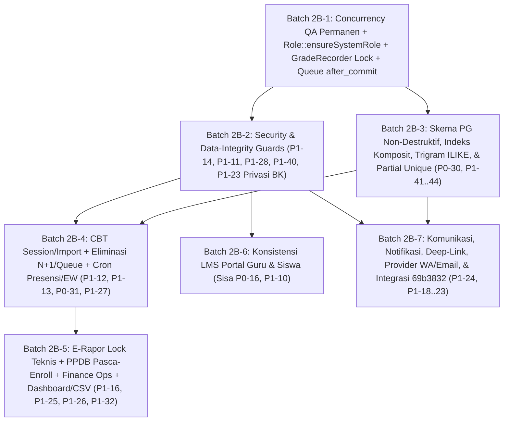

# Rencana Eksekusi Bertahap — Persiapan Tier 2B (`TIER2B_EXECUTION_PLAN`)

> **Status:** Seluruh Tier 2B (Batch 2B-S & Batch 2B-1 s/d Batch 2B-7) **TERINTEGRASI (`develop`)**  
> **Basis Repository:** Branch `develop`
> **Aturan Keras:**
> - **0 perubahan** pada commit lama (`31bfc29..69b3832`); dilarang `reset`, `amend`, `force push`, atau push ke `main`.
> - **100% mempertahankan** seluruh pekerjaan Complaint pada `69b3832` (`feat(lapor)`).
> - **100% mempertahankan** kebijakan bisnis `GradeRecorder` (`max(manual, auto)`) dan permission penerbitan E-Rapor (`P1-16`, menunggu konfirmasi pihak sekolah).
> - **0 migrasi destruktif** (`DROP COLUMN`, `TRUNCATE`, hapus data produksi); seluruh perubahan skema wajib aditif, kompatibel mundur, dan didahului *pre-flight check* sebelum staging/produksi.

---

## 1. Peta Dependensi & Risiko Lintas Modul

### Matriks Risiko & Integrasi Lintas Modul

| Area Lintas Modul | File / Kontrak Bersama | Risiko Integrasi | Mitigasi Wajib |
|---|---|---|---|
| **Integrasi dengan `69b3832` (Complaint Triage)** | [ComplaintService.php](file:///home/j1nkisaragi/projects/SMPLABUMFIXREV/apps/api/app/Services/ComplaintService.php), [routes/console.php](file:///home/j1nkisaragi/projects/SMPLABUMFIXREV/apps/api/routes/console.php), [admin/public-relations/page.tsx](file:///home/j1nkisaragi/projects/SMPLABUMFIXREV/apps/web/src/app/(admin)/admin/public-relations/page.tsx), [types.ts](file:///home/j1nkisaragi/projects/SMPLABUMFIXREV/apps/web/src/features/public-relations/types.ts) | Mengubah konstanta triase/SLA, memutus `ALLOWED_TRANSITIONS`, atau merusak selector/teks yang diuji `ComplaintTriageTest.php` & `adm-guest-02-bullying-review.test.tsx`. | 1. **Jangan sentuh** `SEVERITY_BY_CATEGORY`, `SLA_HOURS_BY_SEVERITY`, `ALLOWED_TRANSITIONS`, `complaints:escalate-overdue`. 2. Gunakan **dual-key** (`target_url` + `action_url`) di `ComplaintService`. 3. Filter `school_id` di `escalateOverdue()` memakai `where('school_id', $c->school_id)->orWhereNull('school_id')` agar tetap kompatibel dengan fixture `school_id = null`. 4. Render `attachments` di Modal 3 tanpa mengubah struktur banner bullying & tabel severity. |
| **Relasi `Student::classes()` vs `activeClasses()`** | [Student.php](file:///home/j1nkisaragi/projects/SMPLABUMFIXREV/apps/api/app/Models/Student.php) ← dipakai `ProgramKhususService`, `AnnouncementService`, `NotificationService`, `TeacherGradingController`, `DashboardService` | Mengubah `classes()` secara global berisiko memecah fitur laporan historis alumni/kenaikan kelas yang memang butuh riwayat kelas lama. | **Jangan ubah `classes()` eksisting.** Tambahkan relasi baru `activeClasses()` (`->wherePivotNull('left_at')`) dan pakai secara eksplisit di modul aktif (`P1-28`, `P1-21`, `P1-14`, `P1-32`). |
| **Kontrak API Android (`apps/mobile`) & Web** | `DELETE /devices/{token}`, `GET/PUT /me/notification-preferences`, `POST /me/tasks/{id}/submit`, `GET /me/teacher/assignments/{id}/submissions` | Perubahan destruktif pada rute atau bentuk payload memecah klien Android/Web eksisting. | Pertahankan `DELETE /devices/{token}` dengan `->where('token', '.*')` berdampingan dengan `DELETE /devices` (body JSON); pertahankan field lama secara aditif (`createdAt` + `created_at`, `action_url` + `target_url`). |
| **Pre-Flight Data Lama PostgreSQL** | Partial unique `academic_years`/`ppdb_waves` (`P0-30`), FK `program_*`/`grade_histories` (`P1-44`), `UNIQUE WHERE deleted_at IS NULL` (`P1-42`) | Migrasi gagal di staging/prod bila sudah ada >1 baris aktif `school_id IS NULL` atau UUID yatim di kolom non-FK. | Sediakan skrip/command *pre-flight read-only check* sebelum migrasi; gunakan `NOT VALID` untuk penambahan FK; tunda FK `schools(id)` & penyempitan CHECK status ke fase terpisah. |
| **CBT `dispatchSync` → `dispatch` (`P0-31`/`P1-13`)** | [QuestionImportService.php](file:///home/j1nkisaragi/projects/SMPLABUMFIXREV/apps/api/app/Services/Cbt/QuestionImportService.php#L64) & FE importer DOCX | Jika FE langsung mengharapkan `status = 'parsed'` pada respons awal `POST /import-docx`, mengubah ke async tanpa polling FE akan memecah alur impor. | Audit & pastikan FE polling `GET /question-imports/{id}` aktif (atau gunakan env flag `CBT_IMPORT_ASYNC=true` di produksi sementara `QUEUE_CONNECTION=sync` di testing). |

---

## 2. Rekomendasi Urutan Eksekusi per Batch Kecil (7 Batch · 1–2 Commit per Batch)

Setiap batch dirancang < 500 baris perubahan bermakna per PR/commit, memiliki gerbang uji sendiri, dan dapat di-`git revert` secara independen tanpa saling mematahkan.

### Batch 2B-1 — Fondasi Concurrency, `Role::ensureSystemRole`, `GradeRecorder` Lock, & Queue Safety
- **Cakupan ID:** `T2B-CONC-02`, `T2B-CONC-03`, `T2B-CONC-01`, `P1-39`
- **Alasan Urutan #1:** Memperkuat jaring pengaman pengujian concurrency PostgreSQL di CI dan menutup risiko crash transaksi (`25P02`/`23505`) sebelum menyentuh logika bisnis lain.
- **Perubahan Utama:**
  1. Tambah `Role::ensureSystemRole(string $code, string $name)` berbasis `insertOrIgnore` dan ganti 8 pemanggilan `Role::firstOrCreate` (`PPDBEnrollmentService`, `PPDBAccountService`, `GuardianService`, `TeacherStaffService`, `ProvisionsLoginAccount`), plus `lockForUpdate` sebelum `PPDBReRegistration::updateOrCreate`.
  2. Bungkus `GradeRecorder::record()` dalam `DB::transaction()` + `pg_advisory_xact_lock` + `lockForUpdate()` (**rumus `max(manual, auto)` tetap 100% utuh**).
  3. Set `'after_commit' => (bool) env('QUEUE_AFTER_COMMIT', true)` di `config/queue.php` + selaraskan `apps/api/.env.example`.
  4. Permanenkan [PostgreSqlConcurrencyTest.php](file:///home/j1nkisaragi/projects/SMPLABUMFIXREV/apps/api/tests/Feature/Ntf/PostgreSqlConcurrencyTest.php) (baca env/config PG) + buat `<testsuite name="Concurrency">` (`tests/Concurrency/`) mencakup 6 skenario multi-proses Tier 2A + `GradeRecorder` + `Role::ensureSystemRole`.
- **Migrasi DB:** Tidak ada.
- **Estimasi Ukuran & Risiko:** Kecil–Sedang · Risiko Regresi Rendah.

### Batch 2B-2 — Penutupan Celah Keamanan/IDOR Kritis & Paginasi API
- **Cakupan ID:** `P1-40`, `P1-14`, `P1-11`, `P1-28`, `P1-23` *(khusus sub-privasi `MeStudentController::counselingRequests`)*
- **Alasan Urutan #2:** Menutup seluruh celah IDOR lintas-kelas/lintas-guru/lintas-siswa/privasi BK dan risiko OOM paginasi yang berdampak langsung ke integritas data dan keamanan anak.
- **Perubahan Utama:**
  1. `PaginationHelper::clamp()` (`1..100`) pada 11 endpoint unbounded + `ReportService` + `max(1, ...)` di 11 service master (`P1-40`).
  2. `GradeService::authorizeGradeEntry`, `TeacherGradingController` (global components, `null` skip & whitelist `updateBulkGrades`), `ExamGradingService::publishToGradebook` scope, & `ProgressReportService:556` `status === 'locked'` (`P1-14`).
  3. Penyeragaman ownership CBT & pemisahan `cbt.exam.manage` dari global admin di 5 service/controller, fix `GET /exams?status=draft`, & validasi `ExamSyncService::pushResults` (`P1-11`).
  4. Tambah `Student::activeClasses()`, validasi penuh `ProgramKhususService::submitTask` (`school_id`, `target_scope`, `file_id`, `due_at`), & histori harian Mood/Mutabaah (`P1-28`).
  5. Kunci `where('requested_by', $user->id)` di `MeStudentController::counselingRequests()` untuk guardian agar tidak membypass P0-18 (`P1-23` sub-privasi).
- **Migrasi DB:** Tidak ada.
- **Estimasi Ukuran & Risiko:** Sedang · Risiko Regresi Sedang (memerlukan audit fixture test untuk guru dengan komponen global & role `cbt_operator`).

### Batch 2B-3 — Skema PostgreSQL Non-Destruktif, Indeks Komposit, & Aktivasi Trigram `ILIKE`
- **Cakupan ID:** `P0-30`, `P1-41`, `P1-42` *(partial unique soft-delete)*, `P1-43`, `P1-44` *(sync `ends_at` + FK `NOT VALID`)*
- **Alasan Urutan #3:** Menyediakan indeks komposit, indeks trigram aktif, dan lebar kolom `nik_enc`/`fcm_token` sebelum optimalisasi N+1 & beban cron di Batch 2B-4.
- **Perubahan Utama:**
  1. Migrasi aditif pelebaran `students.nik_enc`, `applicants.nik_enc`, & `devices.fcm_token` ke `text` (`P1-41` + fondasi `P1-24`).
  2. Migrasi aditif indeks komposit pada 9 tabel target + partial unique `school_id IS NULL` pada `academic_years` & `ppdb_waves` + pre-flight check SQL (`P0-30`).
  3. Migrasi konversi `UNIQUE` 13 tabel `softDeletes()` ke partial unique `WHERE deleted_at IS NULL` (`P1-42`; **FK `schools(id)` ditunda ke fase multi-tenant**).
  4. Helper driver-aware `whereIlike` menggantikan 78 lokasi `LOWER(...) LIKE` di 20 file + tambah indeks `gin_trgm_ops` selektif (`P1-43`).
  5. Isi `ends_at = deadline_at` di `ExamSyncService::pushResults` + migrasi FK `ON DELETE SET NULL` (`NOT VALID`) pada `program_*`, `grade_histories`, `schools.logo_file_id` (`P1-44`; **pengetatan CHECK status ditunda ke fase normalisasi data**).
- **Migrasi DB:** 3–4 migrasi baru **100% aditif & non-destruktif** (diuji `migrate` & `migrate:rollback` di PostgreSQL testing saja; **tidak dijalankan di produksi**).
- **Estimasi Ukuran & Risiko:** Sedang · Risiko Regresi Rendah–Sedang (wajib pre-flight check untuk partial unique).

### Batch 2B-4 — Stabilitas CBT Lifecycle, DOCX Import, Eliminasi N+1, & Cron Presensi/EW
- **Cakupan ID:** `P1-12`, `P1-13`, `P0-31`, `P1-27`
- **Alasan Urutan #4:** Memanfaatkan indeks Batch 2B-3 dan `after_commit` Batch 2B-1 untuk menghilangkan N+1, race autosave CBT, duplikasi bank soal, serta duplikasi/kesalahan cron malam.
- **Perubahan Utama:**
  1. `ExamSessionService::saveAnswer()` transaksional + `lockForUpdate()`, helper tunggal `finalizeSession()` di seluruh jalur terminasi sesi, & penyelarasan `blur_count`/`violation_count` (`P1-12`).
  2. Perbaikan `[BS] KUNCI: B` di `DocxQuestionParser`, transaksi + `lockForUpdate()` di `commitImport()`, validator 6-tipe bersama di `updateDraft()` (`P1-13`; async toggle setelah verifikasi polling FE).
  3. Optimasi batch preload N+1 pada `EarlyWarningService`, `ReportCardService`, `InvoiceGeneratorService`, `ExamGradingService` (`grader` & `$session->answers`), `OrphanFileService::purgeOrphans`, serta `->onOneServer()` di `routes/console.php` (`P0-31`).
  4. Konsolidasi `DailyAttendanceSummaryCommand` & `EarlyWarningService` (`status IN ('aktif','active')` + `AttendanceAggregator`, hapus duplikasi `ATT_LOW`) + skip akhir pekan di auto-fill presensi izin (`P1-27`).
- **Migrasi DB:** Tidak ada.
- **Estimasi Ukuran & Risiko:** Sedang–Tinggi · Risiko Regresi Sedang.

### Batch 2B-5 — E-Rapor Lock Teknis, PPDB Pasca-Enroll, Keuangan Ops, & Dashboard/CSV
- **Cakupan ID:** `P1-16` *(teknis non-kebijakan)*, `P1-25`, `P1-26` *(sisa)*, `P1-32`
- **Alasan Urutan #5:** Membereskan 4 masalah integritas & operasional bisnis berisiko tinggi yang saling independen dengan dampak langsung bagi orang tua, bendahara, dan pimpinan.
- **Perubahan Utama:**
  1. Proteksi `lockReportCard`/`bulkLock` agar hanya mentransisikan `draft <-> terkunci` (tidak menimpa `disetujui`/`terbit`) + filter `ExtracurricularMember` aktif & tanggal semester (`P1-16` teknis; **role penerbitan tidak disentuh**).
  2. Tutup cross-family IDOR `Guardian::where('phone')`, filter `track_id` & proteksi `re_registration_deadline_at > now()` di `escalateWaitlist()`, serta bangun alur aktivasi akun `/auth/activate-guardian` & verifikasi QR `/verifikasi/[token]` (`P1-25`).
  3. Jadwalkan `finance:send-due-reminders` & `finance:reconcile` di `routes/console.php`, pindahkan rekening `ManualGiroPaymentChannel` ke `SiteSetting`/config, & kirim notifikasi di `FinanceService::voidPayment()` (`P1-26`).
  4. Perbaiki 4 filter KPI di `DashboardService` + sanitasi CSV formula injection & peringatan/streaming limit di `ReportService::buildCsv()` (`P1-32`).
- **Migrasi DB:** Opsional kolom nullable `extracurricular_members.semester_id` (aditif) bila diperlukan; tidak wajib untuk perbaikan inti.
- **Estimasi Ukuran & Risiko:** Sedang · Risiko Regresi Sedang.

### Batch 2B-6 — Konsistensi LMS Portal Guru, Wali Kelas, & Portal Siswa
- **Cakupan ID:** `P0-16` *(sisa 5 sub-item)*, `P1-10`
- **Alasan Urutan #6:** Bergantung pada Batch 2B-2 (`P1-14` `updateBulkGrades` & komponen global) sehingga perbaikan SpeedGrader, buku nilai guru, materi guru, wali kelas, dan upload tugas siswa terhubung mulus ke backend yang sudah aman.
- **Perubahan Utama:**
  1. `TeacherLmsController::submissions()` (eager-load `file`, `notes`, `is_late`, skor `0`), `TeacherHomeroomController::homeroom()` (agregat nyata via `AttendanceAggregator` & `Grade`).
  2. `TeacherLmsController::storeMaterial()` tangani upload `FormData` nyata (hapus `default-modul.pdf`), sinkronkan DTO `created_at`/`createdAt`, `file.id`, & sambungkan tombol unduh di `portal/guru/materi`.
  3. SpeedGrader viewer nyata + link `/portal/guru/tugas`; arahkan kunci nilai guru ke `POST /me/teacher/grades/lock`; hapus fake success di `portal/siswa/tugas` + kirim `FormData` file biner nyata.
- **Migrasi DB:** Tidak ada.
- **Estimasi Ukuran & Risiko:** Sedang–Tinggi · Risiko Regresi Sedang (perlu uji penuh FE Vitest + BE Feature test).

### Batch 2B-7 — Komunikasi, Notifikasi, Deep-Link, Provider WA/Email, & Harmoni `69b3832`
- **Cakupan ID:** `P1-24` *(sisa)*, `P1-18`, `P1-20`, `P1-21`, `P1-22`, `P1-23` *(sisa UI)*, `P1-19`
- **Alasan Urutan #7:** Menggabungkan seluruh perbaikan klaster komunikasi dalam 2–3 sub-commit berurutan yang konsisten terhadap kontrak `target_url`, throttle, segmentasi, dan integrasi penuh dengan `69b3832`.
- **Sub-urutan internal:**
  1. **2B-7a (Kontrak & Keamanan Notif):** `throttle` di `routes/api/notifications.php` + `DELETE /devices` (body JSON) (`P1-24`); sinkronisasi 2-arah `NotificationPreference` + polling `NotificationBell` + fix `sw.js` (`P1-18`); ekstraktor deep-link FE + kanonisasi `target_url` BE + fix 4 dead routes + dual-key & isolasi `school_id` di `ComplaintService::escalateOverdue()` (`P1-20`).
  2. **2B-7b (Segmentasi & Event):** Segmentasi `AnnouncementService` Ortu & scoping `teacher` (`P1-21`); event notifikasi steril di 6 service + deduplikasi & `'diproses'` di `TicketSlaReminderCommand` (`P1-22`).
  3. **2B-7c (UI Komunikasi & Provider):** Render `selectedComplaint.attachments` & harmonisasi `ALLOWED_TRANSITIONS` di `admin/public-relations/page.tsx` (100% menjaga `69b3832`), hapus hardcode `ortu/konseling`, perbaiki `guru/perizinan` (`P1-23`); adapter provider Mail/WA nyata + 4 tab manajemen `/admin/notifications` (`P1-19`).
- **Migrasi DB:** `devices.fcm_token` → `text` (sudah di Batch 2B-3 atau disisipkan di 2B-7a bila dijalankan mandiri).
- **Estimasi Ukuran & Risiko:** Sedang–Tinggi · Risiko Regresi Sedang (gerbang ketat: `ComplaintTriageTest` & `adm-guest-02-bullying-review.test.tsx`).

---

## 3. Daftar Item yang Sengaja Di-Defer (Tidak Dimasukkan ke Tier 2B)

| Item | Alasan Ditunda | Target Fase |
|---|---|---|
| **Kebijakan Role Penerbitan E-Rapor (`P1-16` policy)** | Menunggu konfirmasi resmi pihak sekolah (Guru Mapel → Walas → Kepsek). | Setelah konfirmasi sekolah |
| **Mesin PDF Template Rapor Resmi (`P0-17`, `P1-15`, `P1-17`)** | Membutuhkan keputusan pemilihan engine PDF (DomPDF vs Playwright) dan penambahan dependency baru (`AGENTS.md §8`). | Tier 3 / Fase E-Rapor |
| **FK `school_id → schools(id)` (`P1-42` sub-item)** | Memecah 100+ test eksisting yang mengisi UUID acak ke `school_id` tanpa baris `schools`. | Fase Multi-Tenant |
| **Penyempitan CHECK Constraint Status (`P1-44` sub-item)** | Membutuhkan audit & migrasi data lama yang memakai alias EN (`active`/`approved`/`in_progress`) terlebih dahulu. | Fase Normalisasi Data |
| **Unifikasi Shell, Menu Portal/Admin, CMS Nav, & Layar Android (`P0-27..29`, `P1-33..38`, `P1-45`)** | Domain UX/Navigasi & Mobile UI — terpisah dari stabilisasi data/performa/komunikasi Tier 2B. | Tier 3 |

---

## 4. Prosedur Rollback & Checklist Persetujuan

- Setiap batch (2B-1 s/d 2B-7) di-commit terpisah dengan Conventional Commits (`fix(p1-14): ...`, `perf(p0-30): ...`), sehingga rollback cukup dengan `git revert <sha>` tanpa rewrite history.
- Migrasi aditif pada Batch 2B-3 seluruhnya menyediakan metode `down()` yang diuji bersih di `sistlabum_testing` (`php artisan migrate:rollback --path=...`).
- **Belum ada kode yang diubah dan belum ada push.** Eksekusi Batch 2B-1 hanya dimulai setelah Anda menyetujui daftar pekerjaan dan urutan batch di atas.
