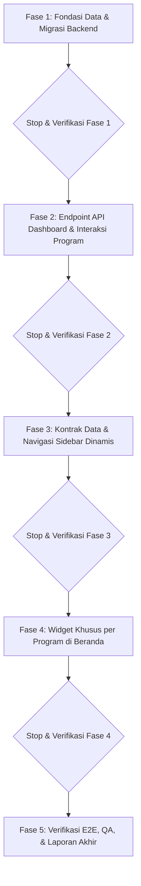

# Rencana Kerja: Dashboard Siswa Multi-Program Belajar (SMP Lab UM)

**ID Fitur:** `BE-PORTAL-STUDENT-02` (Backend API & Data) & `FE-PORTAL-STUDENT-02` (Frontend Modular Dashboard)  
**Spec Referensi:** `docs/superpowers/specs/2026-10-31-student-multi-program-dashboard-design.md`  
**Aturan Kerja:** Mengikuti panduan `AGENTS.md` (TDD, deny-by-default, tanpa data pribadi nyata, stop di setiap fase).

---

## 📌 Ringkasan Rencana Kerja
Sistem portal siswa saat ini memiliki dashboard umum yang sama untuk seluruh murid. Rencana ini mengimplementasikan pembedaan dashboard siswa secara terarah berdasarkan 4 program belajar resmi di SMP Lab UM:
1. **Reguler** (Capaian KKTP, Proyek P5, Ekskul)
2. **Tahfidz** (Tracker Target Juz Al-Qur'an, Jadwal Tasmi', Mutaba'ah Harian)
3. **ICP - International Class Program** (Cambridge Readiness Tracker, Vocab of the Day, Agenda Internasional)
4. **Inklusi** (Sensory-friendly, Milestone PPI, Kontak GPK, Mood Check-in)

---

## 📋 Pembagian Fase & Rincian Tugas

---

### 🟢 Fase 1: Fondasi Data & Migrasi Backend (`BE-PORTAL-STUDENT-02A`)
* **Tujuan:** Menyediakan skema database untuk `program_type` pada siswa & kelas serta tabel profil metadata program `student_program_profiles`.
* **File yang Dibuat / Diubah:**
  * `apps/api/database/migrations/2026_10_31_000041_add_program_type_to_students_and_classes.php`
  * `apps/api/database/migrations/2026_10_31_000042_create_student_program_profiles_table.php`
  * `apps/api/app/Models/Student.php` (tambah field `program_type` & relasi `programProfile()`)
  * `apps/api/app/Models/SchoolClass.php` (tambah field `program_type`)
  * `apps/api/app/Models/StudentProgramProfile.php` (model baru)
* **Pengujian (TDD):**
  * Buat `apps/api/tests/Feature/Portal/StudentProgramProfileTest.php`
  * Uji: pembuatan profil siswa dengan program `reguler`, `tahfidz`, `icp`, dan `inklusi`.
  * Uji: constraint enum `program_type` menolak nilai asing.
* **Kriteria Selesai (DoD Fase 1):** Migrasi sukses dieksekusi, relasi Eloquent teruji via test suite.
* 🛑 **STOP:** Laporkan hasil uji Fase 1 ke user sebelum melangkah ke Fase 2.

---

### 🟢 Fase 2: Endpoint API Dashboard & Interaksi Program (`BE-PORTAL-STUDENT-02B`)
* **Tujuan:** Memperbarui respons endpoint `GET /api/v1/me/student-dashboard` agar menyertakan data program belajar yang relevan, serta menyediakan endpoint interaksi cepat (mood check-in inklusi & mutaba'ah tahfidz).
* **File yang Dibuat / Diubah:**
  * `apps/api/app/Http/Controllers/Api/V1/MeStudentController.php` (update method `dashboard()`, tambah method `submitDailyMood()`, `submitMutabaah()`)
  * `apps/api/routes/api/portal.php` (tambah route `/me/program/mood` dan `/me/program/mutabaah`)
  * `apps/api/database/seeders/StudentProgramProfileSeeder.php` (seeder contoh untuk 4 akun siswa sesuai program)
* **Pengujian (TDD):**
  * Tambahkan test case di `apps/api/tests/Feature/Portal/MeStudentDashboardMultiProgramTest.php`:
    * Akun Tahfidz menerima `programType: 'tahfidz'` dan metadata target juz/tasmi'.
    * Akun ICP menerima `programType: 'icp'` dan checkpoint scores.
    * Akun Inklusi menerima `programType: 'inklusi'`, milestone PPI, info GPK, serta uji `POST /me/program/mood`.
    * Akun Reguler menerima `programType: 'reguler'` dan data KKTP/P5.
    * Proteksi autentikasi (401/403) dan validasi input.
* **Kriteria Selesai (DoD Fase 2):** Seluruh pengujian backend lulus hijau, response API sesuai spesifikasi.
* 🛑 **STOP:** Laporkan hasil uji Fase 2 ke user sebelum melangkah ke Fase 3.

---

### 🟢 Fase 3: Kontrak Data & Navigasi Sidebar Dinamis (`FE-PORTAL-STUDENT-02A`)
* **Tujuan:** Menghubungkan client Next.js dengan tipe program siswa, menampilkan badge identitas program di sidebar/header, serta menampilkan menu samping yang disesuaikan secara otomatis.
* **File yang Dibuat / Diubah:**
  * `apps/web/src/lib/use-student-data.ts` (perluas `StudentDashboardData` dengan `programType` & `programProfile`, tambah hooks mutasi mood/mutabaah)
  * `apps/web/src/app/(portal)/portal/siswa/layout.tsx` (sidebar dinamis menambahkan menu ekstra: *Hafalan* untuk Tahfidz, *Cambridge* untuk ICP, *Target PPI* untuk Inklusi, *Proyek P5* untuk Reguler)
  * Buat placeholder route sederhana bila diklik agar tidak 404:
    * `apps/web/src/app/(portal)/portal/siswa/hafalan/page.tsx`
    * `apps/web/src/app/(portal)/portal/siswa/cambridge/page.tsx`
    * `apps/web/src/app/(portal)/portal/siswa/ppi/page.tsx`
    * `apps/web/src/app/(portal)/portal/siswa/p5/page.tsx`
* **Pengujian (TDD):**
  * `apps/web/src/test/fe-student-navigation-multiprogram.test.tsx`
  * Verifikasi link navigasi bertambah sesuai program siswa yang aktif.
* **Kriteria Selesai (DoD Fase 3):** Test navigasi frontend lulus hijau, navigasi dinamis beroperasi lancar.
* 🛑 **STOP:** Laporkan hasil uji Fase 3 ke user sebelum melangkah ke Fase 4.

---

### 🟢 Fase 4: Widget Khusus per Program di Beranda (`FE-PORTAL-STUDENT-02B`)
* **Tujuan:** Menampilkan komponen widget khusus di beranda dashboard siswa sesuai programnya.
* **File yang Dibuat / Diubah:**
  * `apps/web/src/features/portal/student-programs/tahfidz-widget.tsx` (Tracker Juz/Surat, status tasmi', tombol mutaba'ah)
  * `apps/web/src/features/portal/student-programs/icp-widget.tsx` (Cambridge checkpoint, Vocab of the day, event)
  * `apps/web/src/features/portal/student-programs/inklusi-widget.tsx` (Sensory-friendly, milestone PPI, kartu GPK, tombol mood)
  * `apps/web/src/features/portal/student-programs/reguler-widget.tsx` (Radar KKTP, P5 project milestone, bina prestasi)
  * `apps/web/src/features/portal/student-dashboard-view.tsx` (integrasikan widget di atas baris jadwal/tugas)
* **Pengujian (TDD):**
  * `apps/web/src/test/fe-student-multiprogram-dashboard.test.tsx`
  * Verifikasi: ketika `programType === 'tahfidz'`, widget tahfidz dirender dan widget lain tidak muncul.
  * Verifikasi: ketika `programType === 'icp'`, widget Cambridge dirender.
  * Verifikasi: ketika `programType === 'inklusi'`, widget PPI & GPK dirender dan aksi check-in mood berfungsi.
  * Verifikasi: ketika `programType === 'reguler'`, widget KKTP & P5 dirender.
* **Kriteria Selesai (DoD Fase 4):** Semua widget tampil presisi, responsif di desktop & mobile, test lulus.
* 🛑 **STOP:** Laporkan hasil uji Fase 4 ke user sebelum melangkah ke Fase 5.

---

### 🟢 Fase 5: Verifikasi E2E, QA, & Checklist Definition of Done (`DOD`)
* **Tujuan:** Pengujian menyeluruh lintas aplikasi (`apps/api` dan `apps/web`), typecheck, linting, dan validasi kepatuhan terhadap `AGENTS.md`.
* **Langkah:**
  1. Jalankan `php artisan test --filter=StudentProgram` di `apps/api`.
  2. Jalankan `npm run lint` & `npm run typecheck` di `apps/web`.
  3. Jalankan `npm test` untuk seluruh unit test terkait di `apps/web`.
  4. Verifikasi aturan keamanan: no hardcoded secrets, no PII real data, deny-by-default access.
* 🛑 **STOP & LAPORKAN:** Susun ringkasan akhir sesuai format `AGENTS.md` §11.
